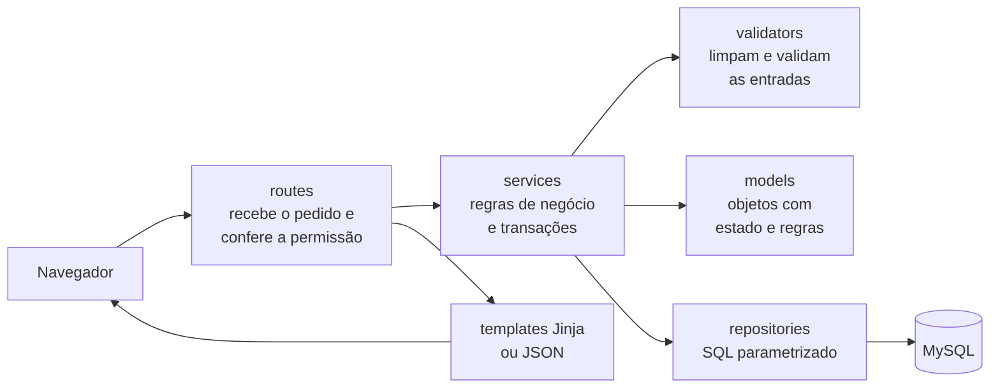
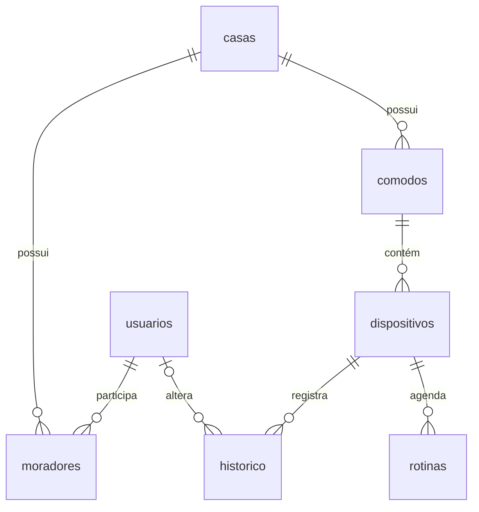
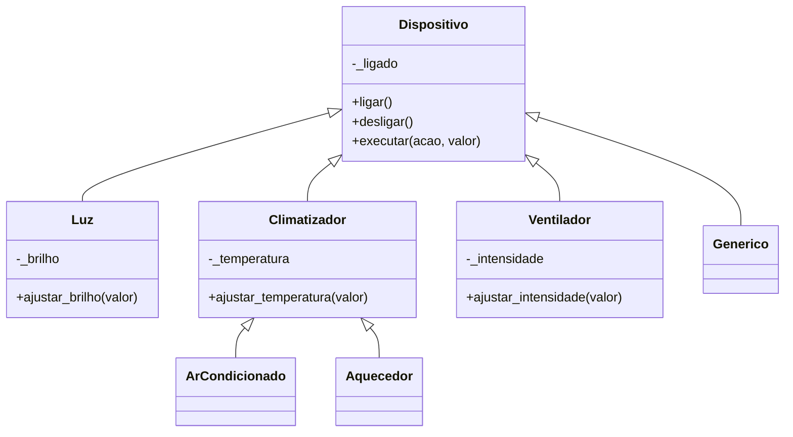
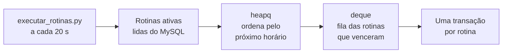

<div align="center">

# Habitus

### Cada cômodo no lugar. Cada rotina no horário.

**Simulador web de casa inteligente** — controle de dispositivos por cômodo, rotinas automáticas por horário e histórico de tudo o que mudou.


<br>


Projeto acadêmico · **UniFECAF** · Ciência da Computação · 4º semestre · **ExpoTech 2026.2**

</div>

---

O **Habitus** é uma aplicação web que simula o gerenciamento de uma casa inteligente. Cada pessoa cria a sua casa, organiza os cômodos, cadastra aparelhos, adiciona moradores e programa rotinas que são executadas sozinhas no horário escolhido.

**Em poucas palavras:**

- **Dispositivos por cômodo** — luzes, ar-condicionado, aquecedor, ventilador e outros aparelhos, com ligar/desligar e ajustes de brilho, temperatura ou intensidade.
- **Rotinas automáticas** — ações agendadas por horário e dia da semana, executadas por um processo próprio que usa `heapq` e `deque`.
- **Casa compartilhada** — moradores com perfil `administrador` ou `comum`, definido separadamente para cada casa.
- **Histórico completo** — cada alteração registra o valor anterior, o novo e quem fez a mudança.

> [!NOTE]
> Os aparelhos do Habitus são **simulados**: o estado de cada um fica salvo no MySQL. O sistema não controla equipamentos físicos e não tem integração com Alexa, Google Home ou dispositivos IoT.

## Sumário

- [Sobre o projeto](#sobre-o-projeto)
- [Funcionalidades](#funcionalidades)
- [Telas do sistema](#telas-do-sistema)
- [Tecnologias utilizadas](#tecnologias-utilizadas)
- [Arquitetura](#arquitetura)
- [Conceitos acadêmicos aplicados](#conceitos-acadêmicos-aplicados)
- [Perfis e permissões](#perfis-e-permissões)
- [Estrutura de pastas](#estrutura-de-pastas)
- [Instalação e configuração](#instalação-e-configuração)
- [Execução do sistema](#execução-do-sistema)
- [Testes](#testes)
- [Demonstração prática](#demonstração-prática)
- [Segurança](#segurança)
- [Limitações](#limitações)
- [Diagramas UML e de Testes](#diagramas-uml-e-de-testes)
- [Documentação complementar](#documentação-complementar)
- [Autoria](#autoria)

---

## Sobre o projeto

### Objetivo

Mostrar, em uma aplicação completa e funcional, como seria a central de uma casa inteligente: um único lugar para acompanhar os ambientes, controlar os aparelhos, automatizar tarefas e saber quem alterou o quê.

### Problemas que o Habitus procura resolver

| Situação | Como o Habitus responde |
| --- | --- |
| Aparelhos espalhados pela casa, sem visão geral | Painel com todos os dispositivos agrupados por cômodo |
| Ações repetidas todos os dias | Rotinas por horário e dia da semana |
| Casa compartilhada por várias pessoas | Perfis de acesso por casa: quem administra e quem apenas usa |
| Dificuldade de saber o que mudou | Histórico com data, valor anterior, valor novo e responsável |

### Como a simulação funciona

- Cada aparelho é um **objeto Python** de uma classe específica (`Luz`, `ArCondicionado`, `Ventilador`...), que conhece suas ações e seus limites.
- Ao ligar, desligar ou ajustar um aparelho, o sistema valida o comando pela classe, grava o novo estado no **MySQL** e registra o histórico **na mesma transação**.
- As rotinas ficam salvas no banco e são executadas por um **segundo processo**, que verifica a agenda a cada 20 segundos.

### Disciplinas demonstradas

O projeto integra quatro disciplinas do 4º semestre:

| Disciplina | Onde aparece no projeto |
| --- | --- |
| **Python** | Back-end com Flask, regras de negócio, executor de rotinas e testes com pytest |
| **Estrutura de Dados** | `heapq`, `deque`, `dict`, `set` e outras estruturas (veja [Estruturas de Dados](#estruturas-de-dados)) |
| **Orientação a Objeto** | Hierarquia de dispositivos com herança, encapsulamento e polimorfismo (veja [Programação Orientada a Objetos](#programação-orientada-a-objetos)) |
| **Interface UX/UI (Figma)** | Telas planejadas no Figma, material complementar descrito em [docs/TELAS_FIGMA.md](docs/TELAS_FIGMA.md); a interface implementada aparece em [Telas do sistema](#telas-do-sistema) |

A seção [Conceitos acadêmicos aplicados](#conceitos-acadêmicos-aplicados) detalha esses conceitos e também as práticas de Engenharia de Software usadas na organização do código.

---

## Funcionalidades

| Módulo | O que está implementado |
| --- | --- |
| **Autenticação** | Cadastro de conta, login e logout. Senhas guardadas como hash. Troca obrigatória da senha temporária no primeiro acesso. |
| **Casas** | A conta nasce com uma casa, da qual a pessoa é administradora. Um usuário pode participar de várias casas e alternar entre elas. |
| **Cômodos** | Criar, renomear e excluir. A exclusão só é permitida quando nenhum dispositivo, ativo ou removido, está ligado ao cômodo: aparelhos ativos precisam ser transferidos antes, e aparelhos removidos continuam ligados a ele para preservar o histórico. Nomes não se repetem na mesma casa, sem diferenciar maiúsculas. No cadastro, é possível começar com Sala, Quarto e Cozinha (com dois aparelhos de exemplo) ou com a casa vazia. |
| **Dispositivos** | Cadastrar, ligar, desligar, ajustar, transferir entre cômodos e remover. A remoção apenas desativa o aparelho, para preservar o histórico, e pausa as rotinas dele. |
| **Moradores** | O administrador informa o e-mail da pessoa; nenhum convite ou mensagem é enviado. Quem já tem conta é apenas vinculado à casa. Para quem não tem, o sistema cria a conta com uma senha temporária, exibida uma única vez para o administrador entregar pessoalmente. Também é possível mudar o perfil e remover o acesso. |
| **Rotinas automáticas** | Ligar, desligar ou aplicar um ajuste em um horário e em dias escolhidos. Editar, pausar, reativar e excluir. O cadastro não executa a ação na hora. |
| **Painel** | Total de dispositivos, quantos estão ligados, cômodos, rotinas ativas, aparelhos por cômodo e as últimas seis atividades. |
| **Histórico** | As 100 alterações mais recentes da casa, com valor anterior, valor novo e responsável. Ações de rotinas aparecem como "Automação". |

### Tipos de dispositivo

| Tipo | Ajuste disponível | Faixa | Valor inicial |
| --- | --- | --- | --- |
| Luz | Brilho | 0 a 100 % | 80 % |
| Ar-condicionado | Temperatura | 16 a 30 °C | 22 °C |
| Aquecedor | Temperatura | 16 a 30 °C | 25 °C |
| Ventilador | Intensidade | 0 a 100 % | 50 % |
| Outro dispositivo | Somente ligar e desligar | — | — |

---

## Telas do sistema

Capturas feitas com o sistema rodando localmente, na visão de um administrador.

### Painel

Visão geral da casa ativa: total de dispositivos, quantos estão ligados, cômodos e rotinas ativas; em seguida, os cômodos com seus aparelhos e a atividade recente. A captura mostra a casa logo após o cadastro com os cômodos sugeridos.


### Dispositivos

Cadastro de aparelhos e um card de controle para cada um: ligar e desligar, ajuste por controle deslizante, transferência para outro cômodo e remoção. Na captura, um ar-condicionado ligado a 22 °C e uma luz desligada com brilho de 80 %.


### Rotinas

Formulário de nova rotina, com dispositivo, ação, horário e dias da semana, e a lista das rotinas cadastradas, que podem ser editadas, pausadas ou excluídas.


### Histórico

As 100 alterações mais recentes da casa, com data, dispositivo, cômodo, ação, valor anterior → valor novo e responsável. A primeira linha foi registrada pelo executor de rotinas, com o responsável "Automação".


### Minha casa

Gestão dos cômodos (criar, renomear e excluir) e dos moradores (adicionar, mudar o perfil e remover o acesso). Cômodos com aparelhos ativos mostram o aviso para transferi-los antes da exclusão; cômodos que guardam aparelhos removidos indicam que mantêm o histórico e não podem ser excluídos.


<!-- Capturas ainda não disponíveis em assets/capturas/: Login (/entrar) e Cadastro (/cadastro). -->

### Resumo das telas

| Tela | Endereço | O que apresenta |
| --- | --- | --- |
| **Painel** | `/painel` | Indicadores da casa, cômodos com seus aparelhos e atividade recente |
| **Dispositivos** | `/dispositivos` | Cards com ligar/desligar, controles deslizantes de ajuste, transferência e remoção |
| **Rotinas** | `/rotinas` | Formulário que mostra só as ações compatíveis com o aparelho escolhido, e a lista de rotinas |
| **Histórico** | `/historico` | Tabela com data, dispositivo, cômodo, ação, antes → depois e responsável |
| **Login** | `/entrar` | Acesso com e-mail e senha |
| **Cadastro** | `/cadastro` | Criação da conta e da casa, com a escolha dos cômodos iniciais |
| **Minha casa** | `/casa` | Cômodos, moradores, permissões e troca de casa |

Os formulários e botões de gestão aparecem somente para administradores. O layout é responsivo: em telas estreitas, o menu lateral vira um menu recolhível.

---

## Tecnologias utilizadas

| Tecnologia | Finalidade no Habitus |
| --- | --- |
| **Python 3** | Linguagem do back-end, das regras de negócio e do executor de rotinas |
| **Flask 3.1** | Servidor web, rotas, sessões e entrega das páginas e arquivos estáticos |
| **Jinja2** | Templates HTML renderizados no servidor (instalado junto com o Flask) |
| **Werkzeug** | Hash e conferência de senhas (`generate_password_hash` / `check_password_hash`), instalado junto com o Flask |
| **PyMySQL** | Conexão com o MySQL e execução de SQL parametrizado |
| **python-dotenv** | Leitura das configurações do arquivo `.env` |
| **MySQL 8.0.16+** | Banco relacional; a versão mínima é exigida pelas restrições `CHECK` do esquema |
| **HTML, CSS e JavaScript puro** | Interface, layout responsivo e pequenas interações (controles, confirmações e formulário de rotinas) |
| **pytest** | Testes automatizados |

---

## Arquitetura

O back-end é dividido em camadas, e cada uma tem uma única responsabilidade:



| Camada | Pasta | Responsabilidade |
| --- | --- | --- |
| Rotas | `backend/app/routes/` | Recebem o pedido HTTP, aplicam login e perfil, chamam o serviço e devolvem a página |
| Serviços | `backend/app/services/` | Regras de negócio; decidem o que acontece junto na mesma transação |
| Validadores | `backend/app/validators/` | Conferem e limpam os dados dos formulários |
| Modelos | `backend/app/models/` | Classes de dispositivos, usuário, cômodo e rotina |
| Repositórios | `backend/app/repositories/` | Comandos SQL, um arquivo por tabela |
| Estruturas | `backend/app/structures/` | Fila de prioridade e fila FIFO do agendador |
| Banco | `backend/app/database.py` | Conexão e transação (`commit` ou `rollback`) |

Rotas não contêm SQL, e repositórios não contêm regras de negócio.

### Transações

A função `transacao()` confirma tudo no final ou desfaz tudo se ocorrer um erro. Exemplos de operações atômicas:

- **Controlar um aparelho:** atualizar o dispositivo e gravar o histórico.
- **Criar uma conta:** usuário, casa, vínculo de administrador e cômodos iniciais.
- **Executar uma rotina:** reler a rotina com bloqueio, alterar o aparelho, gravar o histórico e marcar a execução.

### Banco de dados



São sete tabelas: `usuarios`, `casas`, `moradores` (vínculo com o perfil), `comodos`, `dispositivos`, `historico` e `rotinas`. A chave entre dispositivos e cômodos usa `ON DELETE RESTRICT`, e o banco também valida as faixas de brilho, intensidade e temperatura.

---

## Conceitos acadêmicos aplicados

### Engenharia de Software

| Conceito | Onde aparece |
| --- | --- |
| Arquitetura em camadas | `routes` → `services` → `validators` / `models` → `repositories` → MySQL |
| Separação de responsabilidades | SQL só em `repositories/`; regras só em `services/`; validações só em `validators/` |
| Regras de negócio centralizadas | Ex.: `services/comodos.py` impede excluir cômodos com aparelhos ativos ou removidos; `services/dispositivos.py` pausa as rotinas ao remover um aparelho |
| Integridade dos dados | Transações, bloqueio `SELECT ... FOR UPDATE` e restrições do banco (`UNIQUE`, `CHECK`, chaves estrangeiras) |
| Testes automatizados | 144 testes em `tests/` (141 isolados, com um banco falso que dispensa o MySQL, e 3 de integração com MySQL), todos aprovados em 09/11/2026 |

### Programação Orientada a Objetos

Os dispositivos ficam em `backend/app/models/dispositivo.py`:



| Conceito | Como é aplicado |
| --- | --- |
| **Classes e objetos** | Cada linha da tabela `dispositivos` vira um objeto da classe certa. Também há as classes `Usuario`, `Comodo` e `Rotina`. |
| **Herança** | Todos herdam ligar e desligar de `Dispositivo`. `ArCondicionado` e `Aquecedor` herdam o controle de temperatura de `Climatizador` e só mudam o valor inicial. |
| **Encapsulamento** | O estado fica em atributos internos (`_brilho`, `_temperatura`...) lidos por propriedades. Ele só muda pelos métodos que validam; um valor inválido não altera o objeto. |
| **Polimorfismo** | O serviço sempre chama `executar(acao, valor)`, e cada classe responde do seu jeito. |
| **Reaproveitamento** | Os limites de cada ajuste ficam no atributo `ajuste` da classe e são reutilizados na validação, nas telas e no formulário de rotinas. |

### Estruturas de Dados

| Estrutura | Onde | Para que serve |
| --- | --- | --- |
| `list` | Repositórios e serviços | Resultados de consultas; rotinas executadas e falhas |
| `dict` | `models/dispositivo.py` | Escolhe a classe pelo tipo salvo no banco, sem cadeias de `if/elif` |
| `defaultdict(list)` | `services/casas.py` | Agrupa os dispositivos por cômodo no painel |
| `set` / `frozenset` | `models/rotina.py`, `models/dispositivo.py`, `repositories/dispositivos.py` | Dias da semana de cada rotina, ações permitidas por classe e colunas que podem ser alteradas |
| `tuple` | `structures/fila_rotinas.py`, `models/comodo.py` | Chave do heap `(data e hora, id_rotina, rotina)` e listas fixas, como os cômodos sugeridos |
| `heapq` | `structures/fila_rotinas.py` | Fila de prioridade: deixa no topo a rotina com o próximo horário |
| `deque` | `structures/fila_rotinas.py`, `services/rotinas.py` | Fila FIFO: as rotinas vencidas são executadas na ordem dos horários |

Como o agendador usa essas estruturas:



Retirar a rotina mais próxima do heap custa O(log n), e `deque.popleft()` custa O(1), contra O(n) de `list.pop(0)`.

---

## Perfis e permissões

O perfil é definido **para cada casa**. A mesma pessoa pode ser `administrador` na própria casa e `comum` na casa de outra pessoa, e alternar entre elas em **Minha casa**.

| Ação | `administrador` | `comum` |
| --- | :---: | :---: |
| Ver painel, dispositivos, rotinas, histórico e moradores | ✅ | ✅ |
| Ligar, desligar e ajustar dispositivos | ✅ | ✅ |
| Trocar entre as casas das quais participa | ✅ | ✅ |
| Cadastrar, transferir e remover dispositivos | ✅ | ❌ |
| Criar, renomear e excluir cômodos | ✅ | ❌ |
| Adicionar moradores, mudar perfis e remover acessos | ✅ | ❌ |
| Criar, editar, pausar e excluir rotinas | ✅ | ❌ |

- As permissões são conferidas no servidor: um perfil `comum` que tente uma ação de administrador recebe o erro 403, mesmo que envie o formulário manualmente.
- Ninguém altera ou remove o próprio acesso.
- O perfil é conferido no banco a cada requisição, então uma mudança vale imediatamente.

---

## Estrutura de pastas

```text
Habitus/
├── backend/
│   ├── app/
│   │   ├── models/          # Dispositivo e subclasses, Usuario, Comodo, Rotina
│   │   ├── validators/      # Validação dos dados dos formulários
│   │   ├── repositories/    # Comandos SQL, um arquivo por tabela
│   │   ├── services/        # Regras de negócio e transações
│   │   ├── routes/          # URLs do Flask
│   │   ├── structures/      # FilaRotinas (heapq + deque)
│   │   ├── permissoes.py    # Login obrigatório e acesso de administrador
│   │   ├── database.py      # Conexão MySQL e transação
│   │   ├── config.py        # Leitura do .env e pastas do front-end
│   │   └── __init__.py      # Cria a aplicação Flask
│   ├── run.py               # Inicia o site
│   ├── executar_rotinas.py  # Executa as rotinas no horário
│   ├── requirements.txt
│   └── .env.example         # Modelo de configuração
├── frontend/
│   ├── templates/           # Páginas HTML (Jinja)
│   └── static/              # css/, js/ e img/
├── database/
│   ├── schema.sql           # Cria o banco do zero
│   └── migracao_*.sql       # Atualizam bancos de versões anteriores
├── tests/                   # Testes automatizados (pytest)
├── docs/                    # Documentação técnica (índice em docs/README.md)
├── AGENTS.md                # Orientações para agentes de IA
├── pytest.ini
└── README.md
```

---

## Instalação e configuração

### Pré-requisitos

| Item | Observação |
| --- | --- |
| Windows 10 ou 11 com PowerShell | Os comandos abaixo usam a sintaxe do PowerShell |
| Python 3 | Com `pip`. O projeto foi verificado com o Python 3.14.6 |
| MySQL Server **8.0.16 ou superior** | Versões anteriores não aplicam as restrições `CHECK` do esquema |
| VS Code | Recomendado |
| MySQL Workbench | Opcional, para executar os scripts SQL |

### 1. Abrir o projeto

No VS Code, use **File → Open Folder** e selecione a pasta `Habitus`. Em seguida, abra um terminal em **Terminal → New Terminal** (PowerShell). Todos os comandos abaixo partem dessa pasta.

<!-- Quando o repositório no GitHub estiver publicado, incluir aqui o comando git clone com a URL definitiva. -->

### 2. Criar e ativar o ambiente virtual

```powershell
py -m venv .venv
.\.venv\Scripts\Activate.ps1
```

Se o PowerShell bloquear a ativação, libere apenas para o terminal atual e tente de novo:

```powershell
Set-ExecutionPolicy -Scope Process -ExecutionPolicy Bypass
```

### 3. Instalar as dependências

```powershell
python -m pip install -r backend\requirements.txt
```

### 4. Configurar o `.env`

Copie o modelo para a raiz do projeto. Se já existir um `.env` configurado, pule este passo: o comando substitui o arquivo existente.

```powershell
Copy-Item backend\.env.example .env
```

Abra o `.env` e preencha com os dados do seu MySQL:

| Variável | Descrição | Padrão se ausente |
| --- | --- | --- |
| `SECRET_KEY` | Chave que protege a sessão | Um valor fixo, apenas para testes |
| `DB_HOST` | Endereço do MySQL | `127.0.0.1` |
| `DB_PORT` | Porta do MySQL | `3306` |
| `DB_USER` | Usuário do MySQL | `root` |
| `DB_PASSWORD` | Senha do MySQL | vazio |
| `DB_NAME` | Nome do banco | `habitus_smart_home` |

Para gerar uma `SECRET_KEY` aleatória:

```powershell
python -c "import secrets; print(secrets.token_hex(32))"
```

> [!IMPORTANT]
> Nunca publique o `.env`: ele contém a senha do banco. O `.gitignore` do projeto já o ignora.

O sistema procura o arquivo primeiro em `backend\.env` e depois na raiz. A raiz é recomendada porque os testes de integração leem somente o `.env` da raiz.

### 5. Criar o banco de dados (instalação nova)

No MySQL Workbench, abra `database/schema.sql` em **File → Open SQL Script** e execute o script inteiro (ícone do raio). Ele cria o banco `habitus_smart_home` com as sete tabelas.

Se o cliente `mysql` estiver disponível no terminal, uma alternativa é:

```powershell
mysql -u root -p -e "source database/schema.sql"
```

> [!NOTE]
> O nome `habitus_smart_home` está escrito dentro dos scripts SQL. Se você usar outro valor em `DB_NAME`, será preciso adaptar uma cópia dos scripts.

### 6. Atualizar um banco de versão anterior

> [!WARNING]
> Não apague o banco e não espere que o `schema.sql` atualize tabelas existentes: ele usa `CREATE TABLE IF NOT EXISTS` e não altera tabelas antigas. Faça um backup antes de qualquer migração.

Execute, uma por vez, somente as migrações que ainda não foram aplicadas:

| Ordem | Script | O que faz | Quando pular |
| :---: | --- | --- | --- |
| 1 | `database/migracao_se_ja_criou_banco.sql` | Adiciona `ultima_execucao` em `rotinas` (usada pelo executor) | A coluna já existe |
| 2 | `database/migracao_comodos.sql` | Muda a chave `dispositivos → comodos` para `ON DELETE RESTRICT` | A regra já é `RESTRICT` |
| 3 | `database/migracao_moradores.sql` | Adiciona `trocar_senha` em `usuarios` (usada no cadastro de moradores) | A coluna já existe |

Nenhuma migração apaga tabelas ou registros. A migração 2 supõe que a chave se chama `dispositivos_ibfk_1`; o próprio script mostra o nome real antes da alteração.

---

## Execução do sistema

O Habitus usa **dois processos**, cada um em um terminal com o ambiente virtual ativado.

### Terminal 1 — servidor Flask

```powershell
python backend\run.py
```

Acesse **http://127.0.0.1:5000** no navegador. Para encerrar, use `Ctrl+C`.

O servidor também entrega o front-end (templates, CSS, JavaScript e imagens): não há outro servidor nem etapa com npm. O `run.py` usa `debug=True`, apropriado apenas para desenvolvimento local.

### Terminal 2 — executor de rotinas

Abra um segundo terminal (**+** no painel de terminais), ative o ambiente virtual e execute:

```powershell
.\.venv\Scripts\Activate.ps1
python backend\executar_rotinas.py
```

O terminal exibe as rotinas executadas e eventuais erros. Sem este processo, o site funciona normalmente, mas **nenhuma rotina é executada**.

Como o executor trabalha:

- Verifica a agenda **a cada 20 segundos**, usando o horário do computador.
- **Ao ser iniciado, ele considera apenas o último minuto.** Rotinas cujo horário passou enquanto o executor estava desligado não são executadas depois. Essa janela de um minuto vale até a primeira verificação bem-sucedida.
- A partir daí, cada verificação cobre o intervalo desde a última verificação bem-sucedida, **limitado a 10 minutos**. Atrasos dentro desse limite, como uma queda rápida do MySQL com o executor já rodando, são recuperados; rotinas atrasadas há mais de 10 minutos não são executadas.
- A coluna `ultima_execucao` e a releitura com bloqueio evitam executar a mesma rotina duas vezes.

> [!TIP]
> Mantenha o computador e o MySQL no mesmo fuso horário: o executor usa a hora local, enquanto a data do histórico é gravada pelo MySQL.

Se o terminal estiver dentro de `backend/`, use `python run.py` e `python executar_rotinas.py`.

---

## Testes

A configuração fica em `pytest.ini`, e os testes em `tests/`. São **144 testes**, divididos em dois grupos: 141 isolados e 3 de integração.

**Resultado atual (09/11/2026, Python 3.14.6 e pytest 9.2.0):**

| Execução | Comando | Resultado |
| --- | --- | --- |
| Testes de integração, no banco `habitus_testes` | `python -m pytest -v tests/test_integracao_mysql.py` | `3 passed in 0.50s` |
| Suíte completa (isolados + integração) | `python -m pytest -v` | `144 passed in 2.47s` |

> [!NOTE]
> 144 testes aprovados não significam cobertura de 100% do código. O projeto não mede cobertura, e há partes sem teste automatizado, como o JavaScript e o laço do executor. A lista completa está em [docs/TESTES.md](docs/TESTES.md#10-o-que-ainda-não-tem-teste-automatizado).

### Testes isolados (sem MySQL)

Usam um banco falso (`tests/apoio_banco.py`), que registra os comandos SQL de cada operação e devolve respostas prontas. Não exigem MySQL instalado.

```powershell
python -m pytest -v --ignore=tests/test_integracao_mysql.py
```

| Arquivo | O que verifica |
| --- | --- |
| `test_modelos.py` | Herança, encapsulamento, polimorfismo e limites dos dispositivos |
| `test_estruturas.py` | Heap, fila FIFO, verificações atrasadas, virada da meia-noite e dias da semana |
| `test_validadores.py` | Validações de textos, números, e-mail, senha, horário e dias |
| `test_servicos.py` | Transações, controle de dispositivos com histórico e regras do executor |
| `test_comodos.py` | Cadastro, renomeação, exclusão e transferência, com isolamento entre casas |
| `test_moradores.py` | Senha temporária, vínculo de contas existentes e troca obrigatória de senha |
| `test_rotinas.py` | Cadastro e edição de rotinas, valores por tipo de aparelho e permissões |
| `test_paginas.py` | Páginas, login obrigatório, proteção CSRF e fluxo de cadastro e login |

Os 141 testes isolados passaram dentro da suíte completa de 09/11/2026. Verificação anterior, só dos isolados: `141 passed` em 08/11/2026.

### Testes de integração (MySQL real)

O arquivo `tests/test_integracao_mysql.py` tem 3 testes que se conectam a um MySQL real: conexão e tabelas, operações de cadastro, consulta, alteração e exclusão em `usuarios`, e as chaves de `moradores`.

Pré-requisitos:

- MySQL em execução e um `.env` **na raiz** com `DB_USER` e `DB_PASSWORD`.
- Um banco separado chamado **`habitus_testes`**, com as mesmas sete tabelas do `schema.sql`. Nenhum script do projeto cria esse banco: crie-o a partir de uma cópia do `schema.sql` com o nome trocado, sem alterar o arquivo original.

```powershell
python -m pytest -v tests/test_integracao_mysql.py
```

> [!WARNING]
> Estes testes gravam dados de teste. Eles conferem se a conexão está no banco `habitus_testes` antes de gravar e desfazem tudo com `rollback`, mas nunca aponte esse nome para o banco principal.

- **Situação:** os 3 testes de integração foram **executados e aprovados em 09/11/2026** no banco `habitus_testes`: `3 passed in 0.50s`. Eles validam o esquema com SQL próprio (tabelas, `usuarios` e as chaves de `moradores`), não o SQL dos repositórios e serviços.
- O comando `python -m pytest -v`, sem exclusões, também roda estes testes e **falha** se o banco `habitus_testes` não estiver disponível.

---

## Demonstração prática

Com os dois terminais em execução:

1. **Criar a conta** — em **Criar conta**, informe seus dados e o nome da casa e escolha **Usar sugeridos** (Sala, Quarto e Cozinha, com uma luz e um ar-condicionado de exemplo).
2. **Controlar um aparelho** — em **Dispositivos**, ligue a luz e ajuste o brilho. Depois, confira a alteração em **Histórico**.
3. **Organizar a casa** — em **Minha casa**, crie e renomeie cômodos. Em **Dispositivos**, use **Mover para** para transferir um aparelho.
4. **Programar uma rotina** — em **Rotinas**, crie uma rotina para um ou dois minutos à frente. No horário, confira o terminal do executor, o aparelho e o histórico, onde a ação aparece como "Automação".
5. **Adicionar um morador** — em **Minha casa**, informe um e-mail sem conta, um nome e o perfil **Morador comum**. A senha temporária aparece uma única vez.
6. **Ver o perfil comum** — saia, entre com o e-mail e a senha temporária, crie a nova senha e observe que os controles de gestão não aparecem para esse perfil.

---

## Segurança

| Mecanismo | Como funciona |
| --- | --- |
| Hash de senhas | Senhas guardadas com `generate_password_hash` do Werkzeug; senhas temporárias também ficam só como hash |
| Proteção CSRF | Todo formulário que altera dados envia um token da sessão, conferido no servidor |
| Sessão | Cookie `HttpOnly` e `SameSite=Lax`; a sessão é renovada no login |
| Permissões | Decoradores de login e de administrador nas rotas; perfil conferido no banco a cada requisição |
| Isolamento entre casas | Toda operação feita pelo usuário confere se o registro pertence à casa aberta, mesmo que o id seja alterado na URL |
| SQL parametrizado | Todos os comandos usam parâmetros `%s`; a única coluna montada no texto é conferida em uma lista permitida |
| Transações e bloqueios | Operações relacionadas são atômicas e usam `SELECT ... FOR UPDATE` |
| Senha temporária | Exibida uma única vez, com `Cache-Control: no-store`, sem passar pela sessão |
| Configuração | Chave da sessão e senha do banco ficam no `.env`, fora do código |

---

## Limitações

**Escopo**

- Os aparelhos são simulados; não há integração com dispositivos físicos, Alexa ou Google Home.
- O sistema não envia e-mails: a senha temporária de um morador precisa ser entregue pessoalmente.
- O projeto foi feito para **desenvolvimento e demonstração local**, não para produção.

**Executor de rotinas**

- Precisa estar em execução em um terminal separado e usa o horário local do computador.
- Não recupera rotinas do período em que esteve desligado nem atrasos acima de 10 minutos (veja [Execução do sistema](#execução-do-sistema)).

**Funcionalidades que ainda não existem**

- Criar uma segunda casa, renomear ou excluir uma casa.
- Recuperar a senha, trocá-la voluntariamente ou excluir a conta.
- Restaurar um dispositivo removido.
- Excluir um cômodo ao qual esteja ligado um dispositivo removido, porque esse dispositivo guarda o histórico e não pode ser restaurado nem transferido. Um cômodo cujos aparelhos foram todos transferidos para outro ambiente pode ser excluído.
- Consultar no histórico mais do que as 100 alterações mais recentes.

**Segurança**

- Sem limite de tentativas de login, HTTPS, cookie `Secure` ou expiração de sessão configurada.
- Sem `.env`, o sistema usa uma chave de sessão fixa e um usuário `root` sem senha; esses padrões servem apenas para testes.
- O modo `debug` do Flask nunca deve ser exposto na rede.
- Todos os membros de uma casa veem os e-mails dos outros moradores.

---

## Diagramas UML e de Testes

Diagramas complementares, feitos em Mermaid a partir do código, ficam em [docs/diagramas/](docs/diagramas/README.md):

| Diagrama | O que mostra |
| --- | --- |
| [Casos de uso](docs/diagramas/CASOS_DE_USO.md) | Os atores Visitante, MORADOR (`comum`), ADMIN (`administrador`) e o Executor de rotinas, o que cada um pode fazer e a rota, a permissão e o teste de cada caso de uso |
| [Sequência: transferir um dispositivo](docs/diagramas/SEQUENCIA_TRANSFERIR_DISPOSITIVO.md) | A operação completa, do formulário ao MySQL: CSRF, permissão, validação, serviço, repositórios, transação, COMMIT e ROLLBACK |
| [Organização dos testes](docs/diagramas/ORGANIZACAO_TESTES.md) | Os 144 testes coletados por grupo, categoria e arquivo, os componentes verificados e as lacunas de cobertura |

O [índice da pasta](docs/diagramas/README.md) também aponta os diagramas que já existiam no README e em `docs/` (camadas, banco de dados, classes, agendador, login e o executor de rotinas).

---

## Documentação complementar

A documentação técnica fica em `docs/`, com índice, visão geral e glossário em [docs/README.md](docs/README.md).

| Documento | Conteúdo | Situação |
| --- | --- | --- |
| [docs/README.md](docs/README.md) | Índice, visão geral, glossário e limitações consolidadas | Concluído em 08/11/2026; resultados dos testes atualizados em 09/11/2026 |
| [docs/ARQUITETURA.md](docs/ARQUITETURA.md) | Camadas, dependências, ciclo da requisição, transações e Engenharia de Software | Concluído em 08/11/2026; resultados dos testes atualizados em 09/11/2026 |
| [docs/ESTRUTURAS_E_POO.md](docs/ESTRUTURAS_E_POO.md) | Classes, conceitos de POO, estruturas de dados e o agendador | Concluído em 08/11/2026 |
| [docs/BANCO_DE_DADOS.md](docs/BANCO_DE_DADOS.md) | Tabelas, relacionamentos, restrições, migrações e banco de testes | Concluído em 08/11/2026; resultados dos testes atualizados em 09/11/2026 |
| [docs/ROTAS_E_PERMISSOES.md](docs/ROTAS_E_PERMISSOES.md) | Rotas Flask, perfis, matriz de permissões e respostas HTTP | Concluído em 08/11/2026 |
| [docs/AUTENTICACAO_E_SEGURANCA.md](docs/AUTENTICACAO_E_SEGURANCA.md) | Login, senhas, sessão, CSRF, proteções e limitações de segurança | Concluído em 08/11/2026 |
| [docs/EXECUTOR_ROTINAS.md](docs/EXECUTOR_ROTINAS.md) | Funcionamento das rotinas automáticas e seus limites de tempo | Concluído em 08/11/2026 |
| [docs/TESTES.md](docs/TESTES.md) | Estratégia de testes, comandos e resultados confirmados | Atualizado em 09/11/2026 (144 testes aprovados) |
| [docs/FRONTEND.md](docs/FRONTEND.md) | Templates, telas, CSS e JavaScript | Concluído em 08/11/2026 |
| [docs/ROTEIRO_APRESENTACAO.md](docs/ROTEIRO_APRESENTACAO.md) | Roteiro para a apresentação acadêmica | Concluído em 08/11/2026; resultados dos testes atualizados em 09/11/2026 |
| [docs/TELAS_FIGMA.md](docs/TELAS_FIGMA.md) | Material complementar: orientações para as telas no Figma | Pendente de atualização: faltam os cômodos iniciais e a tela de troca de senha |
| [docs/diagramas/](docs/diagramas/README.md) | Diagramas UML de casos de uso e de sequência, organização dos testes e mapa dos demais diagramas | Criado em 11/11/2026 |
| [AGENTS.md](AGENTS.md) | Referência técnica condensada e regras para agentes de IA | Atualizado em 09/11/2026 (resultados dos testes) |

Em caso de divergência entre qualquer documento e o código, o código prevalece.

---

## Autoria

Projeto desenvolvido em grupo para a **ExpoTech 2026.2**.

| Item | Informação |
| --- | --- |
| Universidade | UniFECAF |
| Curso | Ciência da Computação |
| Semestre | 4º semestre |
| Projeto | Habitus Smart Home 2050 |
| Evento | ExpoTech 2026.2 |
| Disciplinas | Python · Estrutura de Dados · Orientação a Objeto · Interface UX/UI (Figma) |

<!-- A coluna GitHub é opcional: preencha somente com perfis confirmados pelos integrantes. -->

| Integrante | RA | Contribuição | GitHub |
| --- | --- | --- | --- |
| Gustavo Dos Santos Braz | 102509 | _A preencher_ | _A preencher_ |
| Carlos Eduardo dos Santos | 154933 | _A preencher_ | _A preencher_ |
| Kawe de Moraes Sena | 154059 | _A preencher_ | _A preencher_ |
| Gabriel Palinski | 153521 | _A preencher_ | _A preencher_ |
| Matheus Aragão Guedes | 46476 | _A preencher_ | _A preencher_ |

<!-- Quando houver, adicione aqui o link definitivo do repositório no GitHub. -->

---

<div align="center">

**Habitus** · Smart Home 2050 · ExpoTech 2026.2

[Voltar ao topo](#habitus)

</div>
