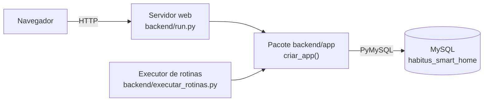
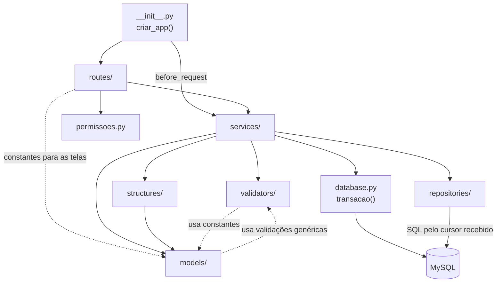
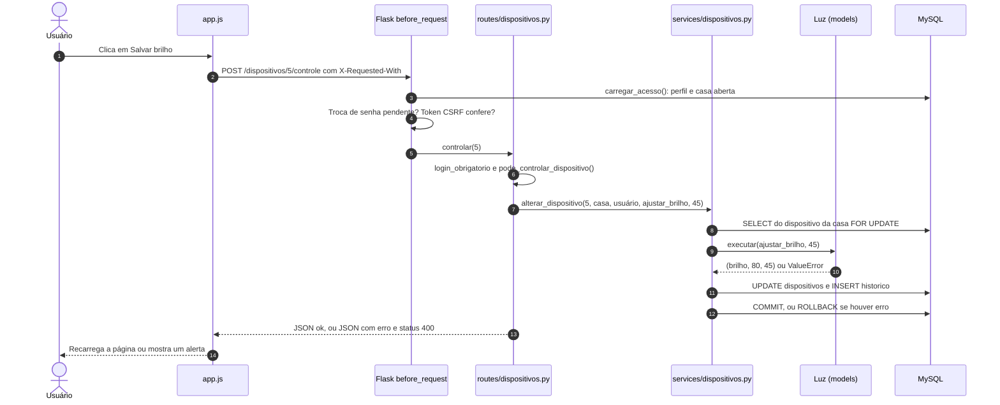

# Arquitetura do Habitus

Este documento explica como o Habitus está organizado: os processos que o compõem, as camadas do back-end e suas dependências, o caminho de uma requisição, o uso de transações e os conceitos de Engenharia de Software aplicados.

Assuntos tratados em outros documentos:

- classes e estruturas de dados: [ESTRUTURAS_E_POO.md](ESTRUTURAS_E_POO.md);
- tabelas e restrições do banco: [BANCO_DE_DADOS.md](BANCO_DE_DADOS.md);
- cada rota e sua permissão: [ROTAS_E_PERMISSOES.md](ROTAS_E_PERMISSOES.md);
- autenticação e segurança: [AUTENTICACAO_E_SEGURANCA.md](AUTENTICACAO_E_SEGURANCA.md);
- executor de rotinas: [EXECUTOR_ROTINAS.md](EXECUTOR_ROTINAS.md);
- testes: [TESTES.md](TESTES.md);
- front-end: [FRONTEND.md](FRONTEND.md).

## Sumário

1. [Visão geral da execução](#1-visão-geral-da-execução)
2. [Camadas e dependências](#2-camadas-e-dependências)
3. [Componentes de cada camada](#3-componentes-de-cada-camada)
4. [Ciclo de uma requisição](#4-ciclo-de-uma-requisição)
5. [Tratamento de erros e respostas](#5-tratamento-de-erros-e-respostas)
6. [Transações](#6-transações)
7. [Conceitos de Engenharia de Software](#7-conceitos-de-engenharia-de-software)
8. [Decisões de projeto e consequências](#8-decisões-de-projeto-e-consequências)
9. [Estado da verificação](#9-estado-da-verificação)

---

## 1. Visão geral da execução

O Habitus roda em **dois processos** independentes, que usam o mesmo pacote `backend/app/` e o mesmo banco:



| Processo | Como inicia | O que faz |
| --- | --- | --- |
| Servidor web | `run.py` chama `criar_app()` e `app.run(debug=True)` | Atende `http://127.0.0.1:5000`, entrega os templates e os arquivos de `frontend/` |
| Executor | `executar_rotinas.py` chama `criar_app()` e entra num laço de 20 s | Abre o contexto da aplicação (`app.app_context()`) e chama `executar_pendentes()` |

- O executor cria a aplicação apenas para reaproveitar a configuração e o acesso ao banco; ele não atende requisições HTTP.
- Os processos **não se comunicam diretamente**: uma rotina cadastrada pelo site fica no banco e é lida pelo executor na verificação seguinte.
- O front-end não é um servidor separado: o Flask é configurado em `criar_app()` com `template_folder` e `static_folder` apontando para `frontend/templates` e `frontend/static`.

## 2. Camadas e dependências

### 2.1 Responsabilidades

| Camada | Pasta ou arquivo | Responsabilidade | Não deve conter |
| --- | --- | --- | --- |
| Fábrica da aplicação | `backend/app/__init__.py` | Criar o Flask, registrar blueprints, verificações globais e erros | Regras de negócio |
| Configuração | `backend/app/config.py` | Ler o `.env` e definir os caminhos do front-end | — |
| Rotas | `backend/app/routes/` | Receber o pedido, aplicar a permissão, chamar o serviço, escolher a resposta | SQL ou regras de negócio |
| Permissões | `backend/app/permissoes.py` | Decoradores `@login_obrigatorio` e `@administrador_obrigatorio` | — |
| Serviços | `backend/app/services/` | Regras de negócio e definição do que acontece na mesma transação | Detalhes de HTTP |
| Validadores | `backend/app/validators/` | Limpar e validar entradas, levantando `ValueError` com mensagem exibível | Acesso ao banco |
| Modelos | `backend/app/models/` | Comportamento dos dispositivos e representação de usuário, cômodo e rotina | Acesso ao banco |
| Estruturas | `backend/app/structures/` | `FilaRotinas`, a agenda do executor | Acesso ao banco |
| Repositórios | `backend/app/repositories/` | SQL parametrizado, um arquivo por tabela | Regras de negócio |
| Acesso ao banco | `backend/app/database.py` | Abrir a conexão e controlar a transação | — |

### 2.2 Dependências reais entre os módulos

O diagrama mostra quem importa quem, conforme os `import` do código:



Regras confirmadas nos imports:

- **Rotas não acessam o banco:** nenhum arquivo de `routes/` importa `repositories/` ou `database.py`.
- **O núcleo não depende do Flask:** só `__init__.py`, `permissoes.py`, `routes/` e `database.py` importam o Flask (`database.py` apenas para ler `current_app.config`). Serviços, validadores, modelos, estruturas e repositórios são Python puro, o que permite testá-los sem servidor.
- **Repositórios são independentes:** não importam nenhum outro módulo do projeto; recebem o cursor como primeiro argumento.

Exceções e ligações que vale conhecer:

| Ligação | Motivo |
| --- | --- |
| `routes/dispositivos.py` importa `TIPOS` de `models/dispositivo.py`; `routes/rotinas.py` importa `ACOES`, `DIAS_DA_SEMANA` e `TODOS_OS_DIAS` de `models/rotina.py` | Rótulos e opções enviados aos templates |
| `models/comodo.py` e `models/dispositivo.py` usam funções de `validators/` | A validação do nome do cômodo e dos números de ajuste fica centralizada |
| `validators/dispositivos.py`, `validators/rotinas.py` e `validators/usuarios.py` leem constantes dos modelos | Tipos, ações, dias e perfis válidos vêm de um único lugar |
| `services/autenticacao.py` chama `criar_comodos_iniciais()` de `services/comodos.py` | Os cômodos iniciais entram na mesma transação do cadastro da conta |
| `services/rotinas.py` chama `salvar_alteracao()` de `services/dispositivos.py` | A execução de uma rotina grava o dispositivo e o histórico como um controle manual |
| `routes/dispositivos.py` usa `transferir_dispositivo()` de `services/comodos.py` | A transferência é uma regra de cômodos, exposta na tela de dispositivos |

Não há importação circular entre arquivos: `validators/campos.py`, base das validações, não importa nenhum modelo.

## 3. Componentes de cada camada

### 3.1 Fábrica da aplicação (`backend/app/__init__.py`)

`criar_app(configuracoes=None)` monta a aplicação; os testes a usam com `{"TESTING": True}`. Em ordem, ela:

1. cria o Flask apontando para `frontend/templates` e `frontend/static`;
2. carrega a classe `Config` e aplica as configurações extras recebidas;
3. registra três funções `before_request` (veja a [seção 4](#4-ciclo-de-uma-requisição));
4. disponibiliza `csrf_token()` aos templates, gerando o token na primeira vez;
5. registra o filtro Jinja `numero` (`22.0` → `22`; `22.5` → `22,5`), definido em `models/rotina.py`;
6. registra os 6 blueprints: `auth`, `site`, `casas`, `dispositivos`, `rotinas` e `historico`;
7. registra um manipulador único para os erros 400, 403 e 404.

`Config` (`backend/app/config.py`) define `SECRET_KEY`, `DB_HOST`, `DB_PORT`, `DB_USER`, `DB_PASSWORD`, `DB_NAME`, `SESSION_COOKIE_HTTPONLY = True` e `SESSION_COOKIE_SAMESITE = "Lax"`.

### 3.2 Rotas (`backend/app/routes/`)

| Blueprint | Arquivo | Funções de rota | Serviços usados |
| --- | --- | :---: | --- |
| `auth` | `autenticacao.py` | 4 | `services/autenticacao.py` |
| `site` | `site.py` | 2 | `services/casas.py` |
| `casas` | `casas.py` | 8 | `services/comodos.py`, `services/moradores.py`, `services/casas.py` |
| `dispositivos` | `dispositivos.py` | 5 | `services/dispositivos.py`, `services/comodos.py` |
| `rotinas` | `rotinas.py` | 6 | `services/rotinas.py` |
| `historico` | `historico.py` | 1 | `services/casas.py` |

Total: 26 funções de rota. A lista completa, com métodos e permissões, está em [ROTAS_E_PERMISSOES.md](ROTAS_E_PERMISSOES.md#3-rotas-por-blueprint).

Padrões que se repetem nas rotas:

- os dados da sessão chegam prontos em `g.usuario`, `g.casa_id` e `g.nome_casa`;
- o serviço sempre recebe `g.casa_id`, nunca um id de casa vindo do formulário;
- `routes/casas.py` concentra o tratamento de erro de cinco ações em `voltar_com_resultado()`, que executa o serviço, mostra a mensagem e redireciona.

### 3.3 Serviços (`backend/app/services/`)

| Arquivo | Funções públicas | Responsabilidade |
| --- | --- | --- |
| `autenticacao.py` | `carregar_acesso`, `autenticar`, `cadastrar_conta`, `trocar_senha_temporaria` | Conta, login e acesso à casa aberta |
| `casas.py` | `casas_do_usuario`, `pode_abrir_casa`, `resumo_do_painel`, `historico_da_casa` | Consultas da casa: troca de casa, painel e histórico |
| `comodos.py` | `listar_comodos`, `nome_em_uso`, `criar_comodos_iniciais`, `criar_comodo`, `renomear_comodo`, `excluir_comodo`, `transferir_dispositivo` | Cômodos e transferência de dispositivos |
| `dispositivos.py` | `dados_da_pagina`, `cadastrar_dispositivo`, `salvar_alteracao`, `alterar_dispositivo`, `remover_dispositivo`, `ajustes_por_tipo` | Cadastro, controle e desativação |
| `moradores.py` | `gerar_senha_temporaria`, `listar_moradores`, `cadastrar_morador`, `mudar_perfil`, `remover_morador` | Vínculos, perfis e senha temporária |
| `rotinas.py` | `dados_da_pagina`, `buscar_rotina`, `salvar_rotina`, `alternar_rotina`, `remover_rotina`, `dia_permitido`, `rotina_pendente`, `executar_rotina`, `executar_pendentes` | Cadastro de rotinas e execução automática |

Os serviços seguem um contrato simples:

- recebem valores já extraídos do pedido e o `id_casa` da casa aberta;
- validam antes de abrir a transação sempre que a validação não depende do banco;
- sinalizam erros de negócio com `ValueError`;
- convertem `pymysql.err.IntegrityError` em `ValueError` com mensagem amigável, por exemplo quando dois cadastros simultâneos esbarram num `UNIQUE`.

### 3.4 Validadores (`backend/app/validators/`)

| Arquivo | Conteúdo |
| --- | --- |
| `campos.py` | Funções genéricas: `texto`, `identificador`, `opcao`, `numero_inteiro`, `numero_decimal` |
| `usuarios.py` | Nome, e-mail, senha e perfil |
| `casas.py` | Nome da casa, nome do cômodo e opção de cômodos iniciais |
| `dispositivos.py` | Nome, tipo e cômodo de um novo dispositivo |
| `rotinas.py` | Horário, dias e os campos de uma rotina que não dependem do aparelho |

Todos devolvem o valor limpo (sem espaços repetidos, e-mail em minúsculas, números convertidos) ou levantam `ValueError`. O valor de um ajuste é validado depois pela **classe do dispositivo**, porque cada tipo tem limites próprios.

### 3.5 Modelos e estruturas

| Arquivo | Classes |
| --- | --- |
| `models/dispositivo.py` | `Dispositivo`, `Luz`, `Climatizador`, `ArCondicionado`, `Aquecedor`, `Ventilador`, `Generico` |
| `models/usuario.py` | `Usuario` |
| `models/comodo.py` | `Comodo` |
| `models/rotina.py` | `Rotina` |
| `structures/fila_rotinas.py` | `FilaRotinas` |

Com `Config`, são 12 classes em `backend/app/`. O papel de cada classe e os conceitos de orientação a objetos estão em [ESTRUTURAS_E_POO.md](ESTRUTURAS_E_POO.md).

### 3.6 Repositórios (`backend/app/repositories/`)

Um arquivo por tabela: `usuarios.py`, `casas.py`, `moradores.py`, `comodos.py`, `dispositivos.py`, `historico.py` e `rotinas.py`.

- Toda função recebe o cursor como primeiro parâmetro e usa parâmetros `%s`.
- Funções de busca que antecedem uma alteração aceitam `bloquear=True`, que acrescenta `FOR UPDATE` à consulta.
- A única coluna montada no texto do SQL fica em `atualizar_campo()` e é conferida antes no conjunto `CAMPOS_CONTROLE`:

```python
# backend/app/repositories/dispositivos.py
CAMPOS_CONTROLE = {"ligado", "brilho", "temperatura", "intensidade"}

def atualizar_campo(cursor, id_dispositivo, campo, valor):
    if campo not in CAMPOS_CONTROLE:
        raise ValueError("Campo de controle invalido.")
    cursor.execute(
        f"UPDATE dispositivos SET {campo} = %s WHERE id_dispositivo = %s",
        (valor, id_dispositivo),
    )
```

### 3.7 Acesso ao banco (`backend/app/database.py`)

`conectar()` abre uma conexão PyMySQL com `utf8mb4`, `DictCursor` (cada linha vira um dicionário) e `autocommit=False`. `transacao()` é o único ponto que confirma ou desfaz alterações:

```python
# backend/app/database.py
@contextmanager
def transacao():
    conexao = conectar()
    try:
        with conexao.cursor() as cursor:
            yield cursor
        conexao.commit()
    except Exception:
        conexao.rollback()
        raise
    finally:
        conexao.close()
```

### 3.8 Permissões (`backend/app/permissoes.py`)

| Decorador | Sem login | Logado sem permissão |
| --- | --- | --- |
| `@login_obrigatorio` | Redireciona para `/entrar` | — |
| `@administrador_obrigatorio` | Redireciona para `/entrar` (aplica `@login_obrigatorio` antes) | Erro 403 se `g.usuario.pode_gerenciar()` for falso |

A rota de controle de dispositivos usa `@login_obrigatorio` e confere `pode_controlar_dispositivo()` dentro da função, respondendo 403 em JSON. A matriz completa de permissões está em [ROTAS_E_PERMISSOES.md](ROTAS_E_PERMISSOES.md#42-matriz-de-permissões).

## 4. Ciclo de uma requisição

### 4.1 Verificações globais (`before_request`)

Antes de qualquer rota, o Flask executa três funções, nesta ordem:

| Ordem | Função | O que faz |
| :---: | --- | --- |
| 1 | `carregar_usuario` | Se há `usuario_id` na sessão, chama `carregar_acesso()`, que consulta o banco e devolve nome, perfil e casa aberta. Preenche `g.usuario` (um `Usuario`), `g.casa_id` e `g.nome_casa`. Se a pessoa não participa de nenhuma casa, limpa a sessão |
| 2 | `exigir_troca_de_senha` | Com `trocar_senha` na sessão, redireciona para `/trocar-senha`; só ficam liberadas a troca de senha, a saída e os arquivos estáticos |
| 3 | `proteger_formularios` | Em POST, PUT, PATCH e DELETE, compara o token CSRF do formulário (ou do cabeçalho `X-CSRF-Token`) com o da sessão usando `hmac.compare_digest`; se não conferir, erro 400 |

Consequência importante: como o perfil e a casa são relidos **em toda requisição autenticada**, mudar o perfil de alguém ou remover seu acesso vale imediatamente.

### 4.2 Exemplo completo: ajustar o brilho de uma luz

O controle de dispositivos é o fluxo que mais atravessa camadas:



O código do serviço mostra a divisão de papéis:

```python
# backend/app/services/dispositivos.py
def alterar_dispositivo(id_dispositivo, id_casa, id_usuario, acao, valor=None):
    with transacao() as cursor:
        dados = repo_dispositivos.buscar_ativo(cursor, id_dispositivo, id_casa, bloquear=True)
        if dados is None:
            raise ValueError("Dispositivo nao encontrado nessa casa.")
        alteracao = criar_dispositivo(dados).executar(acao, valor)   # modelo valida
        return salvar_alteracao(cursor, id_dispositivo, id_usuario, acao, alteracao)
```

- O **repositório** busca o aparelho somente se ele pertence à casa aberta (`id_casa`) e o bloqueia.
- O **modelo** decide se a ação existe para aquele tipo e se o valor está dentro dos limites.
- O **serviço** grava o novo estado e o histórico na mesma transação.
- A **rota** só traduz o resultado em JSON ou em mensagem.

### 4.3 Requisições sem JavaScript

Quando o mesmo formulário é enviado sem o cabeçalho `X-Requested-With: XMLHttpRequest`, a rota responde com redirecionamento e mensagem `flash`. As demais ações de gestão seguem o padrão **Post/Redirect/Get**: o POST altera os dados, a resposta redireciona, e o navegador carrega a página com um GET. Assim, atualizar a página não reenvia o formulário.

Há duas exceções intencionais:

- ao adicionar um morador **sem conta**, `routes/casas.py` exibe a página diretamente, com `Cache-Control: no-store`, para que a senha temporária apareça uma única vez e não passe pela sessão;
- quando o formulário de rotina tem erro, a página é exibida de novo com o que foi digitado.

## 5. Tratamento de erros e respostas

| Situação | Onde é detectada | Resposta |
| --- | --- | --- |
| Dado inválido ou regra de negócio violada | Validadores, modelos ou serviços (`ValueError`) | Mensagem `flash` de erro e redirecionamento; JSON com status 400 no controle via AJAX |
| Erro no formulário de rotina | `routes/rotinas.py` | A página é exibida de novo com os dados digitados e status 400 |
| Erro no login, cadastro ou troca de senha | `routes/autenticacao.py` | O formulário é exibido de novo com a mensagem |
| `UNIQUE` violado em cadastros simultâneos | Serviços (`IntegrityError` → `ValueError`) | Mesma resposta de um `ValueError` |
| Sem login | Decoradores | Redirecionamento para `/entrar` |
| Perfil sem permissão | `@administrador_obrigatorio` | Erro 403 |
| Token CSRF ausente ou diferente | `proteger_formularios` | Erro 400 ("Sessao expirada...") |
| Rotina de outra casa aberta para edição | `routes/rotinas.py` | Erro 404 |
| Outras exceções | — | Comportamento padrão do Flask (erro 500; com `debug=True`, a página de depuração) |

Os erros 400, 403 e 404 usam o manipulador único de `__init__.py`, que devolve um HTML simples com um link de volta.

## 6. Transações

### 6.1 Quem decide o que é atômico

A decisão é sempre do **serviço**: ele abre `with transacao() as cursor` e passa o mesmo cursor para todos os repositórios que precisam participar. Um serviço também pode entregar seu cursor a uma função de outro serviço, ampliando a mesma transação:

```python
# backend/app/services/autenticacao.py (trecho de cadastrar_conta)
with transacao() as cursor:
    id_usuario = repo_usuarios.inserir(cursor, nome, email, generate_password_hash(senha))
    id_casa = repo_casas.inserir(cursor, nome_casa)
    repo_moradores.inserir(cursor, id_casa, id_usuario, "administrador")
    criar_comodos_iniciais(cursor, id_casa, opcao_comodos)   # de services/comodos.py
```

Se qualquer comando falhar, nada do cadastro fica gravado.

### 6.2 Operações de escrita

| Operação | Função | Comandos na mesma transação | Bloqueio (`FOR UPDATE`) |
| --- | --- | --- | --- |
| Criar conta | `autenticacao.cadastrar_conta` | INSERT usuário, casa, vínculo e cômodos iniciais (com 2 dispositivos de exemplo) | — |
| Trocar senha temporária | `autenticacao.trocar_senha_temporaria` | SELECT usuário, UPDATE senha | — |
| Criar cômodo | `comodos.criar_comodo` | SELECT cômodos da casa, INSERT | — (o `UNIQUE` do banco cobre a concorrência) |
| Renomear cômodo | `comodos.renomear_comodo` | SELECT cômodo, SELECT nomes, UPDATE | Cômodo |
| Excluir cômodo | `comodos.excluir_comodo` | SELECT cômodo, contagem de dispositivos, DELETE | Cômodo |
| Transferir dispositivo | `comodos.transferir_dispositivo` | SELECT dispositivo e destino, UPDATE, INSERT histórico | Dispositivo e cômodo de destino |
| Cadastrar dispositivo | `dispositivos.cadastrar_dispositivo` | SELECT cômodo, INSERT | — |
| Controlar dispositivo | `dispositivos.alterar_dispositivo` | SELECT, UPDATE da coluna, INSERT histórico | Dispositivo |
| Remover dispositivo | `dispositivos.remover_dispositivo` | UPDATE `ativo = 0`, UPDATE rotinas para pausadas | — (o próprio UPDATE confere a casa) |
| Adicionar morador | `moradores.cadastrar_morador` | SELECT usuário, SELECT vínculo, INSERT usuário (se novo), INSERT vínculo | Usuário (por e-mail) |
| Mudar perfil / remover morador | `moradores.mudar_perfil` / `remover_morador` | SELECT vínculo, UPDATE ou DELETE | Vínculo |
| Salvar rotina | `rotinas.salvar_rotina` | SELECT dispositivo, INSERT ou (SELECT rotina + UPDATE) | Rotina, na edição |
| Pausar ou excluir rotina | `rotinas.alternar_rotina` / `remover_rotina` | SELECT rotina, UPDATE ou DELETE | Rotina |
| Executar rotina | `rotinas.executar_rotina` | SELECT rotina, SELECT dispositivo, UPDATE, INSERT histórico, UPDATE `ultima_execucao` | Rotina e dispositivo |

O bloqueio `FOR UPDATE` impede que duas operações alterem o mesmo registro ao mesmo tempo com base numa leitura desatualizada. O executor relê a rotina com bloqueio justamente porque ela pode ter sido editada ou pausada depois que a agenda foi montada.

### 6.3 Leituras

As consultas também usam `transacao()`. Isso padroniza a abertura e o fechamento da conexão, e o `commit` final de uma leitura não altera nada. O executor lista as rotinas ativas numa transação curta e executa cada rotina em **outra transação**, para que a falha de uma não desfaça as demais.

## 7. Conceitos de Engenharia de Software

| Conceito | Como é aplicado | Onde ver |
| --- | --- | --- |
| **Arquitetura em camadas** | Cada camada conversa apenas com as vizinhas; a rota nunca acessa o banco | [Seção 2](#2-camadas-e-dependências) |
| **Separação de responsabilidades e coesão** | Um arquivo de repositório por tabela, um serviço por domínio, validações agrupadas por assunto | `repositories/`, `services/`, `validators/` |
| **Baixo acoplamento com o framework** | Regras de negócio sem Flask; o núcleo pode ser testado sem servidor | `services/`, `models/`, `validators/` |
| **Injeção de dependência simples** | Repositórios recebem o cursor; os testes trocam `transacao` por um banco falso com `monkeypatch` | `tests/apoio_banco.py` |
| **Validação antecipada** | Dados inválidos são recusados antes de abrir a conexão | `cadastrar_morador`, `cadastrar_dispositivo`, `salvar_rotina` |
| **Tratamento de erros uniforme** | `ValueError` representa erro de negócio; erros de integridade do banco são traduzidos | [Seção 5](#5-tratamento-de-erros-e-respostas) |
| **Fonte única de verdade** | Limites de cada ajuste no atributo `ajuste` da classe; tipos em `CLASSES`; perfis em `Usuario.PERFIS` | `models/dispositivo.py`, `models/usuario.py` |
| **Atomicidade** | Operações relacionadas confirmadas ou desfeitas juntas | [Seção 6](#6-transações) |
| **Defesa em profundidade** | A tela esconde ações não permitidas, os decoradores bloqueiam, os serviços filtram por casa e o banco aplica `UNIQUE`, `CHECK` e `RESTRICT` | `templates/`, `permissoes.py`, `services/`, `database/schema.sql` |
| **Preservação de dados** | Dispositivos são desativados (`ativo = 0`), não apagados, para manter o histórico | `repositories/dispositivos.py` |
| **Padrão fábrica de aplicação** | `criar_app()` permite criar instâncias com configurações diferentes (site, executor, testes) | `backend/app/__init__.py` |
| **Decoradores para regras transversais** | Login e perfil aplicados por anotação, sem repetir código nas rotas | `backend/app/permissoes.py` |
| **Post/Redirect/Get** | Ações de formulário redirecionam após o POST | `routes/` |
| **Configuração fora do código** | Credenciais e chave de sessão vêm do `.env` | `backend/app/config.py` |
| **Testes automatizados** | 144 testes aprovados em 09/11/2026: 141 isolados e 3 de integração com MySQL (banco `habitus_testes`) | `tests/` (detalhes em [TESTES.md](TESTES.md)) |

## 8. Decisões de projeto e consequências

| Decisão | Vantagem | Consequência ou limite |
| --- | --- | --- |
| Executor em processo separado | Código simples, sem bibliotecas de agendamento; o site não fica bloqueado | Exige um segundo terminal; ao iniciar, considera só o último minuto, e recupera no máximo 10 minutos de atraso |
| Agenda reconstruída a cada verificação | Sempre coerente com o banco, inclusive após edições e pausas | Lê todas as rotinas ativas a cada 20 segundos |
| Uma conexão nova por transação | Sem estado compartilhado entre requisições; fácil de entender e testar | Não há reaproveitamento de conexões: uma página autenticada abre ao menos duas (o acesso em `before_request` e a consulta da página); `/casa` abre quatro |
| Perfil relido em toda requisição | Permissões sempre atualizadas | Uma consulta extra por requisição |
| Páginas renderizadas no servidor e JavaScript mínimo | Sem etapa de build nem npm; regras centralizadas no Python | Após um controle via AJAX, a página é recarregada por inteiro |
| Nome de cômodo comparado em Python e protegido por `UNIQUE` | Mensagem clara e independente da collation, com garantia no banco | Duas consultas na criação |
| Dispositivos desativados em vez de apagados | O histórico nunca perde a referência | Cômodos que já tiveram dispositivos não podem ser excluídos |
| SQL escrito à mão, sem ORM | Comandos visíveis e didáticos | Mudanças no esquema exigem revisar os repositórios e as migrações |

## 9. Estado da verificação

Conferido com o código em 08/11/2026.

**Testado** (testes isolados com banco falso, aprovados em 08/11/2026):

- commit e rollback de `transacao()` (`test_transacao_confirma_ou_desfaz_tudo`);
- controle de dispositivo com `FOR UPDATE`, UPDATE e INSERT no histórico (`test_alteracao_grava_estado_e_historico`);
- valor inválido não gera escrita (`test_valor_invalido_nao_grava_no_banco`);
- dados inválidos não abrem conexão (`test_dados_invalidos_nem_acessam_o_banco`);
- tradução de `IntegrityError` (`test_indice_unique_do_banco_tambem_e_tratado`, `test_cadastro_simultaneo_vira_mensagem_e_desfaz_a_transacao`);
- CSRF ausente → 400 (`test_post_sem_token_nao_e_aceito`);
- perfil comum bloqueado com 403 (`test_morador_comum_nao_pode_adicionar_comodo`);
- cadastro e login passando por rota, serviço e repositório (`test_cadastro_e_login_passando_pelas_camadas`);
- executor dentro do contexto da aplicação (`test_executor_usa_o_contexto_da_aplicacao`).

**Verificado no código**, sem teste automatizado:

- grafo de dependências da [seção 2.2](#22-dependências-reais-entre-os-módulos), conferido pelos `import`;
- resposta JSON do controle via AJAX e o fluxo sem JavaScript;
- manipulador de erros 400/403/404;
- quantidade de conexões por página.

**Não verificado** (depende do ambiente):

- `commit`, `rollback` e bloqueios `FOR UPDATE` num MySQL real, inclusive com acessos simultâneos;
- desempenho e consumo de conexões sob uso real.

Fontes no código: `backend/run.py`, `backend/executar_rotinas.py`, `backend/app/__init__.py`, `backend/app/config.py`, `backend/app/database.py`, `backend/app/permissoes.py`, `backend/app/routes/`, `backend/app/services/`, `backend/app/validators/`, `backend/app/models/`, `backend/app/structures/`, `backend/app/repositories/`, `frontend/static/js/app.js`, `tests/`.
