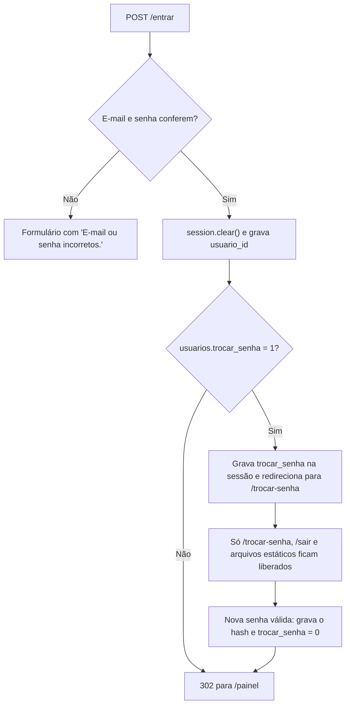

# Autenticação e segurança do Habitus

Este documento explica como o Habitus identifica as pessoas, protege as senhas e a sessão, controla o acesso e se defende de entradas maliciosas. Também registra as limitações de segurança da versão atual.

> [!IMPORTANT]
> O Habitus foi construído para **desenvolvimento e demonstração local**. Ele aplica boas práticas importantes, mas **não está preparado para produção** (veja a [seção 9](#9-limitações-de-segurança)).

Assuntos relacionados em outros documentos:

- rotas, decoradores, matriz de permissões e isolamento entre casas: [ROTAS_E_PERMISSOES.md](ROTAS_E_PERMISSOES.md);
- tabelas `usuarios` e `moradores`, transações e bloqueios: [BANCO_DE_DADOS.md](BANCO_DE_DADOS.md).

## Sumário

1. [Visão geral](#1-visão-geral)
2. [Cadastro de conta](#2-cadastro-de-conta)
3. [Login e logout](#3-login-e-logout)
4. [Senhas](#4-senhas)
5. [Sessões e cookies](#5-sessões-e-cookies)
6. [Moradores e senha temporária](#6-moradores-e-senha-temporária)
7. [Autorização e isolamento](#7-autorização-e-isolamento)
8. [Outras proteções implementadas](#8-outras-proteções-implementadas)
9. [Limitações de segurança](#9-limitações-de-segurança)
10. [Melhorias possíveis (não implementadas)](#10-melhorias-possíveis-não-implementadas)
11. [Estado da verificação e fontes](#11-estado-da-verificação-e-fontes)

---

## 1. Visão geral

| Mecanismo | Implementação | Arquivo principal |
| --- | --- | --- |
| Hash de senha | `generate_password_hash` / `check_password_hash` do Werkzeug | `services/autenticacao.py`, `services/moradores.py` |
| Sessão | Cookie de sessão do Flask, assinado com `SECRET_KEY` | `backend/app/config.py`, `routes/autenticacao.py` |
| Proteção CSRF | Token aleatório na sessão, conferido em todo POST | `backend/app/__init__.py` |
| Troca obrigatória de senha | Indicador `trocar_senha` no banco e na sessão | `routes/autenticacao.py`, `backend/app/__init__.py` |
| Controle de acesso | Decoradores e perfil relido a cada requisição | `backend/app/permissoes.py`, `backend/app/__init__.py` |
| Isolamento entre casas | Toda busca do usuário filtra pelo `id_casa` da casa aberta | `services/`, `repositories/` |
| Validação de entradas | Validadores centralizados e restrições do banco | `backend/app/validators/`, `database/schema.sql` |
| SQL parametrizado | Parâmetros `%s` e lista de colunas permitidas | `backend/app/repositories/` |
| Escape de saída | Escape automático do Jinja nos templates `.html` | `frontend/templates/` |

## 2. Cadastro de conta

Rota `POST /cadastro` → `services/autenticacao.py` → `cadastrar_conta()`.

1. **Validação, antes de abrir a conexão:**

   | Campo | Regra | Função |
   | --- | --- | --- |
   | Nome | 2 a 100 caracteres, espaços repetidos removidos | `validar_nome` |
   | E-mail | Minúsculas, até 150 caracteres, formato `algo@dominio.ext` | `validar_email` |
   | Senha | Pelo menos 8 caracteres e igual à confirmação | `validar_senha` |
   | Nome da casa | 2 a 100 caracteres | `validar_nome_casa` |
   | Cômodos iniciais | `sugeridos` ou `vazio` | `validar_opcao_comodos` |

2. **Gravação numa única transação:** usuário, com a senha já transformada em hash; casa; vínculo `administrador`; cômodos iniciais. Os detalhes do SQL estão em [BANCO_DE_DADOS.md](BANCO_DE_DADOS.md#71-conta-e-casa-servicesautenticacaopy--cadastrar_conta).
3. **E-mail repetido:** o `UNIQUE` de `usuarios.email` gera `IntegrityError`, convertido em "Esse e-mail ja esta cadastrado.". Como a exceção ocorre dentro da transação, nada fica gravado.
4. **Sessão:** a rota faz `session.clear()` e grava `usuario_id` e `casa_id`. A pessoa já entra logada, na casa recém-criada.

O cadastro **não confirma a posse do e-mail**: não há mensagem de verificação, porque o sistema não envia e-mails.

## 3. Login e logout

### 3.1 Login

```python
# backend/app/services/autenticacao.py
def autenticar(email, senha):
    with transacao() as cursor:
        usuario = repo_usuarios.buscar_por_email(cursor, str(email or "").strip().lower())
    if usuario and check_password_hash(usuario["senha_hash"], senha or ""):
        return usuario
    return None
```

- O e-mail é normalizado (espaços e maiúsculas) antes da busca.
- E-mail inexistente ou senha errada produzem **a mesma mensagem**: "E-mail ou senha incorretos.". A tela não revela qual dos dois falhou.
- Em caso de sucesso, `routes/autenticacao.py`:
  1. faz `session.clear()`, descartando qualquer dado da sessão anterior, inclusive o token CSRF;
  2. grava `session["usuario_id"]`;
  3. se `usuarios.trocar_senha` for 1, grava `session["trocar_senha"] = True` e redireciona para `/trocar-senha`; senão, redireciona para `/painel`.



### 3.2 Logout

`POST /sair` executa `session.clear()` e redireciona para `/entrar`. Por ser POST, também exige o token CSRF; um link ou uma imagem de outro site não consegue deslogar a pessoa.

## 4. Senhas

### 4.1 Hash

- **Gravação:** `generate_password_hash(senha)` é chamado sem parâmetros, então vale o padrão da biblioteca. No Werkzeug 3.1.9 instalado, o padrão é o algoritmo **scrypt** com *salt* aleatório de 16 caracteres.
- **Formato:** o resultado é uma string com o método, o *salt* e o hash, gravada em `usuarios.senha_hash` (`VARCHAR(255)`).
- **Conferência:** `check_password_hash(hash, senha)` recalcula o hash com o mesmo *salt* e compara os resultados.
- **A senha em texto nunca é gravada**, nem a definitiva nem a temporária (testes `test_cadastro_e_login_passando_pelas_camadas` e `test_cadastra_novo_morador_com_senha_temporaria`).

Por que hash, e não criptografia: um hash não pode ser revertido. Mesmo quem tiver acesso ao banco não lê as senhas; só consegue testar tentativas, e o scrypt foi projetado para tornar cada tentativa custosa.

### 4.2 Política de senha

| Regra | Onde |
| --- | --- |
| Mínimo de 8 caracteres (`TAMANHO_MINIMO_SENHA`) | `validators/usuarios.py` |
| Confirmação igual à senha | `validators/usuarios.py` |
| Nova senha diferente da temporária | `services/autenticacao.py` → `trocar_senha_temporaria()` |

Não há exigência de letras, números ou símbolos, nem verificação contra senhas comuns.

## 5. Sessões e cookies

### 5.1 Como a sessão funciona

A sessão padrão do Flask fica num **cookie assinado** com a `SECRET_KEY`: o navegador guarda o conteúdo, e a assinatura impede que ele seja alterado sem a chave. O conteúdo é apenas codificado, não criptografado; por isso o Habitus guarda nele somente identificadores e indicadores:

| Chave da sessão | Conteúdo | Gravada em |
| --- | --- | --- |
| `usuario_id` | Id do usuário logado | Login e cadastro |
| `casa_id` | Id da casa aberta | Cadastro, troca de casa e `carregar_usuario()` |
| `trocar_senha` | `True` enquanto a senha temporária não for trocada | Login |
| `csrf_token` | Token CSRF da sessão | `csrf_token()`, ao renderizar o primeiro formulário |

As mensagens `flash` também passam pela sessão até serem exibidas; esse é um comportamento do Flask.

### 5.2 Configuração do cookie

```python
# backend/app/config.py
SECRET_KEY = os.getenv("SECRET_KEY", "chave-local-apenas-para-testes")
SESSION_COOKIE_HTTPONLY = True
SESSION_COOKIE_SAMESITE = "Lax"
```

| Configuração | Efeito |
| --- | --- |
| `SESSION_COOKIE_HTTPONLY = True` | O JavaScript da página não consegue ler o cookie, o que reduz o impacto de um eventual XSS |
| `SESSION_COOKIE_SAMESITE = "Lax"` | O navegador não envia o cookie em POST iniciados por outros sites, uma camada extra contra CSRF |
| `SECRET_KEY` do `.env` | Assina o cookie; quem a conhece pode forjar sessões. Sem `.env`, vale o valor fixo acima (seção 9) |
| `SESSION_COOKIE_SECURE` | **Não configurado**: o cookie também trafega por HTTP, coerente com a execução local sem HTTPS |
| Expiração | **Não configurada**: o código nunca marca a sessão como permanente, então o cookie dura até o navegador ser fechado ou até a pessoa sair. Não há expiração por inatividade |

### 5.3 Revalidação a cada requisição

O cookie diz **quem** é a pessoa, mas não decide **o que** ela pode fazer. Em toda requisição, `carregar_usuario()` relê no banco o vínculo e o perfil. Se o acesso foi removido, ele deixa de valer imediatamente. Se a pessoa não participa de mais nenhuma casa, a sessão é limpa, mesmo que o cookie continue válido.

## 6. Moradores e senha temporária

> [!NOTE]
> O Habitus **não envia convites, e-mails ou senhas**. O administrador informa o e-mail da pessoa, e o resultado aparece somente na tela dele.

### 6.1 Adicionar um morador

`POST /casa/moradores` (somente administrador) → `services/moradores.py` → `cadastrar_morador()`. O perfil e o e-mail são validados antes de abrir a transação. Dentro dela, a conta é buscada pelo e-mail com `FOR UPDATE`:

| Situação | O que acontece | Mensagem ao administrador |
| --- | --- | --- |
| E-mail com conta, que **já participa** da casa | Nada é gravado | "`<nome>` ja participa desta casa." |
| E-mail com conta, que **não participa** da casa | Só cria o vínculo; nome e senha da conta não mudam; o nome digitado é ignorado | "`<nome>` ja tinha conta e agora participa desta casa." |
| E-mail **sem conta** | O nome passa a ser obrigatório; cria a conta com senha temporária e `trocar_senha = 1`, depois o vínculo | A senha temporária, exibida uma única vez |
| Cadastro simultâneo do mesmo vínculo | O `UNIQUE` barra o segundo; a transação é desfeita, inclusive a conta criada | "Esse morador acabou de ser cadastrado. Atualize a pagina." |

### 6.2 Geração e exibição da senha temporária

```python
# backend/app/services/moradores.py
# Sem letras e numeros parecidos (0/O, 1/l/I) para facilitar a digitacao.
CARACTERES_SENHA = "ABCDEFGHJKLMNPQRSTUVWXYZabcdefghijkmnpqrstuvwxyz23456789"

def gerar_senha_temporaria(tamanho=12):
    return "".join(secrets.choice(CARACTERES_SENHA) for _ in range(tamanho))
```

- **Geração:** usa `secrets`, o módulo de números aleatórios próprio para segurança, e não `random`.
- **Alfabeto:** 56 caracteres, sem `0`, `1`, `I`, `O`, `l` e `o`. Com 12 posições, são 56¹² combinações, cerca de **69,7 bits** de entropia (cálculo feito sobre o alfabeto do código).
- **Gravação:** só o hash vai para o banco.
- **Exibição:** a senha aparece **uma única vez**, na resposta ao POST, com `Cache-Control: no-store`. Ela não é guardada na sessão, nem em `flash`, nem no histórico. Ao recarregar `/casa`, ela não aparece mais (teste `test_administrador_ve_a_senha_temporaria_uma_unica_vez`).
- **Entrega:** cabe ao administrador entregar a senha pessoalmente.
- **Validade:** a senha temporária **não expira**; vale até ser trocada.

### 6.3 Troca obrigatória no primeiro acesso

1. No login, `trocar_senha = 1` no banco faz a rota gravar `session["trocar_senha"] = True` (seção 3.1).
2. Em toda requisição, `exigir_troca_de_senha()` (`backend/app/__init__.py`) redireciona para `/trocar-senha` qualquer endpoint fora da lista liberada: `auth.trocar_senha`, `auth.sair` e `static`. O painel, os dispositivos, a casa e as rotinas ficam inacessíveis (teste `test_sem_trocar_a_senha_nao_acessa_outras_paginas`).
3. O `base.html` também esconde o menu lateral enquanto a troca estiver pendente.
4. `trocar_senha_temporaria()` valida a nova senha, recusa a mesma senha temporária e grava o novo hash com `trocar_senha = 0`. A rota remove o indicador da sessão (teste `test_troca_de_senha_grava_hash_e_libera_o_sistema`).

O indicador da sessão é recriado a partir do banco a cada login. Por isso, sair e entrar de novo com a senha temporária não evita a troca.

### 6.4 Mudança de perfil e remoção de acesso

| Ação | Efeito no banco | Efeito no acesso |
| --- | --- | --- |
| Mudar perfil | `UPDATE moradores SET perfil = ...` | Vale na requisição seguinte da pessoa, porque o perfil é relido a cada requisição |
| Remover morador | `DELETE` do vínculo; **a conta continua existindo** | Na requisição seguinte, a pessoa passa para outra casa da qual participe; se não houver nenhuma, a sessão é limpa |

Ninguém altera ou remove o próprio acesso (`_buscar_outro_morador()`).

Uma conta sem nenhuma casa continua conseguindo autenticar. Mas a sessão é limpa na requisição seguinte, e a pessoa volta ao login sem nenhuma mensagem explicando o motivo.

## 7. Autorização e isolamento

Os detalhes estão em [ROTAS_E_PERMISSOES.md](ROTAS_E_PERMISSOES.md). Em resumo:

- **Perfil por casa:** `administrador` ou `comum`, definido em cada vínculo; a mesma pessoa pode ter perfis diferentes em casas diferentes.
- **Casa ativa conferida:** o `casa_id` da sessão só é usado depois que `carregar_acesso()` confirma o vínculo; a troca de casa confere a participação antes de gravar.
- **Decoradores no servidor:** `@login_obrigatorio` e `@administrador_obrigatorio` bloqueiam a rota mesmo que o formulário seja enviado manualmente.
- **Isolamento:** cômodos, dispositivos, rotinas e moradores são buscados junto com o `id_casa` da casa aberta. Ids de outra casa recebem a mesma resposta de um id inexistente.

## 8. Outras proteções implementadas

### 8.1 Proteção CSRF

CSRF (*Cross-Site Request Forgery*) é quando outro site faz o navegador da vítima enviar um formulário para o Habitus, aproveitando a sessão aberta. A defesa é exigir um segredo que o outro site não conhece:

```python
# backend/app/__init__.py
@app.before_request
def proteger_formularios():
    if request.method in ("POST", "PUT", "PATCH", "DELETE"):
        token = request.form.get("csrf_token") or request.headers.get("X-CSRF-Token", "")
        esperado = session.get("csrf_token", "")
        if not token or not esperado or not hmac.compare_digest(token, esperado):
            abort(400, description="Sessao expirada. Atualize a pagina e tente de novo.")
```

- **Geração:** o token é gerado com `secrets.token_hex(24)` (48 caracteres hexadecimais) na primeira vez que um template chama `csrf_token()`, e é guardado na sessão.
- **Envio:** todos os formulários o enviam num campo oculto; o `app.js` o envia junto no `FormData`. O cabeçalho `X-CSRF-Token` também é aceito, mas o front-end atual não o utiliza.
- **Comparação:** `hmac.compare_digest` compara em tempo constante, sem revelar pela demora quantos caracteres coincidiram.
- **Abrangência:** login, cadastro e logout também são protegidos. Como só POST altera dados, as rotas GET não precisam do token.
- **Validade:** o token vale para toda a sessão (não é trocado a cada formulário) e é descartado no login, junto com o resto da sessão.

### 8.2 SQL parametrizado

Todos os comandos usam parâmetros `%s`, e o PyMySQL envia os valores separados do texto do SQL. Um e-mail como `x' OR '1'='1` é tratado como texto, não como comando:

```python
# backend/app/repositories/usuarios.py
cursor.execute("SELECT * FROM usuarios WHERE email = %s", (email,))
```

A única coluna montada no texto do SQL fica em `atualizar_campo()`. Ela vem da classe do dispositivo, nunca do formulário, e ainda é conferida no conjunto `CAMPOS_CONTROLE` (exemplo em [ARQUITETURA.md](ARQUITETURA.md#36-repositórios-backendapprepositories)).

### 8.3 Validação de entradas

- Toda entrada passa pelos validadores de `backend/app/validators/` ou pelas classes de dispositivo **antes** de chegar ao banco: textos com tamanho controlado, ids inteiros positivos, opções dentro de listas fixas, números finitos dentro das faixas.
- Erros viram `ValueError` com uma mensagem pensada para o usuário.
- O banco repete as regras principais com `CHECK`, `ENUM`, `UNIQUE` e `VARCHAR(n)`, como última barreira ([BANCO_DE_DADOS.md](BANCO_DE_DADOS.md#53-check-enum-not-null-e-default)).
- Os validadores do front-end (`required`, `minlength`, `maxlength`, `min`, `max`) só melhoram a experiência: o servidor valida tudo de novo.

### 8.4 Transações e `SELECT ... FOR UPDATE`

- **Atomicidade:** operações relacionadas são atômicas. Por exemplo, a conta de um morador novo e o seu vínculo são gravados juntos ou nenhum dos dois.
- **Bloqueio:** antes de alterar um registro, o serviço o lê com `FOR UPDATE`, evitando decisões tomadas sobre dados desatualizados.

A lista completa está em [ARQUITETURA.md](ARQUITETURA.md#6-transações) e o funcionamento no banco em [BANCO_DE_DADOS.md](BANCO_DE_DADOS.md#6-transações-e-bloqueios).

### 8.5 Escape de saída e tratamento de erros

- **Escape no Jinja:** nos templates `.html`, o Jinja escapa automaticamente as variáveis. Um nome de cômodo como `<script>` é exibido como texto. O projeto não usa `|safe` nos templates; os limites de ajuste vão ao JavaScript pelo filtro `tojson`, que produz JSON seguro dentro do HTML.
- **Mensagens sem detalhes internos:** as mensagens de erro para o usuário vêm de `ValueError` com textos definidos no código; erros do banco são traduzidos (por exemplo, `IntegrityError` → "Esse e-mail ja esta cadastrado.").
- **Página de erro simples** para 400, 403 e 404. O manipulador insere `erro.description` sem escape (seção 9).

## 9. Limitações de segurança

Confirmadas na leitura do código em 08/11/2026:

| Limitação | Situação no código | Risco |
| --- | --- | --- |
| Sem limite de tentativas de login | `autenticar()` não conta falhas nem bloqueia contas | Tentativas automatizadas de adivinhar senhas |
| Modo debug ativo | `app.run(debug=True)` em `backend/run.py` | O depurador do Werkzeug permite executar código. Por padrão, o servidor escuta só em `127.0.0.1` e o console exige um PIN, mas o modo nunca deve ser exposto na rede |
| Sem HTTPS | Execução local por HTTP | Senha e cookie trafegariam sem criptografia numa rede |
| Cookie sem `Secure` | `SESSION_COOKIE_SECURE` não configurado | O cookie seria enviado por HTTP |
| Sessão sem expiração por inatividade | A sessão nunca é marcada como permanente, e não há limite de tempo | Uma sessão aberta num computador compartilhado continua válida até fechar o navegador |
| Sem invalidação no servidor | A sessão é um cookie assinado; sair apaga o cookie do navegador, mas uma cópia anterior continuaria válida | Só a revalidação do vínculo a cada requisição reduz o problema |
| Padrões de desenvolvimento | Sem `.env`: `SECRET_KEY` fixa e pública, `DB_USER` `root` e `DB_PASSWORD` vazio | Sessões forjáveis; banco sem senha |
| Recuperação de senha inexistente | Não há rota de "esqueci minha senha", nem troca voluntária | Quem esquece a senha depende de intervenção direta no banco |
| Senha temporária sem validade | Não há data de expiração | Uma senha não entregue continua válida |
| Política de senha fraca | Somente 8 caracteres mínimos | Senhas fáceis são aceitas |
| Erro sem escape | `pagina_erro()` monta o HTML com f-string usando `erro.description` | Hoje só recebe textos fixos; seria XSS se um dia recebesse entrada do usuário |
| Erros 405 e 500 padrão | Sem tratamento próprio; com debug, o 500 exibe o rastreamento | Exposição de detalhes internos |
| Revelação de contas por e-mail | O cadastro informa "Esse e-mail ja esta cadastrado."; ao adicionar morador, o administrador vê o **nome** da conta dona do e-mail | Permite descobrir se um e-mail tem conta e, para administradores, a quem pertence |
| Vínculo sem consentimento | Um administrador pode vincular qualquer conta existente à sua casa, sem aceite da pessoa | A pessoa passa a ver outra casa sem ter pedido |
| E-mails visíveis | Todos os membros da casa veem os e-mails dos demais em `/casa` | Exposição de dados pessoais entre moradores |
| Diferença de tempo no login | `check_password_hash` só é executado quando o e-mail existe | A demora da resposta poderia indicar se o e-mail tem conta (não medido) |
| Sem cabeçalhos de segurança | Não há `Content-Security-Policy`, `X-Frame-Options` ou similares; o único cabeçalho definido é o `Cache-Control: no-store` da senha temporária | Menos camadas contra XSS e *clickjacking* |
| Sem registro de acessos | O histórico registra só alterações de dispositivos; logins e mudanças de perfil não são registrados | Sem trilha de auditoria de segurança |

## 10. Melhorias possíveis (não implementadas)

Sugestões para uma versão futura. **Nenhuma delas existe no código atual.**

| Área | Melhoria |
| --- | --- |
| Execução | Servidor WSGI de produção, `debug=False`, HTTPS e `SESSION_COOKIE_SECURE = True` |
| Configuração | Recusar iniciar sem `SECRET_KEY` definida e usar um usuário de banco com privilégios mínimos |
| Login | Limite de tentativas por conta e por endereço, com espera progressiva |
| Senhas | Política mais forte, verificação contra senhas vazadas e recuperação de senha por e-mail com token de uso único |
| Senha temporária | Prazo de validade |
| Sessão | Expiração por inatividade (`PERMANENT_SESSION_LIFETIME`) e invalidação no servidor |
| Moradores | Convite com aceite da pessoa, em vez de vínculo direto, e mensagens que não revelem dados de outras contas |
| Cabeçalhos | `Content-Security-Policy`, `X-Frame-Options` e `Referrer-Policy` |
| Erros | Páginas próprias para 405 e 500 e escape da descrição no manipulador |
| Auditoria | Registro de logins, falhas e mudanças de permissão |

## 11. Estado da verificação e fontes

Conferido com o código em 08/11/2026. Os testes citados foram aprovados em 08/11/2026, com o banco falso.

**Testado:**

| Comportamento | Teste | Arquivo |
| --- | --- | --- |
| Cadastro grava hash e e-mail em minúsculas; login com senha errada mostra a mensagem genérica | `test_cadastro_e_login_passando_pelas_camadas` | `tests/test_paginas.py` |
| POST sem token CSRF → 400 | `test_post_sem_token_nao_e_aceito` | `tests/test_paginas.py` |
| Logout limpa a sessão | `test_sair_limpa_a_sessao` | `tests/test_paginas.py` |
| Validação de e-mail, senha e perfil | `test_usuario` | `tests/test_validadores.py` |
| Opção de cômodos inválida não acessa o banco | `test_cadastro_rejeita_opcao_de_comodos_invalida` | `tests/test_comodos.py` |
| Senha temporária aleatória, com 12 caracteres e sem caracteres ambíguos | `test_senha_temporaria_e_aleatoria_e_legivel` | `tests/test_moradores.py` |
| Morador novo: só o hash é gravado, com `trocar_senha` | `test_cadastra_novo_morador_com_senha_temporaria` | `tests/test_moradores.py` |
| Conta existente: só o vínculo, sem mudar a senha | `test_vincula_conta_existente_sem_mudar_senha` | `tests/test_moradores.py` |
| Vínculo repetido e cadastro simultâneo | `test_nao_vincula_quem_ja_participa_da_casa`, `test_cadastro_simultaneo_vira_mensagem_e_desfaz_a_transacao` | `tests/test_moradores.py` |
| Dados inválidos e nome ausente não gravam nada | `test_dados_invalidos_nem_acessam_o_banco`, `test_nome_e_obrigatorio_para_conta_nova` | `tests/test_moradores.py` |
| Senha temporária exibida uma vez, com `no-store`, fora da sessão | `test_administrador_ve_a_senha_temporaria_uma_unica_vez` | `tests/test_moradores.py` |
| Perfil comum não adiciona moradores | `test_morador_comum_nao_cadastra_moradores` | `tests/test_moradores.py` |
| Login com senha temporária exige a troca; conta antiga entra normalmente | `test_login_com_senha_temporaria_exige_troca`, `test_login_de_conta_antiga_continua_normal` | `tests/test_moradores.py` |
| Bloqueio de páginas e liberação após a troca | `test_sem_trocar_a_senha_nao_acessa_outras_paginas`, `test_troca_de_senha_grava_hash_e_libera_o_sistema` | `tests/test_moradores.py` |

Os testes de isolamento e de permissão por rota estão listados em [ROTAS_E_PERMISSOES.md](ROTAS_E_PERMISSOES.md#9-estado-da-verificação-e-fontes).

**Verificado no código**, sem teste automatizado:

- token CSRF **incorreto** (o teste cobre só o token ausente) e o cabeçalho `X-CSRF-Token`;
- configuração dos cookies (`HttpOnly`, `SameSite`) e ausência de `Secure` e de expiração;
- efeitos de mudar perfil e de remover morador; mensagem "ja participa" com o nome da conta;
- algoritmo padrão de hash, conferido no código-fonte do Werkzeug instalado, e entropia da senha temporária, calculada sobre o alfabeto;
- todas as limitações da seção 9.

**Validação manual pendente:**

- os cabeçalhos e atributos do cookie vistos no navegador;
- o comportamento de `SameSite=Lax` em cada navegador;
- a medição da diferença de tempo no login;
- o depurador do Werkzeug num erro 500.

**Fontes:** `backend/app/__init__.py`, `backend/app/config.py`, `backend/app/permissoes.py`, `backend/run.py`, `backend/app/routes/autenticacao.py`, `backend/app/routes/casas.py`, `backend/app/services/autenticacao.py`, `backend/app/services/moradores.py`, `backend/app/validators/usuarios.py`, `backend/app/validators/casas.py`, `backend/app/validators/campos.py`, `backend/app/repositories/usuarios.py`, `backend/app/repositories/moradores.py`, `backend/app/repositories/dispositivos.py`, `frontend/templates/base.html`, `frontend/templates/casa.html`, `frontend/templates/trocar_senha.html`, `frontend/templates/rotinas.html`, `frontend/static/js/app.js`, `database/schema.sql`, `.venv/Lib/site-packages/werkzeug/security.py` (somente leitura), `tests/test_paginas.py`, `tests/test_moradores.py`, `tests/test_validadores.py`, `tests/test_comodos.py`.
