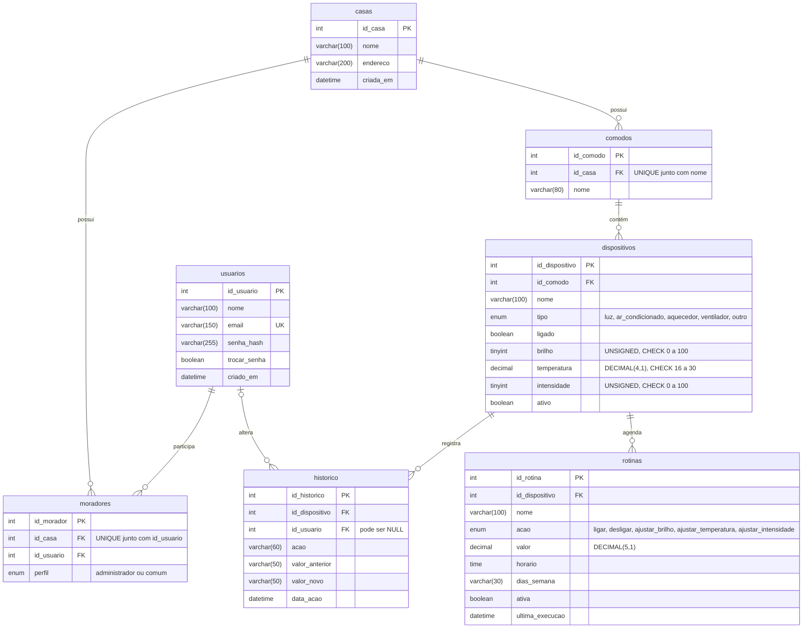
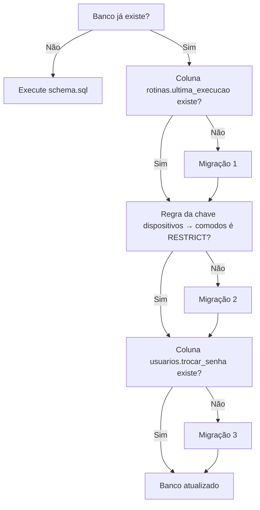

# Banco de dados do Habitus

Este documento descreve o banco MySQL do Habitus: a modelagem das sete tabelas, os mecanismos de integridade, a forma como o sistema grava e lê os dados, as migrações e o banco de testes. A fonte principal é `database/schema.sql`, confrontada com os repositórios em `backend/app/repositories/`.

Assuntos relacionados em outros documentos:

- quem abre cada transação e a lista de operações atômicas: [ARQUITETURA.md](ARQUITETURA.md#6-transações);
- como as classes usam os dados lidos: [ESTRUTURAS_E_POO.md](ESTRUTURAS_E_POO.md);
- instalação passo a passo: [README principal](../README.md#instalação-e-configuração).

## Sumário

1. [Visão geral](#1-visão-geral)
2. [Diagrama entidade-relacionamento](#2-diagrama-entidade-relacionamento)
3. [Tabelas](#3-tabelas)
4. [Relacionamentos](#4-relacionamentos)
5. [Integridade dos dados](#5-integridade-dos-dados)
6. [Transações e bloqueios](#6-transações-e-bloqueios)
7. [Operações e persistência](#7-operações-e-persistência)
8. [Instalação de um banco novo](#8-instalação-de-um-banco-novo)
9. [Migrações de bancos antigos](#9-migrações-de-bancos-antigos)
10. [Banco de testes](#10-banco-de-testes)
11. [Limitações e observações](#11-limitações-e-observações)
12. [Estado da verificação e fontes](#12-estado-da-verificação-e-fontes)

---

## 1. Visão geral

| Item | Valor | Onde |
| --- | --- | --- |
| Sistema gerenciador | MySQL **8.0.16 ou superior** (exigido pelas restrições `CHECK`) | Comentário inicial de `database/schema.sql` |
| Banco principal | `habitus_smart_home` | `schema.sql` e padrão de `DB_NAME` em `backend/app/config.py` |
| Codificação | `utf8mb4` com collation `utf8mb4_unicode_ci` | `CREATE DATABASE` em `schema.sql`; `charset="utf8mb4"` em `backend/app/database.py` |
| Tabelas | 7: `usuarios`, `casas`, `moradores`, `comodos`, `dispositivos`, `historico` e `rotinas` | `schema.sql` |
| Acesso pelo Python | PyMySQL, com `DictCursor` e `autocommit=False` | `backend/app/database.py` |
| Motor de armazenamento | Não declarado no script; o padrão do MySQL 8 é **InnoDB**, que oferece transações, chaves estrangeiras e bloqueio por linha | Comportamento do servidor, não verificado no ambiente |

O sistema não usa ORM: todo o SQL está escrito nos repositórios, com parâmetros `%s`.

## 2. Diagrama entidade-relacionamento

Nomes, tipos e chaves conferidos em `database/schema.sql`. Tamanhos e faixas que não cabem na notação do Mermaid aparecem como comentário entre aspas.



## 3. Tabelas

Convenções das tabelas abaixo: **PK** = chave primária; **FK** = chave estrangeira; **AI** = `AUTO_INCREMENT`. No MySQL, `BOOLEAN` é um sinônimo de `TINYINT(1)` e é lido pelo Python como `0` ou `1`.

### 3.1 `usuarios`

Pessoas que podem entrar no sistema. Uma conta não pertence a uma casa: o vínculo fica em `moradores`.

| Coluna | Tipo | Nulo | Padrão | Uso no código |
| --- | --- | :---: | --- | --- |
| `id_usuario` | `INT` PK AI | Não | — | Guardado na sessão como `usuario_id` |
| `nome` | `VARCHAR(100)` | Não | — | Exibido no menu e no histórico |
| `email` | `VARCHAR(150)` **UNIQUE** | Não | — | Login; gravado sempre em minúsculas pelos validadores |
| `senha_hash` | `VARCHAR(255)` | Não | — | Hash gerado por `generate_password_hash`; a senha nunca é gravada |
| `trocar_senha` | `BOOLEAN` | Não | `FALSE` | `1` para contas criadas com senha temporária |
| `criado_em` | `DATETIME` | Sim | `CURRENT_TIMESTAMP` | Não é exibido nem consultado pelo sistema |

Repositório: `backend/app/repositories/usuarios.py` (`inserir`, `buscar_por_email`, `buscar_por_id`, `atualizar_senha`).

### 3.2 `casas`

| Coluna | Tipo | Nulo | Padrão | Uso no código |
| --- | --- | :---: | --- | --- |
| `id_casa` | `INT` PK AI | Não | — | Guardado na sessão como `casa_id` (a casa aberta) |
| `nome` | `VARCHAR(100)` | Não | — | Exibido no menu lateral e em "Minha casa" |
| `endereco` | `VARCHAR(200)` | Sim | `NULL` | **Não é usado** pelo código |
| `criada_em` | `DATETIME` | Sim | `CURRENT_TIMESTAMP` | Não é exibido nem consultado |

Repositório: `backend/app/repositories/casas.py` (`inserir`, `listar_do_usuario`). Não há comando para alterar ou excluir casas.

### 3.3 `moradores`

Tabela associativa que liga usuários e casas e define o **perfil** de cada pessoa em cada casa.

| Coluna | Tipo | Nulo | Padrão | Uso no código |
| --- | --- | :---: | --- | --- |
| `id_morador` | `INT` PK AI | Não | — | Identifica o vínculo nas rotas `/casa/moradores/<id>/...`; também define a "primeira casa" da pessoa |
| `id_casa` | `INT` FK → `casas` | Não | — | Casa do vínculo |
| `id_usuario` | `INT` FK → `usuarios` | Não | — | Pessoa do vínculo |
| `perfil` | `ENUM('administrador', 'comum')` | Não | `'comum'` | Permissões; lido a cada requisição por `carregar_acesso()` |

Restrição: `UNIQUE (id_casa, id_usuario)` — a mesma pessoa só tem um vínculo por casa.

Repositório: `backend/app/repositories/moradores.py`.

### 3.4 `comodos`

| Coluna | Tipo | Nulo | Padrão | Uso no código |
| --- | --- | :---: | --- | --- |
| `id_comodo` | `INT` PK AI | Não | — | — |
| `id_casa` | `INT` FK → `casas` | Não | — | Casa do cômodo |
| `nome` | `VARCHAR(80)` | Não | — | Validado com 2 a 80 caracteres |

Restrição: `UNIQUE (id_casa, nome)` — nomes não se repetem na mesma casa (veja [5.2](#52-unique)).

Repositório: `backend/app/repositories/comodos.py`.

### 3.5 `dispositivos`

| Coluna | Tipo | Nulo | Padrão | Uso no código |
| --- | --- | :---: | --- | --- |
| `id_dispositivo` | `INT` PK AI | Não | — | — |
| `id_comodo` | `INT` FK → `comodos` | Não | — | Cômodo atual; muda na transferência |
| `nome` | `VARCHAR(100)` | Não | — | — |
| `tipo` | `ENUM('luz', 'ar_condicionado', 'aquecedor', 'ventilador', 'outro')` | Não | — | Escolhe a classe Python (`CLASSES` em `models/dispositivo.py`) |
| `ligado` | `BOOLEAN` | Não | `FALSE` | Estado ligado/desligado |
| `brilho` | `TINYINT UNSIGNED` | Sim | `NULL` | Só para `luz` |
| `temperatura` | `DECIMAL(4,1)` | Sim | `NULL` | Só para `ar_condicionado` e `aquecedor` |
| `intensidade` | `TINYINT UNSIGNED` | Sim | `NULL` | Só para `ventilador` |
| `ativo` | `BOOLEAN` | Não | `TRUE` | `0` quando o dispositivo é "removido" |

Restrições:

- `CONSTRAINT fk_dispositivos_comodo FOREIGN KEY (id_comodo) REFERENCES comodos(id_comodo) ON DELETE RESTRICT`;
- `CHECK (brilho IS NULL OR brilho BETWEEN 0 AND 100)`;
- `CHECK (intensidade IS NULL OR intensidade BETWEEN 0 AND 100)`;
- `CHECK (temperatura IS NULL OR temperatura BETWEEN 16 AND 30)`.

A tabela **não tem `id_casa`**: a casa de um dispositivo é obtida pelo cômodo, com `JOIN comodos`. Por isso todas as consultas de dispositivos da casa fazem esse `JOIN`.

Repositório: `backend/app/repositories/dispositivos.py`.

### 3.6 `historico`

Registro de cada alteração de dispositivo.

| Coluna | Tipo | Nulo | Padrão | Uso no código |
| --- | --- | :---: | --- | --- |
| `id_historico` | `INT` PK AI | Não | — | Desempate na ordenação |
| `id_dispositivo` | `INT` FK → `dispositivos` | Não | — | — |
| `id_usuario` | `INT` FK → `usuarios` | Sim | `NULL` | `NULL` quando a alteração veio de uma rotina |
| `acao` | `VARCHAR(60)` | Não | — | Ex.: `ligar`, `ajustar_brilho`, `transferir_comodo`, `Rotina: <nome>`; cortada em 60 caracteres pelo repositório |
| `valor_anterior` | `VARCHAR(50)` | Sim | — | Valor convertido em texto, cortado em 50 caracteres |
| `valor_novo` | `VARCHAR(50)` | Sim | — | Idem |
| `data_acao` | `DATETIME` | Sim | `CURRENT_TIMESTAMP` | Preenchida pelo MySQL, não pelo Python |

Os valores são gravados como texto porque a mesma coluna guarda informações de naturezas diferentes:

| Ação | `valor_anterior` → `valor_novo` |
| --- | --- |
| Ligar | `0` → `1` |
| Ajustar brilho | `80` → `45` |
| Ajustar temperatura | `22.0` → `24.5` |
| Transferir de cômodo | `Sala` → `Quarto` (nomes dos cômodos) |

Repositório: `backend/app/repositories/historico.py` (`registrar`, `listar_da_casa`).

### 3.7 `rotinas`

| Coluna | Tipo | Nulo | Padrão | Uso no código |
| --- | --- | :---: | --- | --- |
| `id_rotina` | `INT` PK AI | Não | — | Também desempata horários iguais no heap do executor |
| `id_dispositivo` | `INT` FK → `dispositivos` | Não | — | Aparelho controlado |
| `nome` | `VARCHAR(100)` | Não | — | — |
| `acao` | `ENUM('ligar', 'desligar', 'ajustar_brilho', 'ajustar_temperatura', 'ajustar_intensidade')` | Não | — | — |
| `valor` | `DECIMAL(5,1)` | Sim | `NULL` | Só para as ações `ajustar_*`; `NULL` para ligar e desligar |
| `horario` | `TIME` | Não | — | Lido pelo PyMySQL como `timedelta` e convertido em `"HH:MM"` |
| `dias_semana` | `VARCHAR(30)` | Não | `'todos'` | `'todos'` ou dias separados por vírgula (`'0,2,4'`, 0 = segunda) |
| `ativa` | `BOOLEAN` | Não | `TRUE` | `0` quando pausada |
| `ultima_execucao` | `DATETIME` | Sim | `NULL` | Gravada pelo executor; impede execução duplicada |

Repositório: `backend/app/repositories/rotinas.py`.

## 4. Relacionamentos

| Relação | Cardinalidade | Implementação |
| --- | --- | --- |
| Usuários ↔ casas | **N:N** | Tabela `moradores`, com um vínculo único por par e o perfil no vínculo |
| Casa → cômodos | 1:N | `comodos.id_casa` |
| Cômodo → dispositivos | 1:N | `dispositivos.id_comodo` |
| Dispositivo → histórico | 1:N | `historico.id_dispositivo` |
| Usuário → histórico | 0..1:N | `historico.id_usuario` pode ser `NULL` |
| Dispositivo → rotinas | 1:N | `rotinas.id_dispositivo` |

### 4.1 Participação em várias casas

Como a relação entre usuários e casas é N:N, uma mesma conta pode estar em várias casas, com perfis diferentes:

| `moradores` | `id_casa` | `id_usuario` | `perfil` |
| --- | :---: | :---: | --- |
| Ana na própria casa | 1 | 10 | `administrador` |
| Ana na casa de Bruno | 2 | 10 | `comum` |
| Bruno na própria casa | 2 | 11 | `administrador` |

O acesso à casa aberta é carregado em toda requisição por esta consulta (`repositories/moradores.py`):

```sql
SELECT u.id_usuario, u.nome, m.perfil, c.id_casa, c.nome AS nome_casa
FROM moradores m
JOIN usuarios u ON u.id_usuario = m.id_usuario
JOIN casas c ON c.id_casa = m.id_casa
WHERE m.id_usuario = %s AND m.id_casa = %s
```

Se a pessoa não participa mais da casa guardada na sessão, o sistema usa o vínculo de menor `id_morador` (`ORDER BY m.id_morador LIMIT 1`).

### 4.2 Pertencimento à casa por `JOIN`

Dispositivos, rotinas e histórico não guardam `id_casa`; a casa é descoberta pelo caminho `tabela → dispositivos → comodos`. É assim que o sistema impede que um usuário acesse dados de outra casa:

```sql
-- repositories/dispositivos.py → buscar_ativo()
SELECT d.*, c.id_casa, c.nome AS nome_comodo FROM dispositivos d
JOIN comodos c ON c.id_comodo = d.id_comodo
WHERE d.id_dispositivo = %s AND d.ativo = 1 AND c.id_casa = %s
```

O mesmo padrão aparece em `rotinas.CONSULTA_DA_CASA` e em `historico.listar_da_casa()`.

## 5. Integridade dos dados

### 5.1 `PRIMARY KEY` e `FOREIGN KEY`

- Toda tabela tem uma chave primária `INT AUTO_INCREMENT` (`id_<tabela no singular>`). O valor gerado é lido pelo Python com `cursor.lastrowid`, por exemplo ao criar o usuário e, em seguida, o vínculo de administrador.
- Há 7 chaves estrangeiras, listadas na [seção 5.4](#54-regras-de-exclusão-on-delete). Elas impedem, por exemplo, um vínculo com uma casa inexistente: o MySQL recusa com o erro **1452**, o que é verificado pelo teste de integração `test_relacionamentos_mysql`.
- O MySQL cria automaticamente um índice para cada chave estrangeira que ainda não tenha um. Esse é um comportamento do InnoDB, não declarado no script.

### 5.2 `UNIQUE`

| Restrição | Garante | Como o código trata a violação |
| --- | --- | --- |
| `usuarios.email` | Um e-mail por conta | `cadastrar_conta()` captura `IntegrityError` → "Esse e-mail ja esta cadastrado." |
| `moradores (id_casa, id_usuario)` | Um vínculo por pessoa e casa | O serviço consulta antes (`participa()`); em cadastros simultâneos, captura `IntegrityError` |
| `comodos (id_casa, nome)` | Nomes de cômodo únicos na casa | O serviço compara em Python (`nome_em_uso()`); em cadastros simultâneos, captura `IntegrityError` |

A collation `utf8mb4_unicode_ci` faz as comparações de texto **ignorarem maiúsculas e acentos**. O schema cita só as maiúsculas ("'Sala' = 'SALA'"). Consequência para os cômodos:

- a comparação em Python (`casefold()`) trata "Sala" e "SALA" como iguais, mas "Escritorio" e "Escritório" como diferentes;
- o `UNIQUE` do banco deve tratar os dois como iguais e recusar o segundo nome;
- o serviço converte esse erro na mesma mensagem de nome repetido.

Esse efeito decorre da collation e **não foi verificado num MySQL real**.

### 5.3 `CHECK`, `ENUM`, `NOT NULL` e `DEFAULT`

- **`CHECK`** limita brilho, intensidade e temperatura (seção 3.5). O MySQL só aplica `CHECK` a partir da versão 8.0.16; antes disso, a cláusula é aceita e ignorada.
- **`ENUM`** restringe `moradores.perfil`, `dispositivos.tipo` e `rotinas.acao` aos valores listados.
- **Validação dupla:** essas regras também existem no Python, que valida antes de gravar:

  | Regra | No Python | No banco |
  | --- | --- | --- |
  | Faixas de ajuste | Atributo `ajuste` das classes de dispositivo | `CHECK` |
  | Tipos de dispositivo | `CLASSES` | `ENUM` |
  | Ações de rotina | `ACOES` (`models/rotina.py`) | `ENUM` |
  | Perfis | `Usuario.PERFIS` | `ENUM` |
  | Tamanho dos textos | `validators/` | `VARCHAR(n)` |

  O banco funciona como última barreira caso algum caminho do código deixe passar um valor inválido.
- **`NOT NULL` e `DEFAULT`** garantem valores iniciais coerentes: um dispositivo novo nasce desligado e ativo; uma rotina nova nasce ativa, com `dias_semana = 'todos'` se nada for informado.

### 5.4 Regras de exclusão (`ON DELETE`)

| Chave estrangeira | Regra | Efeito ao apagar o registro referenciado |
| --- | --- | --- |
| `moradores.id_casa` → `casas` | `CASCADE` | Apaga os vínculos da casa |
| `moradores.id_usuario` → `usuarios` | `CASCADE` | Apaga os vínculos do usuário |
| `comodos.id_casa` → `casas` | `CASCADE` | Apaga os cômodos da casa |
| `dispositivos.id_comodo` → `comodos` (`fk_dispositivos_comodo`) | **`RESTRICT`** | **Impede** apagar um cômodo que ainda tenha dispositivos ligados a ele, ativos ou removidos |
| `historico.id_dispositivo` → `dispositivos` | `CASCADE` | Apagaria o histórico do dispositivo |
| `historico.id_usuario` → `usuarios` | **`SET NULL`** | Mantém o histórico e deixa o responsável vazio |
| `rotinas.id_dispositivo` → `dispositivos` | `CASCADE` | Apaga as rotinas do dispositivo |

O que o sistema realmente apaga:

| `DELETE` executado pelo sistema | Regras envolvidas |
| --- | --- |
| `comodos` (`excluir_comodo`) | `RESTRICT`. O serviço só chega ao `DELETE` se a contagem de dispositivos do cômodo, ativos ou não, for zero; o `RESTRICT` é a garantia no banco |
| `moradores` (`remover_morador`) | Nenhuma: nenhuma tabela referencia `moradores` |
| `rotinas` (`remover_rotina`) | Nenhuma: nenhuma tabela referencia `rotinas` |

O sistema **nunca** apaga casas, usuários ou dispositivos. Por isso os `CASCADE` dessas tabelas e o `SET NULL` do histórico só seriam acionados por comandos executados diretamente no banco. Dispositivos são "removidos" com `UPDATE ... SET ativo = 0`, o que preserva o histórico.

## 6. Transações e bloqueios

### 6.1 `COMMIT` e `ROLLBACK`

A conexão é aberta com `autocommit=False`, e `transacao()` (`backend/app/database.py`) faz `commit()` ao final do bloco ou `rollback()` se ocorrer qualquer exceção. O funcionamento e a lista completa de operações atômicas estão em [ARQUITETURA.md](ARQUITETURA.md#6-transações).

Exemplo do que o `ROLLBACK` protege: ao adicionar um morador sem conta, a conta é criada e, em seguida, o vínculo. Se o `INSERT` em `moradores` falhar por `UNIQUE` (um cadastro simultâneo), o `IntegrityError` sai de dentro do bloco `with transacao()`. O `rollback()` desfaz também a conta recém-criada, e só depois o serviço converte o erro em `ValueError`. Teste: `test_cadastro_simultaneo_vira_mensagem_e_desfaz_a_transacao`.

### 6.2 `SELECT ... FOR UPDATE`

Os repositórios aceitam `bloquear=True`, que acrescenta `FOR UPDATE` à consulta. No InnoDB, isso bloqueia as linhas lidas até o fim da transação, de modo que outra transação que queira alterá-las espera.

| Função do repositório | Bloqueia | Usada por |
| --- | --- | --- |
| `dispositivos.buscar_ativo` | O dispositivo (e a linha de cômodo do `JOIN`) | Controle, transferência e execução de rotina |
| `comodos.buscar` | O cômodo | Renomear, excluir e o cômodo de destino da transferência |
| `moradores.buscar` | O vínculo | Mudar perfil e remover morador |
| `usuarios.buscar_por_email` | A conta (quando existe) | Adicionar morador |
| `rotinas.buscar_da_casa` | A rotina | Editar, pausar e excluir |
| `rotinas.buscar_por_id` | A rotina | Executor, antes de executar |

Exemplo do executor (`services/rotinas.py` → `executar_rotina()`):

1. relê a rotina com bloqueio;
2. confirma que ela ainda está pendente (ativa, no horário, no dia, sem execução para esse horário);
3. bloqueia o dispositivo;
4. aplica a ação e grava o histórico;
5. grava `ultima_execucao`.

Se dois processos tentassem executar a mesma rotina, o segundo esperaria o primeiro terminar e, ao reler, encontraria `ultima_execucao` atualizada.

O código não altera o nível de isolamento das transações; vale o padrão do servidor. O comportamento sob acessos simultâneos **não foi testado num MySQL real**.

## 7. Operações e persistência

Os serviços abrem a transação e chamam os repositórios, que executam o SQL. Os comandos abaixo foram copiados dos repositórios, com espaços reduzidos.

### 7.1 Conta e casa (`services/autenticacao.py` → `cadastrar_conta`)

```sql
INSERT INTO usuarios (nome, email, senha_hash) VALUES (%s, %s, %s);
INSERT INTO casas (nome) VALUES (%s);
INSERT INTO moradores (id_casa, id_usuario, perfil) VALUES (%s, %s, %s);
-- com a opção "sugeridos", para Sala, Quarto e Cozinha:
INSERT INTO comodos (id_casa, nome) VALUES (%s, %s);
-- e um dispositivo de exemplo na Sala e no Quarto:
INSERT INTO dispositivos (id_comodo, nome, tipo, brilho, temperatura, intensidade)
VALUES (%s, %s, %s, %s, %s, %s);
```

O serviço passa `'administrador'` como valor do perfil; os ids gerados (`lastrowid`) ligam cada `INSERT` ao anterior.

### 7.2 Moradores (`services/moradores.py`)

| Situação | Comandos |
| --- | --- |
| E-mail sem conta | `SELECT * FROM usuarios WHERE email = %s FOR UPDATE` → `INSERT INTO usuarios (nome, email, senha_hash, trocar_senha) VALUES (%s, %s, %s, 1)` → `INSERT INTO moradores` |
| E-mail com conta | Mesmo `SELECT ... FOR UPDATE` → `SELECT 1 FROM moradores WHERE id_usuario = %s AND id_casa = %s` → `INSERT INTO moradores` |
| Mudar perfil | `SELECT * FROM moradores WHERE id_morador = %s AND id_casa = %s FOR UPDATE` → `UPDATE moradores SET perfil = %s WHERE id_morador = %s` |
| Remover acesso | Mesmo `SELECT` → `DELETE FROM moradores WHERE id_morador = %s` |

### 7.3 Cômodos (`services/comodos.py`)

- **Criar:** lista os cômodos da casa (`SELECT id_comodo, nome FROM comodos WHERE id_casa = %s ORDER BY nome`), compara os nomes em Python e insere.
- **Excluir:** conta os dispositivos do cômodo antes do `DELETE`:

  ```sql
  SELECT COUNT(*) AS total, COALESCE(SUM(ativo = 1), 0) AS ativos
  FROM dispositivos WHERE id_comodo = %s
  ```

  Com `ativos > 0`, a mensagem pede a transferência; com `total > 0` e nenhum ativo, explica que o cômodo guarda histórico. O `DELETE` só acontece com `total = 0`.
- **Transferir dispositivo:** `UPDATE dispositivos SET id_comodo = %s WHERE id_dispositivo = %s`, mais o registro `transferir_comodo` no histórico. Rotinas e histórico continuam ligados ao mesmo `id_dispositivo`. Só dispositivos ativos podem ser transferidos (a busca usa `buscar_ativo`); depois de transferidos, deixam de contar para o cômodo de origem.

### 7.4 Dispositivos (`services/dispositivos.py`)

- **Cadastrar:** confere se o cômodo é da casa e insere com os valores de `configuracao_inicial()` da classe (ex.: luz com `brilho = 80` e as demais colunas `NULL`).
- **Controlar:** a coluna do `UPDATE` vem da classe, nunca do formulário, e é conferida na lista `CAMPOS_CONTROLE`:

  ```sql
  UPDATE dispositivos SET brilho = %s WHERE id_dispositivo = %s;
  INSERT INTO historico (id_dispositivo, id_usuario, acao, valor_anterior, valor_novo)
  VALUES (%s, %s, %s, %s, %s);
  ```

- **Remover:** o próprio `UPDATE` confere a casa, e as rotinas do aparelho são pausadas na mesma transação:

  ```sql
  UPDATE dispositivos d JOIN comodos c ON c.id_comodo = d.id_comodo
  SET d.ativo = 0
  WHERE d.id_dispositivo = %s AND c.id_casa = %s AND d.ativo = 1;
  UPDATE rotinas SET ativa = 0 WHERE id_dispositivo = %s;
  ```

  `cursor.rowcount` indica se algum dispositivo foi desativado; se for zero, o serviço responde "Dispositivo nao encontrado.".

### 7.5 Rotinas (`services/rotinas.py`)

| Operação | Comando principal |
| --- | --- |
| Criar | `INSERT INTO rotinas (id_dispositivo, nome, acao, valor, horario, dias_semana) VALUES (...)` |
| Editar | `UPDATE rotinas SET id_dispositivo = %s, nome = %s, acao = %s, valor = %s, horario = %s, dias_semana = %s WHERE id_rotina = %s` |
| Pausar ou ativar | `UPDATE rotinas SET ativa = 1 - ativa WHERE id_rotina = %s` |
| Excluir | `DELETE FROM rotinas WHERE id_rotina = %s` |
| Listar para o executor | `SELECT r.* FROM rotinas r JOIN dispositivos d ON ... WHERE r.ativa = 1 AND d.ativo = 1` (todas as casas) |
| Marcar execução | `UPDATE rotinas SET ultima_execucao = %s WHERE id_rotina = %s` |

Antes de criar ou editar, o valor é validado pela classe do dispositivo, e `valor` fica `NULL` para ligar e desligar. A coluna `ultima_execucao` recebe o horário da verificação em que a rotina rodou (`agora`), e não o horário programado.

### 7.6 Histórico (`repositories/historico.py`)

- **Gravação:** sempre pela função `registrar()`, chamada por `salvar_alteracao()` (controle manual e rotinas) e por `transferir_dispositivo()`.
- **Leitura:**

  ```sql
  SELECT h.*, d.nome AS dispositivo, c.nome AS comodo, u.nome AS usuario
  FROM historico h
  JOIN dispositivos d ON d.id_dispositivo = h.id_dispositivo
  JOIN comodos c ON c.id_comodo = d.id_comodo
  LEFT JOIN usuarios u ON u.id_usuario = h.id_usuario
  WHERE c.id_casa = %s ORDER BY h.data_acao DESC, h.id_historico DESC
  LIMIT %s
  ```

  - O `LEFT JOIN` mantém os registros sem usuário, exibidos como "Automação".
  - Não há filtro por `d.ativo`, então o histórico de dispositivos removidos continua aparecendo.
  - O limite é 100 em `/historico` e 6 no painel.

### 7.7 Conversão de tipos entre MySQL e Python

| Tipo no MySQL | Chega ao Python como | Tratamento no código |
| --- | --- | --- |
| `BOOLEAN` (`TINYINT(1)`) | `int` (`0` ou `1`) | `bool(...)` nos modelos e nos templates |
| `DECIMAL(4,1)`, `DECIMAL(5,1)` | `decimal.Decimal` | Filtro `numero` e `formatar_numero()` (`22.0` → `22`; `22.5` → `22,5`) |
| `TIME` | `datetime.timedelta` | `formatar_horario()` → `"HH:MM"` |
| `DATETIME` | `datetime.datetime` | `strftime()` nos templates |
| Linha de `SELECT` | `dict` (`DictCursor`) | Acesso por nome de coluna |

## 8. Instalação de um banco novo

1. Execute `database/schema.sql` inteiro (MySQL Workbench ou cliente `mysql`). Ele:
   - cria o banco `habitus_smart_home`, se ainda não existir;
   - cria as sete tabelas, se ainda não existirem, já com `ultima_execucao`, `trocar_senha` e a chave `RESTRICT`;
   - termina com `SHOW TABLES` para conferência.
2. **Não** execute as migrações num banco criado por esta versão do `schema.sql`: as colunas e a chave já existem.
3. Os `INSERT` no final do script estão **comentados** e servem só de exemplo; o cadastro real é feito pelo site, que gera o hash da senha.

> [!WARNING]
> `CREATE TABLE IF NOT EXISTS` não altera tabelas que já existem. Executar o `schema.sql` sobre um banco antigo **não** o atualiza; para isso servem as migrações.

## 9. Migrações de bancos antigos

As três migrações em `database/` levam um banco de uma versão anterior ao formato atual. Elas indicam o que mudou entre as versões: a falta de `ultima_execucao`, a chave `CASCADE` entre dispositivos e cômodos e a falta de `trocar_senha`.

### 9.1 Scripts e ordem

| Ordem | Script | Comando principal | Necessária para |
| :---: | --- | --- | --- |
| 1 | `migracao_se_ja_criou_banco.sql` | `ALTER TABLE rotinas ADD COLUMN ultima_execucao DATETIME DEFAULT NULL` | O executor de rotinas, que lê e grava a coluna |
| 2 | `migracao_comodos.sql` | `DROP FOREIGN KEY dispositivos_ibfk_1` e `ADD CONSTRAINT fk_dispositivos_comodo ... ON DELETE RESTRICT` | A garantia, no banco, de que excluir um cômodo não apaga dispositivos |
| 3 | `migracao_moradores.sql` | `ALTER TABLE usuarios ADD COLUMN trocar_senha BOOLEAN NOT NULL DEFAULT FALSE AFTER senha_hash` | Cadastrar morador sem conta e trocar a senha temporária |

### 9.2 Como saber o que falta

Estas consultas apenas leem a estrutura e podem ser feitas antes de decidir:

```sql
SHOW COLUMNS FROM rotinas LIKE 'ultima_execucao';
SHOW COLUMNS FROM usuarios LIKE 'trocar_senha';
SELECT CONSTRAINT_NAME, DELETE_RULE
FROM information_schema.REFERENTIAL_CONSTRAINTS
WHERE CONSTRAINT_SCHEMA = 'habitus_smart_home'
  AND TABLE_NAME = 'dispositivos' AND REFERENCED_TABLE_NAME = 'comodos';
```



### 9.3 Cuidados

- **Faça backup antes.** Comandos `ALTER TABLE` são DDL: no MySQL, eles confirmam a transação automaticamente e **não podem ser desfeitos com `ROLLBACK`**.
- **Execute cada script uma vez.** As migrações 1 e 3 falham se a coluna já existir; nenhuma usa `IF NOT EXISTS`.
- **Confira o nome da chave na migração 2.** O script supõe `dispositivos_ibfk_1` e mostra o nome real numa consulta antes do `DROP`. Se for diferente, ajuste o nome numa cópia do script. Entre o `DROP` e o `ADD`, a tabela fica momentaneamente sem a chave.
- **O nome do banco está fixo:** todos os scripts usam `USE habitus_smart_home`, e a migração 2 também filtra por `CONSTRAINT_SCHEMA = 'habitus_smart_home'`. Com outro `DB_NAME`, use cópias adaptadas.
- **Nenhuma migração apaga tabelas ou registros.** Na migração 3, os usuários existentes recebem `trocar_senha = 0`.

### 9.4 Compatibilidade do código com bancos sem migração

| Funcionalidade | Sem a coluna `trocar_senha` | Sem a coluna `ultima_execucao` |
| --- | --- | --- |
| Login | Funciona: a rota usa `usuario.get("trocar_senha")` | — |
| Cadastro de conta | Funciona: `repositories/usuarios.py` → `inserir()` omite a coluna quando ela não é necessária | — |
| Cadastro de morador sem conta | **Falha**: o `INSERT` usa a coluna | — |
| Troca de senha temporária | **Falha**: o `UPDATE` usa a coluna | — |
| Executor de rotinas | — | **Falha**: `rotina_pendente()` lê a chave `ultima_execucao` e `marcar_execucao()` grava a coluna |

## 10. Banco de testes

| | `habitus_smart_home` | `habitus_testes` |
| --- | --- | --- |
| Finalidade | Dados do sistema em uso | Testes de integração |
| Usado por | O site e o executor (`DB_NAME`) | Somente `tests/test_integracao_mysql.py` |
| Como o nome é definido | `DB_NAME` no `.env` (padrão `habitus_smart_home`) | Fixo no código do teste |
| Criado por | `database/schema.sql` | **Nenhum script do projeto** |
| Credenciais | `DB_USER` e `DB_PASSWORD` do `.env` | As mesmas variáveis, lidas somente do `.env` da raiz |

### 10.1 O que os testes de integração fazem

| Teste | Verifica |
| --- | --- |
| `test_conexao_mysql` | Conecta ao `habitus_testes` e confere se existem **exatamente** as 7 tabelas |
| `test_crud_usuarios_mysql` | `INSERT`, `SELECT`, `UPDATE` e `DELETE` em `usuarios`, com e-mail aleatório `@example.invalid` |
| `test_relacionamentos_mysql` | Vínculos em `moradores`, recusa de usuário e casa inexistentes (erro 1452) e de vínculo duplicado (erro 1062), com `FOREIGN_KEY_CHECKS` ativo |

Cuidados já presentes no código dos testes:

- conferem `SELECT DATABASE()` antes de gravar;
- usam `autocommit=False`;
- fazem `rollback()` no bloco `finally`, mesmo se o teste falhar.

Os testes usam SQL direto: validam o **esquema**, e não os repositórios nem os serviços.

### 10.2 Pré-requisitos

1. MySQL 8.0.16+ em execução, com `DB_USER` e `DB_PASSWORD` no `.env` **da raiz do projeto** (o teste não lê `backend/.env`).
2. Um banco `habitus_testes` com as mesmas sete tabelas do `schema.sql`, criado manualmente. Uma forma é usar uma **cópia** do `schema.sql` em que o nome aparece trocado nas linhas `CREATE DATABASE` e `USE`, sem alterar o arquivo original.
3. O usuário do MySQL precisa ter permissão nesse banco.

Comando, a executar somente com o ambiente conferido:

```powershell
python -m pytest -v tests/test_integracao_mysql.py
```

Situação: os três testes de integração foram **executados e aprovados em 09/11/2026** no banco `habitus_testes` (`3 passed in 0.50s`; Python 3.14.6, pytest 9.2.0). Na elaboração inicial deste documento, em 08/11/2026, eles ainda não tinham sido executados. Sem MySQL, eles **falham** em vez de serem pulados, inclusive quando se executa `python -m pytest -v` sem exclusões.

## 11. Limitações e observações

- **Nome do banco fixo nos scripts:** `schema.sql` e as migrações usam `habitus_smart_home`.
- **Coluna sem uso:** `casas.endereco` existe, mas não é lida nem gravada; `criado_em` e `criada_em` não são exibidos.
- **Cômodos com dispositivos removidos:** como dispositivos são desativados, e não apagados, um dispositivo removido continua ligado ao cômodo e bloqueia a exclusão dele. Como removidos não podem ser transferidos nem restaurados pela interface, esse cômodo não pode mais ser excluído. Já um cômodo cujos dispositivos foram todos transferidos para outro pode ser excluído.
- **Histórico limitado na tela:** o banco guarda todos os registros, mas as telas mostram no máximo 100 (histórico) ou 6 (painel). Não há paginação nem limpeza.
- **Duas fontes de horário:** `historico.data_acao` usa o relógio do MySQL (`CURRENT_TIMESTAMP`), enquanto `rotinas.ultima_execucao` recebe o horário do Python. Com fusos diferentes, os horários ficam inconsistentes.
- **Uma conexão por transação:** não há reaproveitamento de conexões (veja [ARQUITETURA.md](ARQUITETURA.md#8-decisões-de-projeto-e-consequências)).
- **Regras repetidas no código e no esquema:** tipos, ações e perfis estão nas classes Python e nos `ENUM`; mudar um exige mudar o outro.
- **Collation e acentos:** veja a [seção 5.2](#52-unique).

## 12. Estado da verificação e fontes

Conferido com o código e os scripts em 08/11/2026.

**Testado com banco falso** (testes isolados aprovados em 08/11/2026):

- SQL e ordem dos comandos no controle de dispositivo (`test_alteracao_grava_estado_e_historico`) e na execução de rotina (`test_rotina_executa_e_registra_historico`);
- transferência sem `DELETE` e com registro no histórico (`test_transfere_dispositivo_sem_perder_dados`);
- desativação com pausa das rotinas (`test_remover_dispositivo_preserva_historico`);
- bloqueio da exclusão de cômodos com dispositivos ativos ou removidos (`test_nao_exclui_comodo_com_dispositivos`, `test_nao_exclui_comodo_que_guarda_historico_de_dispositivo_removido`);
- tratamento de `IntegrityError` (`test_indice_unique_do_banco_tambem_e_tratado`, `test_cadastro_simultaneo_vira_mensagem_e_desfaz_a_transacao`);
- `INSERT` com `trocar_senha` para morador novo (`test_cadastra_novo_morador_com_senha_temporaria`);
- login de conta sem a coluna `trocar_senha` (`test_login_de_conta_antiga_continua_normal`);
- commit e rollback de `transacao()` (`test_transacao_confirma_ou_desfaz_tudo`).

Esses testes isolados também passaram na suíte completa de 09/11/2026 (`144 passed`).

**Testado num MySQL real** (os 3 testes de integração, aprovados em 09/11/2026 no banco `habitus_testes`):

- existência de **exatamente** as 7 tabelas (`test_conexao_mysql`);
- `INSERT`, `SELECT`, `UPDATE` e `DELETE` em `usuarios` (`test_crud_usuarios_mysql`);
- chaves estrangeiras de `moradores` recusando usuário e casa inexistentes (erro 1452) e a chave única recusando vínculo duplicado (erro 1062), com `FOREIGN_KEY_CHECKS` ativo (`test_relacionamentos_mysql`).

Esses testes usam SQL próprio e o banco `habitus_testes`: não executam o SQL dos repositórios e não verificam o banco principal `habitus_smart_home`.

**Verificado no código e nos scripts**, sem teste automatizado:

- todas as colunas, tipos, chaves e restrições das seções 2 a 5;
- os comandos SQL da seção 7;
- o conteúdo das migrações e a compatibilidade da seção 9.4;
- a conversão de tipos da seção 7.7, conferida pelo tratamento feito no código.

**Não verificado** (depende de um MySQL real):

- aplicação efetiva de `CHECK`, `ENUM`, `RESTRICT`, `CASCADE` e `SET NULL`;
- `UNIQUE` e chaves estrangeiras fora de `moradores`;
- o SQL dos repositórios executado num MySQL real;
- bloqueios `FOR UPDATE` sob acessos simultâneos;
- motor InnoDB e nível de isolamento do servidor;
- comportamento da collation com acentos.

**Fontes:**

- `database/schema.sql`, `database/migracao_se_ja_criou_banco.sql`, `database/migracao_comodos.sql`, `database/migracao_moradores.sql`;
- `backend/app/database.py`, `backend/app/config.py`, `backend/app/repositories/` (os 7 arquivos);
- `backend/app/services/autenticacao.py`, `comodos.py`, `dispositivos.py`, `moradores.py`, `rotinas.py`, `casas.py`;
- `backend/app/routes/autenticacao.py`, `backend/app/models/rotina.py`;
- `tests/test_integracao_mysql.py`, `tests/test_servicos.py`, `tests/test_comodos.py`, `tests/test_moradores.py`.
