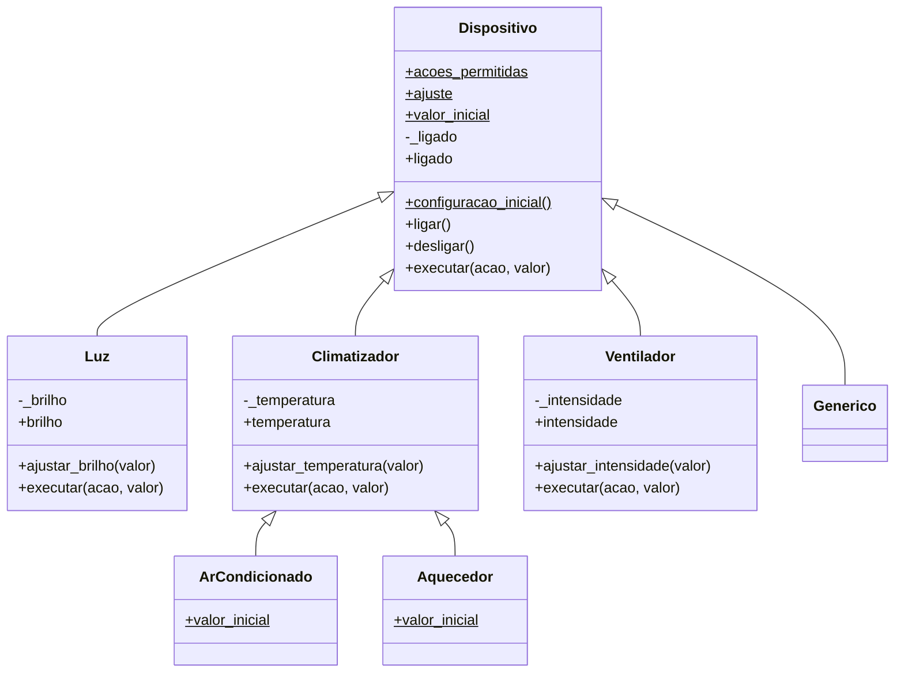
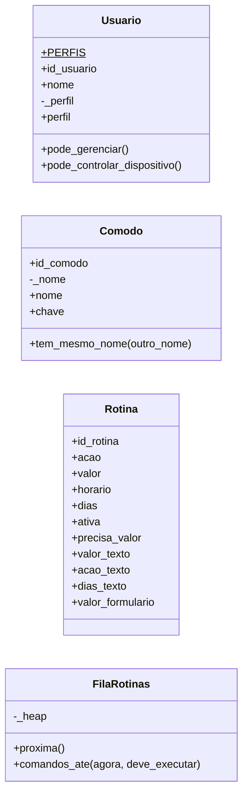
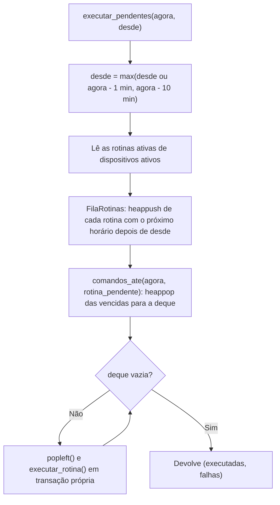

# Orientação a Objetos e Estruturas de Dados no Habitus

Este documento mostra onde e como o Habitus aplica **Programação Orientada a Objetos** e **Estruturas de Dados**, com exemplos retirados do código. Os caminhos partem da raiz do projeto.

Assuntos relacionados em outros documentos:

- camadas, dependências e transações: [ARQUITETURA.md](ARQUITETURA.md);
- tabelas e tipos do MySQL: [BANCO_DE_DADOS.md](BANCO_DE_DADOS.md);
- processo do executor, laço e terminal: [EXECUTOR_ROTINAS.md](EXECUTOR_ROTINAS.md);
- testes citados ao longo do texto: [TESTES.md](TESTES.md).

## Sumário

**Parte 1 — Programação Orientada a Objetos**

1. [Visão geral das classes](#1-visão-geral-das-classes)
2. [Diagramas de classes](#2-diagramas-de-classes)
3. [Classes e objetos](#3-classes-e-objetos)
4. [Atributos e métodos](#4-atributos-e-métodos)
5. [Encapsulamento](#5-encapsulamento)
6. [Herança](#6-herança)
7. [Polimorfismo](#7-polimorfismo)
8. [Abstração e reaproveitamento](#8-abstração-e-reaproveitamento)
9. [Usuario, Comodo e Rotina](#9-usuario-comodo-e-rotina)

**Parte 2 — Estruturas de Dados**

10. [Visão geral das estruturas](#10-visão-geral-das-estruturas)
11. [Estruturas básicas](#11-estruturas-básicas)
12. [A classe FilaRotinas](#12-a-classe-filarotinas)
13. [Agendamento passo a passo](#13-agendamento-passo-a-passo)
14. [Análise de complexidade](#14-análise-de-complexidade)

**Encerramento**

15. [Limitações e observações](#15-limitações-e-observações)
16. [Roteiro para demonstração](#16-roteiro-para-demonstração)
17. [Estado da verificação e fontes](#17-estado-da-verificação-e-fontes)

---

# Parte 1 — Programação Orientada a Objetos

## 1. Visão geral das classes

O pacote `backend/app/` tem **12 classes**, contadas no código em 08/11/2026:

| Classe | Arquivo | Responsabilidade |
| --- | --- | --- |
| `Dispositivo` | `backend/app/models/dispositivo.py` | Comportamento comum: estado ligado/desligado e o método `executar()` |
| `Luz` | `backend/app/models/dispositivo.py` | Acrescenta o ajuste de brilho |
| `Climatizador` | `backend/app/models/dispositivo.py` | Reúne o ajuste de temperatura compartilhado |
| `ArCondicionado` | `backend/app/models/dispositivo.py` | Climatizador que começa em 22 °C |
| `Aquecedor` | `backend/app/models/dispositivo.py` | Climatizador que começa em 25 °C |
| `Ventilador` | `backend/app/models/dispositivo.py` | Acrescenta o ajuste de intensidade |
| `Generico` | `backend/app/models/dispositivo.py` | Aparelho do tipo `outro`, que só liga e desliga |
| `Usuario` | `backend/app/models/usuario.py` | Perfil de uma pessoa na casa aberta e suas permissões |
| `Comodo` | `backend/app/models/comodo.py` | Nome validado de um cômodo e comparação sem diferenciar maiúsculas |
| `Rotina` | `backend/app/models/rotina.py` | Converte uma linha da tabela `rotinas` em textos para a tela |
| `FilaRotinas` | `backend/app/structures/fila_rotinas.py` | Agenda de rotinas com `heapq` e `deque` |
| `Config` | `backend/app/config.py` | Conjunto de configurações lido pelo Flask; não participa da modelagem do domínio |

## 2. Diagramas de classes

### 2.1 Hierarquia dos dispositivos



Leitura do diagrama: `$` marca atributos e métodos de **classe**; `-` marca atributos internos, por convenção do Python (prefixo `_`); nomes públicos sem parênteses, como `ligado` e `brilho`, são **propriedades** somente leitura.

### 2.2 Demais classes do domínio



O diagrama de `Rotina` mostra só os atributos principais; a classe também guarda `id_dispositivo`, `nome`, `nome_dispositivo` e `nome_comodo`.

## 3. Classes e objetos

Cada linha da tabela `dispositivos` chega do banco como um dicionário. O sistema escolhe a classe certa pelo campo `tipo` e cria o objeto:

```python
# backend/app/models/dispositivo.py
CLASSES = {
    "luz": Luz,
    "ar_condicionado": ArCondicionado,
    "aquecedor": Aquecedor,
    "ventilador": Ventilador,
    "outro": Generico,
}

def criar_dispositivo(dados):
    return classe_do_tipo(dados.get("tipo"))(dados)
```

Os objetos de dispositivo têm **vida curta**: são criados no início de uma operação, executam a ação e devolvem o resultado ao serviço, que grava o novo estado no MySQL. O estado oficial está sempre no banco; o objeto é o lugar onde as regras do aparelho são aplicadas.

| Onde um dispositivo é instanciado | Para quê |
| --- | --- |
| `services/dispositivos.py` → `alterar_dispositivo()` | Executar um controle manual |
| `services/rotinas.py` → `salvar_rotina()` | Validar a ação e o valor de uma rotina, sem gravar o estado |
| `services/rotinas.py` → `executar_rotina()` | Aplicar a ação de uma rotina no horário |

A classe `Dispositivo` não é declarada como abstrata (não usa o módulo `abc`), mas nenhum tipo do banco aponta diretamente para ela: na prática, ela serve como classe base.

## 4. Atributos e métodos

### 4.1 Atributos de classe e de instância

| Tipo | Exemplo | Significado |
| --- | --- | --- |
| Atributo de classe | `Dispositivo.acoes_permitidas` (`frozenset`) | Ações que o tipo aceita, iguais para todos os objetos da classe |
| Atributo de classe | `Luz.ajuste` (`dict`) | Ação, coluna, título, limites, passo e unidade do ajuste |
| Atributo de classe | `ArCondicionado.valor_inicial = 22` | Valor do ajuste no cadastro |
| Atributo de classe | `Usuario.PERFIS` (`tuple`) | Perfis válidos |
| Atributo de instância | `self._ligado`, `self._brilho`, `self._temperatura`, `self._intensidade` | Estado de um aparelho específico |
| Atributo de instância | `Comodo.id_comodo`, `Comodo._nome` | Identificador e nome validado |

### 4.2 Tipos de método

| Tipo | Exemplo | Uso |
| --- | --- | --- |
| Construtor | `Luz.__init__(self, dados)` | Chama `super().__init__(dados)` e lê o brilho |
| Método de instância | `ligar()`, `ajustar_brilho(valor)`, `executar(acao, valor)` | Alteram o estado e devolvem `(coluna, valor anterior, valor novo)` |
| Método de classe (`@classmethod`) | `Dispositivo.configuracao_inicial()` | Valores das colunas `brilho`, `temperatura` e `intensidade` ao cadastrar |
| Propriedade (`@property`) | `ligado`, `brilho`, `Usuario.perfil`, `Comodo.chave`, `Rotina.dias_texto` | Leitura controlada ou valor calculado |

O método de classe usa `cls`, então responde de acordo com a subclasse que o chamou:

```python
# backend/app/models/dispositivo.py
@classmethod
def configuracao_inicial(cls):
    configuracao = {"brilho": None, "temperatura": None, "intensidade": None}
    if cls.ajuste:
        configuracao[cls.ajuste["campo"]] = cls.valor_inicial
    return configuracao
```

`Luz.configuracao_inicial()` devolve brilho 80; `Aquecedor.configuracao_inicial()`, temperatura 25; `Generico.configuracao_inicial()`, as três colunas vazias.

## 5. Encapsulamento

O estado de um aparelho fica em atributos com prefixo `_` e é lido por propriedades sem *setter*. Ele só muda pelos métodos que validam o valor **antes** de alterá-lo:

```python
# backend/app/models/dispositivo.py (classe Luz)
@property
def brilho(self):
    return self._brilho

def ajustar_brilho(self, valor):
    novo = numero_inteiro(valor, self.ajuste["minimo"], self.ajuste["maximo"], "O brilho")
    anterior = self._brilho
    self._brilho = novo
    return "brilho", anterior, novo
```

- Se o valor for inválido, `numero_inteiro()` levanta `ValueError` antes da atribuição, e o objeto continua com o valor anterior.
- Tentar atribuir `luz.brilho = 50` causa `AttributeError`, porque a propriedade não tem *setter*.
- No Python, o prefixo `_` é uma **convenção**: ele indica uso interno, mas não impede o acesso direto. O encapsulamento depende da disciplina do código, que nunca altera `_brilho` fora da própria classe.

O mesmo padrão aparece fora dos dispositivos:

| Classe | Encapsulamento |
| --- | --- |
| `Usuario` | `_perfil` só é lido pela propriedade `perfil`; as decisões ficam em `pode_gerenciar()` e `pode_controlar_dispositivo()` |
| `Comodo` | O construtor valida o nome com `validar_nome_comodo()`; não é possível criar um `Comodo` com nome inválido |

Testes que demonstram: `test_encapsulamento_mantem_o_valor_valido` e `test_temperatura_invalida_nao_muda_o_objeto` (em `tests/test_modelos.py`), e `test_nome_invalido_e_recusado` (em `tests/test_comodos.py`).

## 6. Herança

```text
Dispositivo                ligar(), desligar(), executar() básico
├── Luz                    + ajuste de brilho
├── Climatizador           + ajuste de temperatura
│   ├── ArCondicionado     muda só valor_inicial (22)
│   └── Aquecedor          muda só valor_inicial (25)
├── Ventilador             + ajuste de intensidade
└── Generico               herda tudo, sem acréscimos
```

| Classe | Herda | Acrescenta ou substitui |
| --- | --- | --- |
| `Luz` | Estado ligado, `ligar()`, `desligar()` | `_brilho`, `ajustar_brilho()`, novo `executar()` |
| `Climatizador` | O mesmo de `Luz` | `_temperatura`, `ajustar_temperatura()`, novo `executar()` |
| `ArCondicionado`, `Aquecedor` | Todo o código de `Climatizador` | Apenas `valor_inicial` |
| `Ventilador` | O mesmo de `Luz` | `_intensidade`, `ajustar_intensidade()`, novo `executar()` |
| `Generico` | Tudo de `Dispositivo` | Nada |

`Climatizador` existe para que o ar-condicionado e o aquecedor compartilhem os mesmos limites e o mesmo método, sem repetir código:

```python
# backend/app/models/dispositivo.py
class ArCondicionado(Climatizador):
    valor_inicial = 22  # comeca refrigerando


class Aquecedor(Climatizador):
    valor_inicial = 25  # comeca aquecendo
```

As subclasses **ampliam** o conjunto de ações herdado, sem redefini-lo do zero:

```python
acoes_permitidas = Dispositivo.acoes_permitidas | {"ajustar_brilho"}   # em Luz
```

A união de um `frozenset` com um `set` produz um novo `frozenset`; o conjunto da classe base continua inalterado.

Teste que demonstra: `test_acoes_permitidas_sao_herdadas_e_ampliadas`; e, para a especialização do climatizador, `test_subclasses_do_climatizador_tem_configuracao_diferente`.

## 7. Polimorfismo

Todos os dispositivos respondem ao mesmo método, `executar(acao, valor)`. Cada subclasse trata a sua ação e entrega as demais para a classe base com `super()`:

```python
# backend/app/models/dispositivo.py
class Dispositivo:
    def executar(self, acao, valor=None):
        """Devolve (coluna alterada, valor anterior, valor novo)."""
        if acao == "ligar":
            return self.ligar()
        if acao == "desligar":
            return self.desligar()
        raise ValueError("Esse controle nao funciona neste dispositivo.")


class Ventilador(Dispositivo):
    def executar(self, acao, valor=None):
        if acao == "ajustar_intensidade":
            return self.ajustar_intensidade(valor)
        return super().executar(acao, valor)
```

Quem chama não precisa saber o tipo do aparelho:

```python
# backend/app/services/dispositivos.py
alteracao = criar_dispositivo(dados).executar(acao, valor)
return salvar_alteracao(cursor, id_dispositivo, id_usuario, acao, alteracao)
```

Resultados partindo de um aparelho desligado e, no caso da luz, com brilho 80:

| Chamada | `Luz` | `Climatizador` | `Ventilador` | `Generico` |
| --- | --- | --- | --- | --- |
| `executar("ligar")` | `("ligado", 0, 1)` | `("ligado", 0, 1)` | `("ligado", 0, 1)` | `("ligado", 0, 1)` |
| `executar("ajustar_brilho", "40")` | `("brilho", 80, 40)` | `ValueError` | `ValueError` | `ValueError` |
| `executar("ajustar_temperatura", "23")` | `ValueError` | `("temperatura", anterior, 23.0)` | `ValueError` | `ValueError` |

O resultado é sempre uma tupla `(coluna, anterior, novo)`. Por isso `salvar_alteracao()` grava qualquer tipo de controle da mesma forma: atualiza a coluna e registra o histórico.

Há um segundo exemplo de polimorfismo no método de classe `configuracao_inicial()` (seção 4.2): a mesma chamada produz valores diferentes conforme a subclasse.

Teste que demonstra: `test_polimorfismo_mesma_chamada_para_classes_diferentes`.

## 8. Abstração e reaproveitamento

Cada classe descreve o seu ajuste **uma única vez**, no atributo `ajuste`:

```python
# backend/app/models/dispositivo.py (classe Climatizador)
ajuste = {"acao": "ajustar_temperatura", "campo": "temperatura", "titulo": "Temperatura",
          "minimo": 16, "maximo": 30, "passo": 0.5, "unidade": " °C"}
```

Esse dicionário é reaproveitado em cinco pontos:

| Onde | Uso |
| --- | --- |
| `ajustar_temperatura()` | Limites da validação (`self.ajuste["minimo"]`, `self.ajuste["maximo"]`) |
| `configuracao_inicial()` | Coluna que recebe o valor inicial (`cls.ajuste["campo"]`) |
| `services/dispositivos.py` → `ajustes_por_tipo()` | Controles deslizantes da tela de dispositivos |
| `AJUSTES` → `services/rotinas.py` → `rotinas.html` | Limites enviados em JSON ao formulário de rotinas |
| `models/rotina.py` → `UNIDADES` | Unidade exibida no cartão da rotina (`75%`, `23 °C`) |

Também são reaproveitados:

- `CLASSES`, que define os tipos válidos em `validators/dispositivos.py`;
- `acoes_permitidas`, que informa ao formulário de rotinas quais ações cada aparelho aceita;
- `Usuario.PERFIS`, que define os perfis válidos em `validators/usuarios.py`.

As validações numéricas genéricas (`numero_inteiro`, `numero_decimal`) ficam em `validators/campos.py`; os limites, porém, pertencem a cada classe.

Teste que demonstra: `test_limites_vem_do_atributo_da_classe`; e, na tela, `test_pagina_de_dispositivos_usa_limites_das_classes`.

## 9. Usuario, Comodo e Rotina

### Usuario (`backend/app/models/usuario.py`)

- **Representa** as permissões de uma pessoa **na casa aberta**.
- **Onde é criado:** a cada requisição, em `carregar_usuario()` (`backend/app/__init__.py`), com o id, o nome e o perfil devolvidos por `carregar_acesso()`. Fica disponível como `g.usuario`.
- **`pode_gerenciar()`:** verdadeiro só para `administrador`. É usado por `@administrador_obrigatorio` e pelos templates para mostrar ou esconder controles de gestão.
- **`pode_controlar_dispositivo()`:** verdadeiro para os dois perfis válidos. É conferido na rota de controle.

### Comodo (`backend/app/models/comodo.py`)

- **Representa** o nome de um cômodo já validado: de 2 a 80 caracteres, com espaços repetidos removidos.
- **`chave`:** o nome em `casefold()`, de modo que `"SALA"`, `"sala"` e `" Sala "` sejam iguais.
- **`tem_mesmo_nome()`:** normaliza o outro nome antes de comparar. É usado por `nome_em_uso()` em `services/comodos.py`, ao criar e renomear.
- **Constante:** `COMODOS_SUGERIDOS` (Sala, Quarto e Cozinha), usada no cadastro com a opção `sugeridos`.

### Rotina (`backend/app/models/rotina.py`)

- **Representa** uma linha da tabela `rotinas` pronta para a tela: é um adaptador de apresentação, sem acesso ao banco.
- **Conversões que faz:**
  - o horário que o MySQL devolve como `timedelta` vira `"HH:MM"` (`formatar_horario()`);
  - o texto `dias_semana` vira um conjunto de dias;
  - `Decimal("22.5")` vira `"22,5"`.
- **Propriedades para a tela:** `acao_texto` ("Ajustar brilho para 75%"), `dias_texto` ("Segunda a sexta"), `valor_formulario` (o valor para preencher a edição).
- **Funções do mesmo módulo** usadas pelo agendador: `proximo_horario()`, `dias_do_texto()` e `dias_para_texto()`.

Testes que demonstram: `test_permissoes` (`Usuario`), `test_comparacao_ignora_maiusculas_e_espacos` (`Comodo`), `test_cartao_mostra_valor_com_unidade_como_vem_do_mysql` (`Rotina`).

---

# Parte 2 — Estruturas de Dados

## 10. Visão geral das estruturas

| Estrutura | Representa no Habitus | Onde | Por que foi escolhida |
| --- | --- | --- | --- |
| `list` | Coleções ordenadas: resultados de consultas, rotinas executadas, falhas | `repositories/`, `services/` | Mantém a ordem e permite acrescentar no fim |
| `dict` | Linhas do banco, mapeamentos tipo → classe, configurações de ajuste | `models/dispositivo.py`, `repositories/` | Busca por chave em tempo constante médio |
| `tuple` | Dados fixos e resultados compostos | `models/`, `structures/fila_rotinas.py` | Imutável e comparável elemento a elemento |
| `set` / `frozenset` | Dias da semana, ações permitidas, colunas alteráveis | `models/`, `validators/rotinas.py`, `repositories/dispositivos.py` | Pertencimento rápido, sem duplicados |
| `defaultdict(list)` | Dispositivos agrupados por cômodo | `services/casas.py` | Agrupa sem verificar se a chave existe |
| `heapq` | Agenda ordenada pelo próximo horário | `structures/fila_rotinas.py` | Acesso ao menor horário em O(1) e retirada em O(log n) |
| `deque` | Fila de comandos vencidos | `structures/fila_rotinas.py`, `services/rotinas.py` | Inserção e remoção nas pontas em O(1) |

## 11. Estruturas básicas

### 11.1 `list`

- **Resultados de consultas.** Os repositórios usam `cursor.fetchall()`. Com o `DictCursor` do PyMySQL, uma consulta com resultados devolve uma **lista de dicionários**; sem resultados, devolve uma sequência vazia (uma tupla). O código apenas percorre e conta essas sequências, então os dois casos funcionam igual.
- **Coleções montadas pelo sistema:** `[Rotina(linha) for linha in linhas]` em `services/rotinas.py`; as listas `executadas` e `falhas`, preenchidas com `append()` em `executar_pendentes()`; a lista de parâmetros SQL que cresce conforme o filtro em `repositories/dispositivos.py` → `buscar_ativo()`.
- **Contribuição:** preserva a ordem definida pelo SQL (`ORDER BY`), que é a ordem exibida nas telas.

### 11.2 `dict`

- **Linhas do banco:** cada registro é um dicionário (`dados["tipo"]`, `rotina["horario"]`). É o formato que os modelos recebem nos construtores.
- **Mapeamentos fixos:**

  | Dicionário | Arquivo | Conteúdo |
  | --- | --- | --- |
  | `CLASSES` | `models/dispositivo.py` | tipo → classe |
  | `TIPOS` | `models/dispositivo.py` | tipo → rótulo |
  | `AJUSTES` | `models/dispositivo.py` | ação → configuração do ajuste |
  | `ACOES` e `UNIDADES` | `models/rotina.py` | ação → texto; ação → unidade |
  | `EXEMPLOS` | `services/comodos.py` | cômodo sugerido → dispositivo de exemplo |
  | `FORMULARIO_PADRAO` | `routes/rotinas.py` | Valores iniciais de uma nova rotina |

- **Por que foi escolhido:** `classe_do_tipo()` encontra a classe com `CLASSES.get(tipo)` em tempo constante médio, sem uma cadeia de `if/elif`. Um tipo novo exige só uma entrada no dicionário (e no `ENUM` do banco).
- **Construção por compreensão:** `AJUSTES` e `UNIDADES` são montados a partir das classes, o que evita repetir os limites:

  ```python
  AJUSTES = {classe.ajuste["acao"]: classe.ajuste for classe in CLASSES.values() if classe.ajuste}
  ```

### 11.3 `tuple`

| Uso | Exemplo | Por que tupla |
| --- | --- | --- |
| Listas fixas | `COMODOS_SUGERIDOS`, `Usuario.PERFIS`, `OPCOES_COMODOS_INICIAIS`, os endpoints liberados em `exigir_troca_de_senha` | Imutáveis: o próprio código comenta que a tupla "evita alteracoes acidentais" |
| Índice com significado | `DIAS_DA_SEMANA = ("Seg", ..., "Dom")` | A posição coincide com `datetime.weekday()` (0 = segunda) |
| Retorno composto | `executar()` devolve `(coluna, anterior, novo)`; `executar_pendentes()` devolve `(executadas, falhas)` | Desempacotamento direto: `campo, anterior, novo = alteracao` |
| Parâmetros SQL | `cursor.execute(sql, (id_comodo, id_casa))` | Formato aceito pelo PyMySQL |
| Chave do heap | `(agendado, id_rotina, rotina)` | Comparação elemento a elemento (seção 12) |
| Itens da fila | `(rotina, agendado)` | Leva junto a rotina e o horário em que deveria rodar |

### 11.4 `set` e `frozenset`

| Conjunto | Tipo | Arquivo | Uso |
| --- | --- | --- | --- |
| `acoes_permitidas` | `frozenset` | `models/dispositivo.py` | Ações por classe; imutável, pode ser compartilhado com segurança pelas subclasses |
| `TODOS_OS_DIAS` | `set` (`{"0", ..., "6"}`) | `models/rotina.py` | Referência dos dias válidos |
| `Rotina.dias` | `set` | `models/rotina.py` | Dias escolhidos, obtidos por `dias_do_texto()` |
| `CAMPOS_CONTROLE` | `set` | `repositories/dispositivos.py` | Colunas que podem entrar no `UPDATE` |
| `dias` do formulário | `set` | `routes/rotinas.py`, `validators/rotinas.py` | Elimina dias repetidos |

Operações de conjunto usadas:

- **Subconjunto:** `dias <= TODOS_OS_DIAS` recusa dias inválidos em `validar_dias()`.
- **Igualdade:** `self.dias == {"0", "1", "2", "3", "4"}` produz o texto "Segunda a sexta" em `Rotina.dias_texto`.
- **Pertencimento:** `campo in CAMPOS_CONTROLE` e `str(data.weekday()) in dias_do_texto(...)` em `dia_permitido()`.
- **União:** amplia as ações herdadas (seção 6).
- **Remoção de duplicados:** `validar_dias(["0", "2", "2"])` resulta em `{"0", "2"}` (teste `test_horario_e_dias`).

Como um conjunto não tem ordem, o sistema usa `sorted()` quando precisa de um resultado estável: `dias_para_texto()` grava `"0,2,4"` sempre na mesma ordem.

### 11.5 `defaultdict(list)`

```python
# backend/app/services/casas.py (resumo_do_painel)
por_comodo = defaultdict(list)
for dispositivo in dispositivos:
    por_comodo[dispositivo["id_comodo"]].append(dispositivo)
```

- **O que representa:** um dicionário de listas, de `id_comodo` para os dispositivos daquele cômodo.
- **Por que foi escolhido:** ao acessar uma chave inexistente, ele cria uma lista vazia automaticamente. Assim, o agrupamento não precisa verificar se a chave já existe, e o template pode consultar `por_comodo[comodo.id_comodo]` mesmo para um cômodo sem aparelhos.
- **Custo:** um único percurso pela lista, O(n).

## 12. A classe FilaRotinas

`FilaRotinas` (`backend/app/structures/fila_rotinas.py`) organiza as rotinas ativas pela **próxima data e hora** em que cada uma deve rodar, contando a partir do instante `desde`:

```python
# backend/app/structures/fila_rotinas.py
class FilaRotinas:
    def __init__(self, rotinas, desde):
        self._heap = []
        for rotina in rotinas:
            agendado = proximo_horario(rotina["horario"], desde)
            # id_rotina desempata horarios iguais (dicionarios nao podem ser comparados).
            heapq.heappush(self._heap, (agendado, rotina["id_rotina"], rotina))

    def proxima(self):
        return self._heap[0][0] if self._heap else None

    def comandos_ate(self, agora, deve_executar):
        comandos = deque()
        while self._heap and self._heap[0][0] <= agora:
            agendado, _, rotina = heapq.heappop(self._heap)
            if deve_executar(rotina, agendado):
                comandos.append((rotina, agendado))
        return comandos
```

### 12.1 O heap (`heapq`)

- **O que é:** `heapq` mantém uma lista Python organizada como **heap mínimo**: o menor elemento fica sempre na posição 0.
- **Chave de ordenação:** a tupla `(agendado, id_rotina, rotina)` é comparada elemento a elemento:
  1. `agendado` (um `datetime`) ordena pela hora da próxima execução;
  2. `id_rotina` desempata rotinas no mesmo horário;
  3. a `rotina` (um dicionário) nunca chega a ser comparada, porque `id_rotina` é único. Isso é necessário: o Python não sabe comparar dois dicionários, e sem o desempate o `heappush` levantaria `TypeError`.
- **`proxima()`** apenas consulta o topo, sem retirar.

### 12.2 O cálculo de `agendado`

```python
# backend/app/models/rotina.py
def proximo_horario(horario, depois_de):
    hora, minuto = (int(parte) for parte in formatar_horario(horario).split(":"))
    candidato = depois_de.replace(hour=hora, minute=minuto, second=0, microsecond=0)
    if candidato <= depois_de:
        candidato += timedelta(days=1)
    return candidato
```

O resultado é a primeira ocorrência do horário **estritamente depois** de `desde`. Isso resolve dois casos:

- **Virada da meia-noite:** com `desde` às 23:59:50, uma rotina das 00:00 recebe a data do dia seguinte (`test_rotina_da_meia_noite_nao_se_perde`).
- **Horário que já passou hoje:** recebe a data de amanhã e fica no fim do heap (`test_heap_deixa_a_rotina_mais_proxima_no_topo`).

Cada rotina entra no heap **uma única vez**, com a sua próxima ocorrência. Isso basta porque a janela verificada nunca passa de 10 minutos (seção 13), menos que o intervalo entre duas ocorrências do mesmo horário, que é de 24 horas.

### 12.3 A fila (`deque`)

- **O que faz:** `comandos_ate()` retira do heap, em ordem de horário, tudo o que venceu até `agora` e coloca numa `deque`. O serviço consome a fila com `popleft()`, executando as rotinas na ordem em que deveriam ter rodado (FIFO).
- **Filtro injetado:** `comandos_ate()` recebe a função `deve_executar` como parâmetro. O serviço passa `rotina_pendente`, que exige quatro condições:
  1. a rotina está ativa;
  2. o horário confere;
  3. o dia da semana foi escolhido;
  4. `ultima_execucao` é anterior ao horário agendado.

  Assim, `FilaRotinas` não conhece as regras de negócio e pode ser testada isoladamente (`tests/test_estruturas.py`).
- **Rotinas descartadas:** as que venceram mas não passam no filtro (outro dia da semana, já executadas, pausadas) saem do heap e não entram na fila.

## 13. Agendamento passo a passo

Este é o caminho seguido em cada verificação do executor:



### 13.1 A janela de verificação

`executar_pendentes()` (`backend/app/services/rotinas.py`) considera só as rotinas com horário entre `desde` e `agora`:

```python
ATRASO_MAXIMO = timedelta(minutes=10)

desde = max(desde or agora - timedelta(minutes=1), agora - ATRASO_MAXIMO)
```

O processo `executar_rotinas.py` passa como `desde` o horário da **última verificação bem-sucedida**. Na primeira verificação, `desde` é `None`. Daí resultam três regras:

1. **Ao iniciar, apenas o último minuto é considerado.** Rotinas cujo horário passou enquanto o executor estava desligado **não são executadas depois**.
2. **Com o executor rodando, a janela cobre o intervalo desde a última verificação bem-sucedida.** Uma verificação um pouco atrasada não perde rotinas.
3. **A janela nunca passa de 10 minutos.** Se as verificações falharem por mais tempo (por exemplo, MySQL fora do ar), só os últimos 10 minutos são recuperados.

Exemplos com uma rotina diária das 19:00:

| Situação | Última verificação bem-sucedida | `agora` | `desde` calculado | Executa? |
| --- | --- | --- | --- | :---: |
| Verificação normal | 18:59:50 | 19:00:10 | 18:59:50 | Sim |
| Verificação atrasada (teste `test_verificacao_atrasada_nao_perde_comandos`, rotinas das 19:00 e 19:02) | 18:58 | 19:03 | 18:58 | Sim, as duas |
| MySQL indisponível desde 18:00 (teste `test_atraso_maior_que_o_limite_nao_e_recuperado`) | 18:00 | 19:30 | 19:20 | Não |
| Executor iniciado às 19:00:30 | — | 19:00:30 | 18:59:30 | Sim |
| Executor iniciado às 19:05 | — | 19:05 | 19:04 | Não |

### 13.2 Garantias e seus limites

| Garantia | Como é obtida | Limite |
| --- | --- | --- |
| Não executar duas vezes | `executar_rotina()` relê a rotina com `SELECT ... FOR UPDATE` e só executa se `ultima_execucao` for anterior ao horário agendado; depois grava `ultima_execucao` | Testado com banco falso (`test_rotina_ja_executada_nao_e_repetida`); o bloqueio entre dois executores simultâneos num MySQL real não foi verificado |
| Respeitar mudanças recentes | A releitura percebe se a rotina foi pausada, editada ou se o aparelho foi removido depois de montada a fila | Testado (`test_rotina_pausada_depois_de_montar_a_fila_nao_executa`) |
| Isolar falhas | Cada rotina roda em transação própria; `ValueError` e erros do MySQL de uma rotina não impedem as próximas | Testado (`test_falha_em_uma_rotina_nao_perde_as_seguintes`). A rotina que falhou **não é tentada de novo**: a verificação termina com sucesso e a janela avança |
| Não perder rotinas em atrasos curtos | Janela desde a última verificação bem-sucedida | Somente até 10 minutos, e nunca para o período em que o executor esteve desligado |

## 14. Análise de complexidade

Notação: *n* = rotinas ativas; *k* = rotinas vencidas na janela; *c* = cômodos da casa; *m* = dispositivos da casa.

| Operação | Estrutura | Custo | Onde | Justificativa |
| --- | --- | --- | --- | --- |
| Escolher a classe pelo tipo | `dict` | O(1) médio | `classe_do_tipo()` | Busca por chave em tabela hash |
| Conferir a coluna do `UPDATE` | `set` | O(1) médio | `atualizar_campo()` | Pertencimento em tabela hash |
| Conferir o dia da semana | `set` | O(1) para conferir; o conjunto é remontado do texto a cada chamada, com no máximo 7 itens | `dia_permitido()` | `dias_do_texto()` percorre o texto salvo |
| Validar os dias marcados | `set` | O(d), com d ≤ 7 | `validar_dias()` | Teste de subconjunto |
| Agrupar dispositivos | `defaultdict` | O(m) | `resumo_do_painel()` | Um percurso, inserção O(1) |
| Verificar nome repetido de cômodo | `list` | O(c) | `nome_em_uso()` | Compara com cada cômodo da casa |
| Montar a agenda | `heapq` | O(n log n) | `FilaRotinas.__init__` | *n* chamadas de `heappush`, cada uma O(log n) |
| Consultar a próxima rotina | `heapq` | O(1) | `proxima()` | Leitura de `_heap[0]` |
| Retirar as vencidas | `heapq` | O(k log n) | `comandos_ate()` | *k* chamadas de `heappop` |
| Enfileirar e consumir comandos | `deque` | O(1) por operação | `comandos_ate()`, `executar_pendentes()` | `append()` e `popleft()` nas pontas |
| Calcular o próximo horário | — | O(1) | `proximo_horario()` | Aritmética de datas |

Uma verificação completa custa O(n log n) em memória. Na prática, o tempo é dominado pelo banco: a leitura das rotinas ativas e, para cada rotina executada, uma transação com cinco comandos SQL.

**Por que não usar só uma lista?**

- Encontrar o menor horário numa lista sem ordem custa O(n) a cada consulta; no heap, a consulta é O(1) e a retirada O(log n).
- Retirar do início de uma lista com `list.pop(0)` custa O(n), porque desloca os demais itens; `deque.popleft()` custa O(1).

Com poucas rotinas, a diferença é pequena. A escolha se justifica pela adequação de cada estrutura ao problema: fila de prioridade para "qual é a próxima" e fila FIFO para "executar na ordem".

## 15. Limitações e observações

- **A agenda é reconstruída a cada verificação** (a cada 20 segundos), a partir do MySQL. Isso a mantém coerente com edições e pausas, mas não há agenda persistente em memória. O heap é montado com *n* inserções; `heapq.heapify()` faria a montagem em O(n), mas não é usado.
- **`acoes_permitidas` e `executar()` precisam ser mantidos em sincronia.** O conjunto descreve as ações para o formulário de rotinas, enquanto `executar()` as implementa com comparações; uma ação acrescentada só em um dos dois lugares geraria inconsistência.
- **Os tipos e as ações também estão no banco.** Os `ENUM` de `dispositivos.tipo` e `rotinas.acao` repetem os nomes definidos nas classes. Um novo tipo exige mudar o código e o esquema.
- **Os nomes de cômodos são comparados em Python só sem diferenciar maiúsculas.** A collation do banco (`utf8mb4_unicode_ci`) também ignora acentos: "Escritorio" e "Escritório" passam pela comparação em Python, mas o `UNIQUE` do banco deve recusar o segundo. O serviço trata esse erro com a mesma mensagem de nome repetido. Esse comportamento decorre da collation e não foi verificado num MySQL real (veja [BANCO_DE_DADOS.md](BANCO_DE_DADOS.md#52-unique)).
- **O encapsulamento é por convenção**, como é próprio do Python (seção 5).
- **Rotinas que falham não são reprocessadas** (seção 13.2).

## 16. Roteiro para demonstração

1. Abra `backend/app/models/dispositivo.py`: a hierarquia, o atributo `ajuste`, os métodos `executar()` e `configuracao_inicial()`.
2. Abra `backend/app/structures/fila_rotinas.py`: o `heapq`, a chave de desempate e a `deque`.
3. Abra `backend/app/services/rotinas.py`: `executar_pendentes()`, a janela com `ATRASO_MAXIMO` e `rotina_pendente()`.
4. Execute os testes de modelos e estruturas, que não usam MySQL:

```powershell
python -m pytest -v tests/test_modelos.py tests/test_estruturas.py
```

## 17. Estado da verificação e fontes

Conferido com o código em 08/11/2026.

**Testado** (testes isolados com banco falso, aprovados em 08/11/2026):

| Conceito | Teste | Arquivo |
| --- | --- | --- |
| Classes e criação por tipo | `test_luz_permite_ajustar_brilho`, `test_ventilador_e_dispositivo_generico` | `tests/test_modelos.py` |
| Encapsulamento | `test_encapsulamento_mantem_o_valor_valido`, `test_temperatura_invalida_nao_muda_o_objeto` | `tests/test_modelos.py` |
| Herança | `test_acoes_permitidas_sao_herdadas_e_ampliadas`, `test_subclasses_do_climatizador_tem_configuracao_diferente` | `tests/test_modelos.py` |
| Polimorfismo | `test_polimorfismo_mesma_chamada_para_classes_diferentes`, `test_cada_classe_sabe_sua_configuracao_inicial` | `tests/test_modelos.py` |
| Reaproveitamento do `ajuste` | `test_limites_vem_do_atributo_da_classe` / `test_pagina_de_dispositivos_usa_limites_das_classes` | `tests/test_modelos.py` / `tests/test_paginas.py` |
| `Comodo` | `test_nome_do_comodo_e_normalizado`, `test_comparacao_ignora_maiusculas_e_espacos` | `tests/test_comodos.py` |
| `Rotina` | `test_cartao_mostra_valor_com_unidade_como_vem_do_mysql`, `test_descricao_da_acao` | `tests/test_rotinas.py` |
| Heap e desempate | `test_heap_deixa_a_rotina_mais_proxima_no_topo`, `test_fila_executa_apenas_rotinas_que_chegaram_na_hora_em_ordem` | `tests/test_estruturas.py` |
| Fila FIFO | `test_fila_fifo_entrega_na_ordem_dos_horarios` | `tests/test_estruturas.py` |
| Janela e atrasos | `test_verificacao_atrasada_nao_perde_comandos`, `test_rotina_da_meia_noite_nao_se_perde`, `test_atraso_maior_que_o_limite_nao_e_recuperado` | `tests/test_estruturas.py` / `tests/test_servicos.py` |
| Conjuntos de dias | `test_fila_respeita_os_dias_e_a_ultima_execucao`, `test_horario_e_dias` | `tests/test_estruturas.py` / `tests/test_validadores.py` |
| Agrupamento por cômodo | `test_painel_agrupa_dispositivos_por_comodo` | `tests/test_paginas.py` |

**Verificado no código**, sem teste específico:

- a janela de 1 minuto na primeira verificação do executor;
- a ausência de nova tentativa para rotinas que falharam;
- o tipo devolvido por `fetchall()` sem resultados, conferido no código-fonte do PyMySQL instalado;
- o `AttributeError` ao atribuir a uma propriedade sem *setter*, que é comportamento padrão do Python.

**Não verificado:**

- bloqueio entre dois executores num MySQL real;
- comportamento da collation com acentos num MySQL real.

**Fontes no código:** `backend/app/models/dispositivo.py`, `backend/app/models/usuario.py`, `backend/app/models/comodo.py`, `backend/app/models/rotina.py`, `backend/app/structures/fila_rotinas.py`, `backend/app/services/rotinas.py`, `backend/app/services/dispositivos.py`, `backend/app/services/casas.py`, `backend/app/services/comodos.py`, `backend/app/validators/campos.py`, `backend/app/validators/rotinas.py`, `backend/app/repositories/dispositivos.py`, `backend/app/routes/rotinas.py`, `backend/app/__init__.py`, `backend/executar_rotinas.py`, `tests/test_modelos.py`, `tests/test_estruturas.py`, `tests/test_servicos.py`, `tests/test_comodos.py`, `tests/test_rotinas.py`, `tests/test_paginas.py`, `tests/test_validadores.py`.
