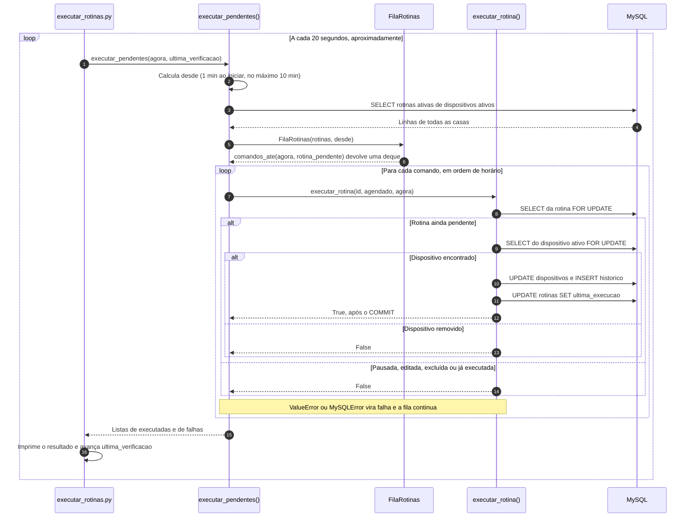

# Executor de rotinas automáticas

Este documento explica como o Habitus executa as rotinas programadas: o processo `backend/executar_rotinas.py`, o agendamento, a persistência no MySQL, o tratamento de falhas e os limites de tempo da implementação atual.

Assuntos tratados em outros documentos, que aqui são apenas citados:

- `FilaRotinas`, `heapq`, `deque` e a análise de complexidade: [ESTRUTURAS_E_POO.md](ESTRUTURAS_E_POO.md#12-a-classe-filarotinas);
- a tabela `rotinas` e o funcionamento dos bloqueios: [BANCO_DE_DADOS.md](BANCO_DE_DADOS.md#37-rotinas);
- o cadastro de rotinas pelo site e suas permissões: [ROTAS_E_PERMISSOES.md](ROTAS_E_PERMISSOES.md#35-rotinas).

## Sumário

1. [Finalidade e arquitetura](#1-finalidade-e-arquitetura)
2. [Iniciar e encerrar no Windows](#2-iniciar-e-encerrar-no-windows)
3. [O laço de verificação](#3-o-laço-de-verificação)
4. [Agendamento](#4-agendamento)
5. [Execução de uma rotina](#5-execução-de-uma-rotina)
6. [Rotinas pausadas, editadas e removidas](#6-rotinas-pausadas-editadas-e-removidas)
7. [Falhas](#7-falhas)
8. [Limites de tempo e exemplos](#8-limites-de-tempo-e-exemplos)
9. [Fuso horário](#9-fuso-horário)
10. [Limitações](#10-limitações)
11. [Estado da verificação e fontes](#11-estado-da-verificação-e-fontes)

---

## 1. Finalidade e arquitetura

`backend/executar_rotinas.py` é o processo que coloca as rotinas em prática. O site apenas **cadastra** rotinas: salvar uma rotina não altera o aparelho nem o histórico. Quem as executa no horário é o executor.

### 1.1 Por que um processo separado

O servidor Flask só trabalha quando recebe uma requisição. Uma rotina das 19:00, porém, precisa rodar mesmo que ninguém esteja com o site aberto. O projeto resolve isso com um segundo processo Python, com um laço próprio:

| Vantagem | Consequência |
| --- | --- |
| Não precisa de bibliotecas de agendamento nem de threads dentro do Flask | É preciso abrir um segundo terminal |
| O site nunca fica bloqueado esperando rotinas | Se o executor estiver desligado, as rotinas não rodam |
| O executor pode ser reiniciado sem derrubar o site | Os dois processos só se comunicam pelo banco |

### 1.2 Como o processo usa a aplicação

```python
# backend/executar_rotinas.py (trecho)
INTERVALO_SEGUNDOS = 20

app = criar_app()

if __name__ == "__main__":
    ...
    with app.app_context():
        executadas, falhas = executar_pendentes(agora, ultima_verificacao)
```

- **`criar_app()`** monta a mesma aplicação do site. O executor não atende requisições: ele a cria para obter a configuração do `.env` (`DB_HOST`, `DB_NAME`...).
- **`app.app_context()`** é necessário porque `conectar()` (`backend/app/database.py`) lê as configurações em `current_app.config`, que só existe dentro de um contexto de aplicação. O teste `test_executor_usa_o_contexto_da_aplicacao` confirma esse uso.
- **Acesso ao MySQL:** o executor usa os mesmos serviços e repositórios do site. Cada leitura ou execução abre a sua própria conexão por `transacao()`.

## 2. Iniciar e encerrar no Windows

O executor roda num terminal separado do servidor Flask, com o mesmo ambiente virtual ativado:

```powershell
# a partir da raiz do projeto
.\.venv\Scripts\Activate.ps1
python backend\executar_rotinas.py
```

Mensagens exibidas pelo processo:

| Situação | Texto no terminal |
| --- | --- |
| Início | `Verificando rotinas a cada 20 segundos. Ctrl+C para sair.` |
| Rotina executada | `19:00:05 Rotina executada: <nome>` |
| Falha numa rotina | `19:00:05 Rotina com erro: <nome>: <mensagem>` |
| Falha na verificação inteira | `19:00:05 Erro ao verificar rotinas: <erro>` |
| Encerramento com `Ctrl+C` | `Execucao encerrada.` |

Para encerrar, pressione `Ctrl+C` no terminal do executor. O laço trata o `KeyboardInterrupt` e encerra sem mostrar o rastreamento do erro.

Os pré-requisitos são os mesmos do site: banco criado e `.env` configurado (veja o [README principal](../README.md#instalação-e-configuração)). Em bancos antigos, a coluna `rotinas.ultima_execucao` precisa existir; sem ela, toda verificação falha (veja [BANCO_DE_DADOS.md](BANCO_DE_DADOS.md#94-compatibilidade-do-código-com-bancos-sem-migração)).

## 3. O laço de verificação

```python
# backend/executar_rotinas.py (laço principal)
ultima_verificacao = None
while True:
    agora = datetime.now()
    with app.app_context():
        try:
            executadas, falhas = executar_pendentes(agora, ultima_verificacao)
            ultima_verificacao = agora
            ...  # imprime executadas e falhas
        except Exception as erro:
            print(f"{agora:%H:%M:%S} Erro ao verificar rotinas: {erro}")
    time.sleep(INTERVALO_SEGUNDOS)
```

- **Intervalo:** a pausa de 20 segundos acontece **depois** de cada verificação. Por isso, o período real é de 20 segundos mais o tempo da própria verificação: aproximadamente 20 segundos.
- **`ultima_verificacao`** só avança quando `executar_pendentes()` termina sem exceção. Se a verificação inteira falhar (por exemplo, MySQL indisponível), a próxima recomeça do último ponto bem-sucedido, dentro do limite de 10 minutos.
- **Horário:** `agora` é o horário local do computador (`datetime.now()`), sem fuso explícito.

## 4. Agendamento

### 4.1 `executar_pendentes()`

```python
# backend/app/services/rotinas.py
ATRASO_MAXIMO = timedelta(minutes=10)

def executar_pendentes(agora=None, desde=None):
    agora = agora or datetime.now()
    desde = max(desde or agora - timedelta(minutes=1), agora - ATRASO_MAXIMO)

    with transacao() as cursor:
        rotinas = repo_rotinas.listar_ativas(cursor)

    agenda = FilaRotinas(rotinas, desde)                         # heapq: ordena pelo horario
    comandos = agenda.comandos_ate(agora, rotina_pendente)       # deque: fila FIFO
    executadas, falhas = [], []

    while comandos:
        rotina, agendado = comandos.popleft()
        try:
            if executar_rotina(rotina["id_rotina"], agendado, agora):
                executadas.append(rotina["nome"])
        except (ValueError, pymysql.MySQLError) as erro:
            falhas.append(f"{rotina['nome']}: {erro}")

    return executadas, falhas
```

| Etapa | O que acontece |
| --- | --- |
| 1. Janela | Calcula `desde`: o instante a partir do qual as rotinas são consideradas (seção 8) |
| 2. Leitura | Lista as rotinas **ativas** de dispositivos **ativos**, de todas as casas, numa transação curta |
| 3. Agenda | `FilaRotinas` coloca cada rotina num heap, pela próxima data e hora depois de `desde` |
| 4. Seleção | `comandos_ate()` retira do heap as que venceram até `agora` e põe numa `deque` as que passam no filtro `rotina_pendente` |
| 5. Execução | Cada comando é executado por `executar_rotina()`, em transação própria, na ordem dos horários |

A leitura da etapa 2 já descarta rotinas pausadas e de dispositivos removidos:

```sql
-- repositories/rotinas.py → listar_ativas()
SELECT r.* FROM rotinas r
JOIN dispositivos d ON d.id_dispositivo = r.id_dispositivo
WHERE r.ativa = 1 AND d.ativo = 1
```

### 4.2 Cálculo dos horários

- **Leitura do horário:** a coluna `horario` é um `TIME`, que o PyMySQL entrega como `timedelta`. `formatar_horario()` o converte em `"HH:MM"`, e `proximo_horario(horario, desde)` calcula a **primeira data e hora com esse horário estritamente depois de `desde`**. Se o horário de hoje já passou, a data é a de amanhã.
- **Precisão:** os segundos são ignorados; uma rotina é sempre agendada para `HH:MM:00`.
- **Detalhes:** o cálculo completo e o tratamento da meia-noite estão em [ESTRUTURAS_E_POO.md](ESTRUTURAS_E_POO.md#122-o-cálculo-de-agendado).

### 4.3 Dias da semana

A coluna `dias_semana` guarda `'todos'` ou os números dos dias separados por vírgula, na mesma numeração de `datetime.weekday()`:

| 0 | 1 | 2 | 3 | 4 | 5 | 6 |
| :---: | :---: | :---: | :---: | :---: | :---: | :---: |
| Seg | Ter | Qua | Qui | Sex | Sáb | Dom |

`dias_do_texto()` transforma o texto num conjunto (`'0,2,4'` → `{"0", "2", "4"}`). `dia_permitido()` confere o dia **da data agendada**, não do momento da verificação, o que importa perto da meia-noite.

### 4.4 O filtro `rotina_pendente()`

```python
# backend/app/services/rotinas.py
def rotina_pendente(rotina, agendado):
    ultima = rotina["ultima_execucao"]
    return (
        bool(rotina["ativa"])
        and formatar_horario(rotina["horario"]) == agendado.strftime("%H:%M")
        and dia_permitido(rotina["dias_semana"], agendado)
        and (ultima is None or ultima < agendado)
    )
```

| Condição | Impede |
| --- | --- |
| `ativa` | Executar uma rotina pausada |
| Horário igual ao agendado | Executar uma rotina cujo horário foi editado depois de montada a agenda (seção 6) |
| `dia_permitido` | Executar fora dos dias escolhidos |
| `ultima_execucao` anterior ao agendado | Executar duas vezes para o mesmo horário |

O mesmo filtro é aplicado duas vezes: ao montar a fila, com os dados da leitura inicial, e dentro de `executar_rotina()`, com os dados relidos sob bloqueio.

## 5. Execução de uma rotina

```python
# backend/app/services/rotinas.py
def executar_rotina(id_rotina, agendado, agora):
    with transacao() as cursor:
        atual = repo_rotinas.buscar_por_id(cursor, id_rotina, bloquear=True)
        if not atual or not rotina_pendente(atual, agendado):
            return False
        dados = repo_dispositivos.buscar_ativo(cursor, atual["id_dispositivo"], bloquear=True)
        if not dados:
            return False

        alteracao = criar_dispositivo(dados).executar(atual["acao"], atual["valor"])
        salvar_alteracao(cursor, atual["id_dispositivo"], None,
                         f"Rotina: {atual['nome']}", alteracao)
        repo_rotinas.marcar_execucao(cursor, id_rotina, agora)
        return True
```

Passo a passo, dentro de **uma única transação**:

1. **Relê a rotina com `SELECT ... FOR UPDATE`.** Se ela foi excluída, pausada, editada ou já executada desde a leitura inicial, devolve `False` sem gravar nada.
2. **Relê o dispositivo ativo com bloqueio.** `buscar_ativo()` exige `ativo = 1`; um aparelho removido nesse intervalo faz a função devolver `False`.
3. **Aplica a ação pela classe do dispositivo.** `executar(acao, valor)` valida o valor salvo, por exemplo `Decimal("75.0")` para brilho 75.
4. **Grava o novo estado e o histórico** com `salvar_alteracao()`, a mesma função dos controles manuais. O histórico recebe:
   - `id_usuario = NULL` (a tela mostra "Automação");
   - ação `Rotina: <nome>`, cortada em 60 caracteres pelo repositório.
5. **Grava `ultima_execucao = agora`.** A coluna recebe o horário da verificação em que a rotina rodou, não o horário programado.
6. **Confirma (`commit`)** ao sair do bloco. Uma exceção em qualquer passo desfaz tudo (`rollback`).

Ajustar um valor por rotina **não liga** o aparelho; ligar um aparelho já ligado também gera histórico.

### 5.1 Diagrama do executor



## 6. Rotinas pausadas, editadas e removidas

Entre a leitura inicial (etapa 2) e a execução, uma pessoa pode alterar a rotina pelo site. A releitura sob bloqueio trata cada caso:

| Alteração feita pelo site | Antes da verificação | Depois de montada a fila |
| --- | --- | --- |
| Rotina pausada (`ativa = 0`) | Não é lida (`WHERE r.ativa = 1`) | A releitura percebe e não executa (teste `test_rotina_pausada_depois_de_montar_a_fila_nao_executa`) |
| Rotina excluída | Não é lida | `buscar_por_id()` não encontra; não executa |
| Horário editado | Entra na agenda com o novo horário | O horário relido não confere com o agendado; não executa agora |
| Dispositivo removido | Não é lida (`d.ativo = 1`), e as rotinas do aparelho já foram pausadas na remoção | `buscar_ativo()` não encontra o dispositivo; não executa |
| Ação ou valor editados | A agenda usa os dados novos | A execução usa os dados relidos, ou seja, os novos |

Editar ou reativar uma rotina **não** limpa `ultima_execucao`. Como a comparação é feita com o horário agendado, uma rotina já executada às 19:00 e editada para 19:30 no mesmo dia volta a rodar às 19:30.

## 7. Falhas

| Tipo de falha | Exemplo | Tratamento | A rotina é tentada de novo? |
| --- | --- | --- | --- |
| Falha numa rotina (`ValueError`) | Valor salvo fora dos limites da classe | Transação desfeita; mensagem na lista `falhas`; as próximas da fila continuam | **Não.** A verificação termina com sucesso, `ultima_verificacao` avança e o horário sai da janela |
| Falha numa rotina (`pymysql.MySQLError`) | Erro do banco ao gravar | Igual ao anterior | **Não**, pelo mesmo motivo |
| Falha na verificação inteira | MySQL fora do ar na leitura inicial; coluna `ultima_execucao` inexistente | A exceção chega ao laço; mensagem "Erro ao verificar rotinas"; `ultima_verificacao` **não** avança | **Sim**, na próxima verificação, desde que o atraso não passe de 10 minutos |

O isolamento das falhas é coberto pelo teste `test_falha_em_uma_rotina_nao_perde_as_seguintes`. Se uma falha geral interromper a fila no meio, as rotinas já confirmadas têm `ultima_execucao` gravada e não se repetem na nova tentativa.

## 8. Limites de tempo e exemplos

A regra completa e uma tabela de casos estão em [ESTRUTURAS_E_POO.md](ESTRUTURAS_E_POO.md#131-a-janela-de-verificação). Resumo:

| Regra | Valor | Origem |
| --- | --- | --- |
| Janela na primeira verificação | Último **1 minuto** | `desde` é `None` → `agora − 1 min` |
| Janela com o executor rodando | Desde a última verificação bem-sucedida | `ultima_verificacao` |
| Teto da janela | **10 minutos** | `ATRASO_MAXIMO` |
| Período em que o executor esteve desligado | **Não é recuperado** | Ao reiniciar, a janela volta a ser de 1 minuto |

### Exemplo 1 — funcionamento normal

Executor iniciado às 18:58:05, com uma rotina diária "Luz da noite" às 19:00:

| Verificação | `desde` | Resultado |
| --- | --- | --- |
| 18:58:05 (primeira) | 18:57:05 | Próxima ocorrência: 19:00 de hoje, ainda não venceu |
| 18:58:25 … 18:59:45 | Verificação anterior | Ainda não venceu |
| 19:00:05 | 18:59:45 | 19:00 está na janela → **executa**; `ultima_execucao = 19:00:05` |
| 19:00:25 | 19:00:05 | A próxima ocorrência já é 19:00 de amanhã → nada a fazer |

### Exemplo 2 — executor interrompido

Executor encerrado com `Ctrl+C` às 18:55 e reiniciado às 19:02:40. Há rotinas às 19:00 e às 19:02:

- primeira verificação: `desde` = 19:01:40;
- a rotina das **19:02** está na janela e **executa**;
- a rotina das **19:00** ficou fora da janela e **não executa hoje**; volta a valer amanhã.

Se o reinício fosse às 19:03:00, `desde` seria 19:02:00. Como o horário precisa ser **estritamente posterior** a `desde`, a rotina das 19:02 também não rodaria.

### Exemplo 3 — MySQL indisponível com o executor rodando

Última verificação bem-sucedida às 19:09:50; o MySQL volta a responder às 19:25:10. Há rotinas às 19:12 e às 19:20:

- na primeira verificação após a volta, `desde` = max(19:09:50, 19:15:10) = **19:15:10**;
- a rotina das **19:20** executa com atraso, às 19:25:10;
- a das **19:12**, atrasada mais de 10 minutos, **não executa**.

O comportamento do teto é coberto por `test_atraso_maior_que_o_limite_nao_e_recuperado`.

### Exemplo 4 — dias da semana

Uma rotina às 07:00 com `dias_semana = '0,2,4'` (segunda, quarta e sexta), numa terça-feira às 07:00:

- ela vence e sai do heap;
- `dia_permitido()` recusa a terça, e ela não entra na fila;
- na quarta-feira, executa normalmente.

## 9. Fuso horário

O executor e o MySQL usam relógios diferentes:

| Dado | Relógio usado |
| --- | --- |
| `agora` no executor, `ultima_execucao` | Hora local do computador onde o Python roda (`datetime.now()`) |
| `rotinas.horario` | Hora digitada no formulário, sem fuso |
| `historico.data_acao` | Relógio do servidor MySQL (`CURRENT_TIMESTAMP`) |

- **Mesmo fuso:** se o computador e o MySQL usam o mesmo fuso (o caso típico da execução local), os horários coincidem.
- **Fusos diferentes:** por exemplo, um MySQL configurado em UTC com o Windows em horário de Brasília. As rotinas continuam rodando no horário local do Python, mas o histórico mostra o horário do MySQL, deslocado.
- **Configuração:** o projeto não tem nenhuma configuração de fuso. O comentário sobre `America/Sao_Paulo` no `.env.example` não corresponde a nenhuma variável lida pelo código.

## 10. Limitações

- **Precisa de um segundo processo:** sem o executor em execução, nenhuma rotina roda, e não há aviso no site.
- **Interrupções:** rotinas do período em que o executor esteve desligado são perdidas; atrasos acima de 10 minutos também.
- **Falhas individuais não são repetidas** (seção 7).
- **A agenda é refeita a cada verificação**, lendo todas as rotinas ativas de todas as casas.
- **Precisão de minutos:** a execução pode ocorrer até cerca de 20 segundos depois do horário, conforme o momento da verificação.
- **Vários executores:** nada impede abrir dois executores. A releitura com `FOR UPDATE` e a coluna `ultima_execucao` foram pensadas para evitar duplicidade, mas isso não foi verificado num MySQL real.
- **Sem registro persistente:** as mensagens do executor aparecem só no terminal; apenas as execuções bem-sucedidas ficam no histórico.

## 11. Estado da verificação e fontes

Conferido com o código em 08/11/2026. Os testes isolados foram executados nesta etapa (08/11/2026, 19:05): **141 passed**. As regras abaixo foram verificadas **com banco falso**, não num MySQL real.

**Testado:**

| Regra | Teste | Arquivo |
| --- | --- | --- |
| Execução grava dispositivo, histórico sem usuário e `ultima_execucao` | `test_rotina_executa_e_registra_historico` | `tests/test_servicos.py` |
| Rotina já executada não se repete | `test_rotina_ja_executada_nao_e_repetida`, `test_rotina_nao_repete_no_mesmo_horario` | `tests/test_servicos.py`, `tests/test_modelos.py` |
| Rotina pausada depois de montada a fila não executa | `test_rotina_pausada_depois_de_montar_a_fila_nao_executa` | `tests/test_servicos.py` |
| Falha numa rotina não impede as seguintes | `test_falha_em_uma_rotina_nao_perde_as_seguintes` | `tests/test_servicos.py` |
| Atraso acima de 10 minutos não é recuperado | `test_atraso_maior_que_o_limite_nao_e_recuperado` | `tests/test_servicos.py` |
| Uso do contexto da aplicação | `test_executor_usa_o_contexto_da_aplicacao` | `tests/test_servicos.py` |
| Ordem, verificações atrasadas, meia-noite, dias e horários antes das 10h | Os 10 testes de `test_estruturas.py` | `tests/test_estruturas.py` |
| Dias da semana | `test_rotina_dias_da_semana` | `tests/test_modelos.py` |
| Cadastro de rotina não executa a ação | `test_cria_rotina_com_ajuste_sem_executar_agora` | `tests/test_rotinas.py` |

**Verificado só na leitura do código:**

- o laço de `executar_rotinas.py`: intervalo, avanço de `ultima_verificacao`, mensagens e `Ctrl+C`;
- a janela de 1 minuto na primeira verificação;
- a ausência de nova tentativa para falhas individuais;
- a releitura após exclusão ou edição de horário;
- o descarte de rotinas de dispositivos removidos.

**Não verificado:**

- execução com um MySQL real;
- bloqueios `FOR UPDATE` com dois executores simultâneos;
- comportamento com fusos diferentes no Python e no MySQL;
- execução prolongada do processo.

**Fontes:** `backend/executar_rotinas.py`, `backend/app/__init__.py`, `backend/app/database.py`, `backend/app/services/rotinas.py`, `backend/app/services/dispositivos.py`, `backend/app/structures/fila_rotinas.py`, `backend/app/models/rotina.py`, `backend/app/models/dispositivo.py`, `backend/app/repositories/rotinas.py`, `backend/app/repositories/dispositivos.py`, `backend/app/repositories/historico.py`, `backend/.env.example`, `database/schema.sql`, `tests/test_servicos.py`, `tests/test_estruturas.py`, `tests/test_modelos.py`, `tests/test_rotinas.py`.
