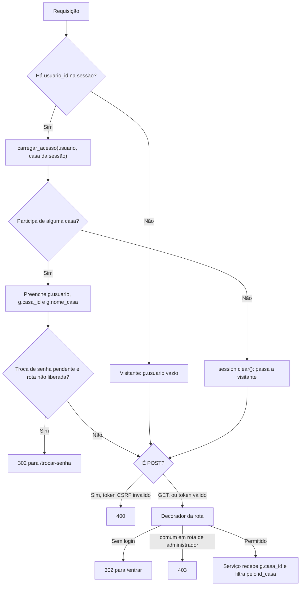

# Rotas e permissões do Habitus

Este documento descreve as rotas Flask do Habitus e o controle de acesso: os blueprints, cada rota com sua permissão e suas respostas, os perfis, o isolamento entre casas e o formato das requisições e respostas.

Assuntos relacionados em outros documentos:

- ciclo completo de uma requisição e camadas: [ARQUITETURA.md](ARQUITETURA.md#4-ciclo-de-uma-requisição);
- senhas, sessão, CSRF e limitações de segurança: [AUTENTICACAO_E_SEGURANCA.md](AUTENTICACAO_E_SEGURANCA.md);
- consultas SQL que filtram por casa: [BANCO_DE_DADOS.md](BANCO_DE_DADOS.md#42-pertencimento-à-casa-por-join).

## Sumário

1. [Visão geral](#1-visão-geral)
2. [Blueprints](#2-blueprints)
3. [Rotas por blueprint](#3-rotas-por-blueprint)
4. [Perfis e permissões](#4-perfis-e-permissões)
5. [Isolamento entre casas](#5-isolamento-entre-casas)
6. [Requisições e respostas](#6-requisições-e-respostas)
7. [Exemplo real: renomear um cômodo](#7-exemplo-real-renomear-um-cômodo)
8. [Limitações](#8-limitações)
9. [Estado da verificação e fontes](#9-estado-da-verificação-e-fontes)

---

## 1. Visão geral

Contagem feita no código em 08/11/2026:

| Item | Quantidade |
| --- | --- |
| Blueprints | 6, todos registrados em `criar_app()` sem prefixo de URL |
| Declarações de rota (`@...route`, `@...get`, `@...post`) | **26**, uma por função |
| Combinações de método e caminho | 29 (`/entrar`, `/cadastro` e `/trocar-senha` aceitam GET e POST na mesma declaração) |
| Caminhos distintos | 23 |
| Métodos HTTP usados | Somente GET e POST |

Além dessas rotas, o Flask cria automaticamente `/static/<arquivo>` para servir `frontend/static/`.

Regra geral: **toda alteração de dados usa POST**. As rotas GET apenas exibem páginas ou redirecionam; mesmo a saída da conta (`/sair`) é POST.

## 2. Blueprints

| Blueprint | Arquivo | Responsabilidade | Serviços usados | Rotas |
| --- | --- | --- | --- | :---: |
| `auth` | `backend/app/routes/autenticacao.py` | Login, cadastro de conta, troca da senha temporária, saída | `services/autenticacao.py` | 4 |
| `site` | `backend/app/routes/site.py` | Página inicial e painel | `services/casas.py` | 2 |
| `casas` | `backend/app/routes/casas.py` | Minha casa: troca de casa, cômodos e moradores | `services/comodos.py`, `services/moradores.py`, `services/casas.py` | 8 |
| `dispositivos` | `backend/app/routes/dispositivos.py` | Lista, cadastro, controle, transferência e remoção | `services/dispositivos.py`, `services/comodos.py` | 5 |
| `rotinas` | `backend/app/routes/rotinas.py` | Lista, cadastro, edição, pausa e exclusão de rotinas | `services/rotinas.py` | 6 |
| `historico` | `backend/app/routes/historico.py` | Histórico de alterações | `services/casas.py` | 1 |

## 3. Rotas por blueprint

Legenda de acesso:

| Acesso | Significado | Quem aplica |
| --- | --- | --- |
| **Público** | Não exige login | — |
| **Logado** | Exige login, com qualquer perfil | `@login_obrigatorio` |
| **Admin** | Exige o perfil `administrador` na casa aberta | `@administrador_obrigatorio` |

Valem para todas as rotas:

- todo **POST** exige o token CSRF (sem ele, **400**);
- enquanto houver troca de senha pendente, qualquer rota fora de `/trocar-senha` e `/sair` redireciona (**302**) para `/trocar-senha`.

Ambas as verificações estão em [ARQUITETURA.md](ARQUITETURA.md#41-verificações-globais-before_request).

### 3.1 `auth`

| Método | Caminho | Função | Acesso | Finalidade | Respostas |
| --- | --- | --- | --- | --- | --- |
| GET | `/entrar` | `entrar` | Público | Formulário de login | 200; 302 → `/painel` se já estiver logado |
| POST | `/entrar` | `entrar` | Público | Autenticar | 302 → `/painel` ou `/trocar-senha`; 200 com mensagem de erro |
| GET | `/cadastro` | `cadastro` | Público | Formulário de conta e casa | 200; 302 → `/painel` se já estiver logado |
| POST | `/cadastro` | `cadastro` | Público | Criar conta, casa e cômodos iniciais | 302 → `/painel`; 200 com mensagem de erro |
| GET | `/trocar-senha` | `trocar_senha` | Logado com troca pendente | Formulário da nova senha | 200; 302 → `/entrar` sem login; 302 → `/painel` sem troca pendente |
| POST | `/trocar-senha` | `trocar_senha` | Logado com troca pendente | Gravar a nova senha | 302 → `/painel`; 200 com mensagem de erro |
| POST | `/sair` | `sair` | Qualquer pessoa | Limpar a sessão | 302 → `/entrar` |

As rotas de `auth` não usam decoradores: cada função confere `g.usuario` e a sessão no próprio corpo.

### 3.2 `site`

| Método | Caminho | Função | Acesso | Finalidade | Respostas |
| --- | --- | --- | --- | --- | --- |
| GET | `/` | `inicio` | Público | Encaminhar o visitante | 302 → `/painel` se logado, senão → `/entrar` |
| GET | `/painel` | `painel` | Logado | Resumo da casa aberta | 200 |

### 3.3 `casas`

| Método | Caminho | Função | Acesso | Finalidade | Respostas |
| --- | --- | --- | --- | --- | --- |
| GET | `/casa` | `detalhes` | Logado | Cômodos, moradores e troca de casa | 200 |
| POST | `/casa/selecionar` | `selecionar` | Logado | Abrir outra casa da qual participa | 302 → `/painel`; 302 → `/casa` com erro se não participar |
| POST | `/casa/comodos` | `novo_comodo` | Admin | Criar cômodo | 302 → `/casa` com mensagem |
| POST | `/casa/comodos/<id_comodo>/renomear` | `renomear_comodo` | Admin | Renomear cômodo | 302 → `/casa` com mensagem |
| POST | `/casa/comodos/<id_comodo>/remover` | `remover_comodo` | Admin | Excluir cômodo | 302 → `/casa` com mensagem |
| POST | `/casa/moradores` | `novo_morador` | Admin | Adicionar morador pelo e-mail | 200 com a senha temporária (conta nova); 302 → `/casa` nos demais casos |
| POST | `/casa/moradores/<id_morador>/perfil` | `mudar_perfil` | Admin | Mudar o perfil de outro morador | 302 → `/casa` com mensagem |
| POST | `/casa/moradores/<id_morador>/remover` | `remover_morador` | Admin | Remover o acesso de outro morador | 302 → `/casa` com mensagem |

### 3.4 `dispositivos`

| Método | Caminho | Função | Acesso | Finalidade | Respostas |
| --- | --- | --- | --- | --- | --- |
| GET | `/dispositivos` | `listar` | Logado | Lista com controles | 200 |
| POST | `/dispositivos` | `criar` | Admin | Cadastrar dispositivo | 302 → `/dispositivos` com mensagem |
| POST | `/dispositivos/<id_dispositivo>/controle` | `controlar` | Logado (ambos os perfis) | Ligar, desligar ou ajustar | JSON 200 / 400 via AJAX; 302 → `/dispositivos` sem AJAX |
| POST | `/dispositivos/<id_dispositivo>/transferir` | `transferir` | Admin | Mudar de cômodo | 302 → `/dispositivos` com mensagem |
| POST | `/dispositivos/<id_dispositivo>/remover` | `remover` | Admin | Desativar (`ativo = 0`) | 302 → `/dispositivos` com mensagem |

### 3.5 `rotinas`

| Método | Caminho | Função | Acesso | Finalidade | Respostas |
| --- | --- | --- | --- | --- | --- |
| GET | `/rotinas` | `listar` | Logado | Lista de rotinas (e formulário, para administradores) | 200 |
| POST | `/rotinas` | `criar` | Admin | Criar rotina | 302 → `/rotinas`; 400 com o formulário preenchido se houver erro |
| GET | `/rotinas/<id_rotina>/editar` | `editar` | Admin | Abrir o formulário de edição | 200; 404 se a rotina não for da casa |
| POST | `/rotinas/<id_rotina>/editar` | `atualizar` | Admin | Gravar a edição | 302 → `/rotinas`; 400 com o formulário preenchido se houver erro |
| POST | `/rotinas/<id_rotina>/alternar` | `alternar` | Admin | Pausar ou reativar | 302 → `/rotinas` com mensagem |
| POST | `/rotinas/<id_rotina>/remover` | `remover` | Admin | Excluir rotina | 302 → `/rotinas` com mensagem |

### 3.6 `historico`

| Método | Caminho | Função | Acesso | Finalidade | Respostas |
| --- | --- | --- | --- | --- | --- |
| GET | `/historico` | `listar` | Logado | As 100 alterações mais recentes da casa | 200 |

Os parâmetros de caminho usam o conversor `<int:...>`: um valor que não seja número inteiro não corresponde a nenhuma rota, e o Flask responde 404.

## 4. Perfis e permissões

### 4.1 Os perfis

- **Valores:** existem dois, gravados em `moradores.perfil`: **`administrador`** e **`comum`**. A classe `Usuario` (`backend/app/models/usuario.py`) os lista em `PERFIS` e oferece dois métodos:

  | Método | Verdadeiro para |
  | --- | --- |
  | `pode_gerenciar()` | Somente `administrador` |
  | `pode_controlar_dispositivo()` | Os dois perfis |

- **O perfil é do vínculo, não da conta.** A mesma pessoa pode ser `administrador` na própria casa e `comum` na casa de outra pessoa. O perfil válido é sempre o da **casa aberta** (`session["casa_id"]`).
- **Origem dos administradores:** quem cria a conta é administrador da casa criada. Outros administradores surgem quando um administrador adiciona um morador com esse perfil ou muda o perfil de alguém.

### 4.2 Matriz de permissões

| Funcionalidade | Visitante | Com troca de senha pendente | `comum` | `administrador` |
| --- | :---: | :---: | :---: | :---: |
| Entrar e criar conta | ✅ | — | — | — |
| Trocar a senha temporária | ❌ | ✅ | — | — |
| Sair da conta | ✅ | ✅ | ✅ | ✅ |
| Ver painel, dispositivos, rotinas e histórico | ❌ | ❌ | ✅ | ✅ |
| Ver cômodos e moradores (nome, perfil e e-mail) | ❌ | ❌ | ✅ | ✅ |
| Trocar entre as casas das quais participa | ❌ | ❌ | ✅ | ✅ |
| Ligar, desligar e ajustar dispositivos | ❌ | ❌ | ✅ | ✅ |
| Cadastrar, transferir e remover dispositivos | ❌ | ❌ | ❌ | ✅ |
| Criar, renomear e excluir cômodos | ❌ | ❌ | ❌ | ✅ |
| Adicionar moradores, mudar perfis e remover acessos | ❌ | ❌ | ❌ | ✅, exceto o próprio |
| Criar, editar, pausar, reativar e excluir rotinas | ❌ | ❌ | ❌ | ✅ |

"—" indica que a situação não se aplica: quem está logado e acessa `/entrar` ou `/cadastro` é redirecionado ao painel, e `/trocar-senha` só funciona com a troca pendente.

### 4.3 Os decoradores

```python
# backend/app/permissoes.py
def login_obrigatorio(funcao):
    @wraps(funcao)
    def verificar(*args, **kwargs):
        if not g.usuario:
            return redirect(url_for("auth.entrar"))
        return funcao(*args, **kwargs)
    return verificar


def administrador_obrigatorio(funcao):
    @wraps(funcao)
    @login_obrigatorio
    def verificar(*args, **kwargs):
        if not g.usuario.pode_gerenciar():
            abort(403, description="Somente o administrador pode fazer isso.")
        return funcao(*args, **kwargs)
    return verificar
```

- **`@login_obrigatorio`** redireciona para `/entrar` quando `g.usuario` está vazio, ou seja, quando não há login ou o login deixou de ser válido.
- **`@administrador_obrigatorio`** aplica `@login_obrigatorio` antes. Logo, quem não está logado é redirecionado (302), e quem está logado como `comum` recebe 403.
- **`@wraps`** preserva o nome da função original, que o Flask usa como nome do endpoint (por exemplo, `casas.novo_comodo`).
- **Exceção:** a rota de controle de dispositivos usa `@login_obrigatorio` e confere `pode_controlar_dispositivo()` no corpo, respondendo `{"erro": "Sem permissao."}` com status 403. Como os dois perfis válidos podem controlar, esse 403 não ocorre com os perfis atuais.

### 4.4 Como o vínculo com a casa é verificado

Os decoradores não consultam o banco: eles leem `g.usuario`, preenchido pela função `carregar_usuario()` (`backend/app/__init__.py`) **antes de cada requisição**:



`carregar_acesso()` (`services/autenticacao.py`) executa a consulta descrita em [BANCO_DE_DADOS.md](BANCO_DE_DADOS.md#41-participação-em-várias-casas):

1. procura o vínculo do usuário com a casa guardada na sessão;
2. se esse vínculo não existe mais, usa a primeira casa da pessoa (menor `id_morador`) e atualiza `session["casa_id"]`;
3. se a pessoa não participa de nenhuma casa, a sessão é limpa.

Consequências:

- a casa guardada na sessão **nunca é usada sem ser conferida**;
- uma mudança de perfil ou uma remoção de acesso vale **na requisição seguinte**, sem que a pessoa precise sair;
- para abrir outra casa, `/casa/selecionar` só grava o novo `casa_id` depois de `pode_abrir_casa()` confirmar o vínculo.

### 4.5 Verificação no servidor

As permissões são decididas no servidor, em camadas:

| Camada | O que faz | Arquivo |
| --- | --- | --- |
| Template | Esconde formulários e botões de gestão quando `g.usuario.pode_gerenciar()` é falso | `frontend/templates/*.html` |
| Decorador | Recusa a rota com 302 ou 403, mesmo que o formulário seja enviado manualmente | `backend/app/permissoes.py` |
| Serviço | Só opera sobre registros da casa aberta (seção 5) | `backend/app/services/` |
| Serviço de moradores | Recusa alterar o próprio acesso: "Voce nao pode alterar o seu proprio acesso." | `services/moradores.py` → `_buscar_outro_morador()` |

Esconder um botão no template é só conveniência visual; a proteção efetiva está no decorador e no serviço. Como ninguém altera o próprio perfil nem remove o próprio vínculo, o administrador que executa a ação continua administrador, e a casa nunca fica sem administrador por meio do sistema.

## 5. Isolamento entre casas

As rotas recebem ids na URL (`/casa/comodos/3/renomear`) e no formulário (`id_comodo`, `id_dispositivo`). Esses ids poderiam ser alterados manualmente para apontar para registros de outra casa. O sistema impede isso porque o serviço sempre recebe `g.casa_id`, e nunca um id de casa vindo do pedido, e busca o registro **junto com** esse id:

| Recurso | Como a casa é conferida | Onde | Teste |
| --- | --- | --- | --- |
| Cômodo (renomear, excluir) | `WHERE id_comodo = %s AND id_casa = %s` | `repositories/comodos.py` → `buscar()` | `test_nao_renomeia_comodo_de_outra_casa`, `test_nao_exclui_comodo_de_outra_casa` |
| Cômodo do cadastro ou de destino | Mesma busca | `cadastrar_dispositivo()`, `transferir_dispositivo()` | `test_nao_cadastra_em_comodo_de_outra_casa`, `test_nao_transfere_para_comodo_de_outra_casa` |
| Dispositivo (controle, transferência) | `JOIN comodos ... AND c.id_casa = %s` | `repositories/dispositivos.py` → `buscar_ativo()` | `test_dispositivo_de_outra_casa_nao_e_controlado`, `test_nao_transfere_dispositivo_de_outra_casa` |
| Dispositivo (remoção) | O próprio `UPDATE ... JOIN comodos ... AND c.id_casa = %s` | `repositories/dispositivos.py` → `desativar()` | Sem teste específico |
| Dispositivo escolhido numa rotina | `buscar_ativo()` com o `id_casa` | `services/rotinas.py` → `salvar_rotina()` | `test_nao_usa_dispositivo_de_outra_casa` |
| Rotina (editar, pausar, excluir) | `CONSULTA_DA_CASA`: `JOIN` com dispositivos e cômodos, `c.id_casa = %s` | `repositories/rotinas.py` → `buscar_da_casa()` | `test_nao_edita_rotina_de_outra_casa` |
| Morador (perfil, remoção) | `WHERE id_morador = %s AND id_casa = %s` | `repositories/moradores.py` → `buscar()` | Sem teste |
| Listas, painel e histórico | `WHERE ... id_casa = %s` | Funções `listar_*` dos repositórios | Sem teste específico de isolamento |
| Troca de casa | `participa(id_usuario, id_casa)` | `services/casas.py` → `pode_abrir_casa()` | Sem teste |

- **Resposta a um registro de outra casa:** é a mesma de um registro inexistente, como "Comodo nao encontrado nesta casa." ou "Dispositivo nao encontrado nessa casa.". Assim, a resposta não revela se o id existe em outra casa.
- **Exceção:** `GET /rotinas/<id>/editar` responde 404.
- **Executor de rotinas:** é o único código que trabalha com todas as casas, porque não atende pedidos de usuários.

## 6. Requisições e respostas

### 6.1 Formulários

- **Formato:** todos os formulários são HTML com `method="post"` e um campo oculto `csrf_token`. As rotas leem os campos com `request.form.get()`, e os dias da rotina com `request.form.getlist("dias")`.
- **Tipos:** os valores chegam como texto; validadores e modelos os convertem (por exemplo, `"22,5"` → `22.5`). A rota só faz verificações mínimas, como conferir com `isdigit()` o cômodo de destino de uma transferência ou o id da casa em `/casa/selecionar`.
- **Ação do controle:** os formulários de controle de dispositivos enviam a ação num campo oculto (`acao = ligar`, `desligar` ou `ajustar_brilho`...), e o valor num controle deslizante (`valor`).

### 6.2 Post/Redirect/Get e mensagens `flash`

A maioria dos POST termina com `redirect()`, e a mensagem do resultado é guardada com `flash(mensagem, categoria)`:

- **Categorias:** `"sucesso"` e `"erro"`, que `base.html` exibe na página seguinte com as classes CSS `aviso sucesso` e `aviso erro`.
- **Atualizar a página não reenvia o formulário**, porque a última requisição do navegador é um GET.
- **Atalho em `routes/casas.py`:** `voltar_com_resultado()` concentra o padrão para cinco ações. Ele executa o serviço, mostra a mensagem de sucesso ou o texto do `ValueError` e redireciona para `/casa`.
- **Pop-up "Conta criada":** a mensagem "Conta criada!" do cadastro também aciona esse pop-up em `frontend/static/js/app.js`.

Exceções intencionais ao redirecionamento:

| Situação | Resposta | Motivo |
| --- | --- | --- |
| Morador adicionado com conta nova | 200, página `/casa` com a senha temporária e `Cache-Control: no-store` | A senha aparece uma única vez e não passa pela sessão |
| Erro no formulário de rotina | 400, página de rotinas com os campos preenchidos | Não perder o que foi digitado |
| Erro no login, cadastro ou troca de senha | 200, o mesmo formulário com a mensagem | Mesmo motivo |

### 6.3 Controle de dispositivos em JSON

Os formulários de controle têm o atributo `data-ajax`. O `app.js` intercepta o envio, faz `fetch()` com o mesmo `FormData` (que já contém o `csrf_token`) e o cabeçalho `X-Requested-With: XMLHttpRequest`. A rota reconhece o pedido por esse cabeçalho (`pedido_ajax()`):

| Situação | Status | Corpo da resposta |
| --- | :---: | --- |
| Controle aplicado | 200 | `{"ok": true, "resultado": {"campo": "brilho", "antes": 80, "depois": 45}}` |
| Valor ou ação inválidos | 400 | `{"erro": "O brilho deve ficar entre 0 e 100."}` |
| Dispositivo de outra casa ou removido | 400 | `{"erro": "Dispositivo nao encontrado nessa casa."}` |
| Perfil sem permissão de controle | 403 | `{"erro": "Sem permissao."}` (não ocorre com os perfis atuais) |

Depois de uma resposta de sucesso, o `app.js` recarrega a página; em caso de erro, mostra a mensagem com `window.alert()`. Sem o cabeçalho, a mesma rota responde com `flash` e redirecionamento.

### 6.4 Códigos HTTP

| Código | Quando ocorre no Habitus | Origem |
| :---: | --- | --- |
| **200** | Páginas exibidas; formulários de login, cadastro e troca de senha com erro; senha temporária; JSON de sucesso | Rotas |
| **302** | Redirecionamentos do padrão Post/Redirect/Get; falta de login; troca de senha pendente; `/` | Rotas, decoradores e `exigir_troca_de_senha` |
| **400** | Token CSRF ausente ou inválido; erro no formulário de rotina; JSON de erro no controle | `proteger_formularios`, `routes/rotinas.py`, `routes/dispositivos.py` |
| **403** | Perfil `comum` em rota de administrador | `@administrador_obrigatorio` |
| **404** | Rota inexistente; id não numérico na URL; rotina de outra casa em `/rotinas/<id>/editar` | Flask e `routes/rotinas.py` |
| 405 | Método não aceito, como GET em `/sair` | Padrão do Flask, sem tratamento próprio |
| 500 | Exceção inesperada | Padrão do Flask; com `debug=True`, exibe o depurador |

Os códigos 400, 403 e 404 usam o manipulador único de `backend/app/__init__.py`, que devolve um HTML simples com a descrição e o link "Voltar ao Habitus". O tratamento de cada tipo de erro está em [ARQUITETURA.md](ARQUITETURA.md#5-tratamento-de-erros-e-respostas).

## 7. Exemplo real: renomear um cômodo

Fluxo coberto pelo teste `test_administrador_renomeia_na_casa_aberta` (`tests/test_comodos.py`), com um administrador na casa 7:

| Passo | Pedido ou ação | Resultado |
| :---: | --- | --- |
| 1 | `POST /casa/comodos/3/renomear` com `nome=Escritorio` e `csrf_token` | — |
| 2 | `carregar_usuario()` confirma o vínculo e o perfil `administrador` na casa 7 | `g.usuario`, `g.casa_id = 7` |
| 3 | `proteger_formularios()` compara o token | Confere |
| 4 | `@administrador_obrigatorio` chama `pode_gerenciar()` | Verdadeiro |
| 5 | `renomear_comodo()` chama `servico_comodos.renomear_comodo(7, 3, "Escritorio")` | O teste confere exatamente esses argumentos |
| 6 | O serviço busca o cômodo 3 **da casa 7** com `FOR UPDATE`, confere nomes repetidos e grava | — |
| 7 | `voltar_com_resultado()` registra "Comodo renomeado para Escritorio." | **302** → `/casa` |
| 8 | O navegador faz `GET /casa` | **200**, com a mensagem de sucesso |

A mesma requisição feita por um perfil `comum` para no passo 4 com **403**, sem chamar o serviço; isso é coberto por `test_morador_comum_nao_gerencia_comodos`. Feita sem login, para no mesmo passo com **302** para `/entrar`, como em `test_visitante_sem_login_e_redirecionado`.

## 8. Limitações

- **AJAX com sessão expirada:**
  - com o token CSRF inválido, o servidor responde 400 em HTML, e não em JSON;
  - sem login, o redirecionamento leva o `fetch()` à página de login, também em HTML.

  Nos dois casos, o `app.js` falha ao ler o JSON e mostra um alerta com o erro técnico em vez de uma mensagem clara.
- **Páginas de erro simples:** 400, 403 e 404 devolvem um HTML mínimo, sem o layout do sistema; 405 e 500 usam as páginas padrão do Flask.
- **Mensagens de "não encontrado" em vez de 404:** recursos de outra casa geram mensagem `flash` e redirecionamento, exceto na edição de rotina.
- **Rotinas de dispositivos removidos:** saem da lista; abrir a edição de uma delas pela URL resulta em 404.
- **`/sair` não exige login:** um visitante pode enviá-lo, o que apenas limpa uma sessão vazia.
- **Sem API pública:** a única resposta JSON é a do controle de dispositivos, pensada para o próprio front-end.

## 9. Estado da verificação e fontes

Conferido com o código em 08/11/2026. Os testes citados foram aprovados em 08/11/2026, com o banco falso.

**Testado:**

- login obrigatório: `test_painel_exige_login`, `test_visitante_sem_login_e_redirecionado`;
- 403 para o perfil comum:
  - criar cômodo (`test_morador_comum_nao_pode_adicionar_comodo`);
  - criar, renomear e excluir cômodos e transferir dispositivos (`test_morador_comum_nao_gerencia_comodos`, 4 rotas);
  - adicionar moradores (`test_morador_comum_nao_cadastra_moradores`);
  - criar e editar rotinas (`test_morador_comum_nao_cria_nem_edita_rotinas`, 3 rotas);
- template sem os controles de gestão para o perfil comum: `test_lista_mostra_os_dados_salvos_depois_de_atualizar`;
- POST sem token CSRF → 400: `test_post_sem_token_nao_e_aceito`;
- bloqueio durante a troca de senha: `test_sem_trocar_a_senha_nao_acessa_outras_paginas`;
- isolamento entre casas: os 8 testes citados na seção 5;
- erro do formulário de rotina com status 400 e campos preservados: `test_erro_mantem_o_que_foi_digitado`;
- resposta 200 com `Cache-Control: no-store` da senha temporária: `test_administrador_ve_a_senha_temporaria_uma_unica_vez`;
- fluxo do exemplo da seção 7: `test_administrador_renomeia_na_casa_aberta`;
- transferência com destino inválido sem chegar ao serviço: `test_administrador_transfere_dispositivo`.

**Verificado no código**, sem teste automatizado:

- a contagem das 26 declarações de rota e de suas permissões;
- a resposta JSON de `/dispositivos/<id>/controle`;
- o 403 das rotas `POST /dispositivos`, `/dispositivos/<id>/remover`, `/rotinas/<id>/alternar`, `/rotinas/<id>/remover`, `/casa/moradores/<id>/perfil` e `/casa/moradores/<id>/remover`;
- a troca de casa e o retorno à primeira casa em `carregar_acesso()`;
- o isolamento na remoção de dispositivos e na gestão de moradores;
- o 404 de rotina de outra casa;
- o manipulador de erros e os códigos 405 e 500, que são padrão do Flask.

**Validação manual pendente:**

- o comportamento do `app.js` no navegador, inclusive os alertas;
- o efeito imediato de uma mudança de perfil para quem está com a página aberta.

**Fontes:** `backend/app/routes/` (6 arquivos), `backend/app/permissoes.py`, `backend/app/__init__.py`, `backend/app/models/usuario.py`, `backend/app/services/autenticacao.py`, `backend/app/services/casas.py`, `backend/app/services/comodos.py`, `backend/app/services/dispositivos.py`, `backend/app/services/moradores.py`, `backend/app/services/rotinas.py`, `backend/app/repositories/comodos.py`, `backend/app/repositories/dispositivos.py`, `backend/app/repositories/moradores.py`, `backend/app/repositories/rotinas.py`, `frontend/templates/base.html`, `frontend/templates/casa.html`, `frontend/templates/dispositivos.html`, `frontend/templates/rotinas.html`, `frontend/static/js/app.js`, `tests/test_paginas.py`, `tests/test_comodos.py`, `tests/test_moradores.py`, `tests/test_rotinas.py`, `tests/test_servicos.py`.
