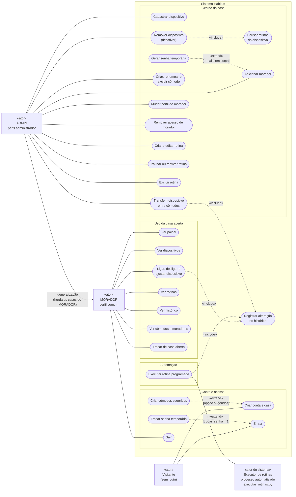

# Diagrama de casos de uso

Este documento apresenta o diagrama UML de casos de uso do Habitus: quem usa o sistema, o que cada ator pode fazer e quais relações existem entre os casos de uso. Cada caso de uso corresponde a uma rota ou a uma função real do código, e a tabela de rastreabilidade indica onde está a permissão e qual teste a comprova.

Assuntos relacionados em outros documentos:

- matriz completa de permissões, decoradores e respostas HTTP: [ROTAS_E_PERMISSOES.md](../ROTAS_E_PERMISSOES.md#42-matriz-de-permissões);
- login, senha temporária e sessão: [AUTENTICACAO_E_SEGURANCA.md](../AUTENTICACAO_E_SEGURANCA.md);
- funcionamento do executor de rotinas: [EXECUTOR_ROTINAS.md](../EXECUTOR_ROTINAS.md).

## Sumário

1. [Atores](#1-atores)
2. [Diagrama](#2-diagrama)
3. [Como ler o diagrama](#3-como-ler-o-diagrama)
4. [Relações entre casos de uso](#4-relações-entre-casos-de-uso)
5. [Rastreabilidade: caso de uso, rota, permissão e teste](#5-rastreabilidade-caso-de-uso-rota-permissão-e-teste)
6. [O que não aparece no diagrama](#6-o-que-não-aparece-no-diagrama)
7. [Estado da verificação e fontes](#7-estado-da-verificação-e-fontes)

## 1. Atores

| Ator | Valor no código | Quem é |
| --- | --- | --- |
| **Visitante** | Sem `usuario_id` na sessão | Pessoa que ainda não entrou no sistema |
| **MORADOR** | `moradores.perfil = 'comum'` | Usa a casa aberta: vê as telas e controla os aparelhos |
| **ADMIN** | `moradores.perfil = 'administrador'` | Gerencia a casa aberta, além de tudo o que o MORADOR faz |
| **Executor de rotinas** | Processo `backend/executar_rotinas.py` | Ator de sistema: um **processo automatizado**, sem login e sem pessoa, que executa as rotinas no horário |

- Os nomes ADMIN e MORADOR são os rótulos deste diagrama. No banco e no código, os perfis se chamam `administrador` e `comum` (`backend/app/models/usuario.py`).
- O perfil é **definido por casa**: a mesma pessoa pode ser ADMIN da própria casa e MORADOR na casa de outra pessoa. O perfil que vale é o da casa aberta (`session["casa_id"]`).
- Quem cria a conta torna-se ADMIN da casa criada (`services/autenticacao.cadastrar_conta`).
- Na UML, um ator é um **papel**. O papel MORADOR é o de membro da casa aberta. O perfil `comum` desempenha apenas esse papel; o perfil `administrador` também o desempenha, por isso o ADMIN é a especialização do MORADOR na generalização. O rótulo "perfil comum" no diagrama indica quem tem **somente** esse papel; não exclui o ADMIN.
- O Executor de rotinas é um ator **não humano**. O código dele faz parte do projeto, mas ele roda em um processo separado do site, sem sessão nem perfil, e dispara a execução pelo relógio. Por isso fica fora da fronteira, como ator de sistema, e se associa somente a "Executar rotina programada".

## 2. Diagrama

O Mermaid não tem um tipo próprio para casos de uso. O diagrama abaixo usa um fluxograma com a convenção da UML: os atores ficam fora da fronteira do sistema, e os casos de uso são as formas arredondadas dentro dela.

## 3. Como ler o diagrama

| Elemento | Notação | Significado |
| --- | --- | --- |
| Ator | Retângulo com «ator» ou «ator de sistema» | Quem inicia o caso de uso, fora da fronteira do sistema |
| Caso de uso | Forma arredondada dentro de "Sistema Habitus" | Um objetivo que o sistema realiza |
| Associação | Linha contínua sem seta | O ator participa do caso de uso |
| Generalização | Seta contínua de ADMIN para MORADOR | ADMIN é um caso particular de MORADOR e herda todas as associações dele |
| «include» | Seta tracejada do caso base para o incluído | O caso base **sempre** executa o caso incluído |
| «extend» | Seta tracejada do caso que estende para o caso base, com a condição entre colchetes | O caso extensor só acontece **quando a condição vale** |

Os agrupamentos "Conta e acesso", "Uso da casa aberta", "Gestão da casa" e "Automação" servem apenas para organizar a leitura; não são elementos da UML.

Na UML, a generalização é desenhada com uma ponta de seta triangular vazada. O Mermaid não tem essa ponta em fluxogramas, por isso ela aparece como uma seta contínua com o rótulo "generalização".

## 4. Relações entre casos de uso

Cada relação foi incluída porque o código executa exatamente esse comportamento.

| Relação | Tipo | Por que é semanticamente correta | Onde está no código |
| --- | --- | --- | --- |
| ADMIN → MORADOR | Generalização | Toda rota com `@login_obrigatorio` aceita os dois perfis, e `pode_controlar_dispositivo()` é verdadeiro para ambos. O ADMIN só **acrescenta** as rotas com `@administrador_obrigatorio` | `backend/app/permissoes.py`, `backend/app/models/usuario.py` |
| Criar cômodos sugeridos → Criar conta e casa | «extend» | A conta pode ser criada sem cômodos (opção `vazio`); com a opção `sugeridos` (padrão), a mesma transação cria Sala, Quarto e Cozinha, mais "Luz da sala" e "Ar do quarto" | `services/comodos.criar_comodos_iniciais`, chamada por `services/autenticacao.cadastrar_conta` |
| Trocar senha temporária → Entrar | «extend» | O login termina normalmente, exceto quando `usuarios.trocar_senha` = 1: aí grava `session["trocar_senha"]` e redireciona para `/trocar-senha`; o `before_request` `exigir_troca_de_senha` bloqueia as outras páginas | `routes/autenticacao.entrar`, `app/__init__.py` |
| Gerar senha temporária → Adicionar morador | «extend» | Se o e-mail já tem conta, só o vínculo é criado. Se não tem, o serviço gera uma senha de 12 caracteres com `secrets`, grava só o hash e a exibe uma única vez | `services/moradores.cadastrar_morador` e `gerar_senha_temporaria` |
| Remover dispositivo → Pausar rotinas do dispositivo | «include» | Toda remoção faz `ativo = 0` **e** `UPDATE rotinas SET ativa = 0` na mesma transação | `services/dispositivos.remover_dispositivo`, `repositories/rotinas.pausar_do_dispositivo` |
| Ligar, desligar e ajustar → Registrar alteração no histórico | «include» | Todo controle grava o novo estado e um registro no histórico na mesma transação | `services/dispositivos.salvar_alteracao` |
| Transferir dispositivo → Registrar alteração no histórico | «include» | Toda transferência grava `transferir_comodo` com o nome do cômodo de origem e o de destino | `services/comodos.transferir_dispositivo` |
| Executar rotina programada → Registrar alteração no histórico | «include» | Toda execução usa `salvar_alteracao()`, gravando `id_usuario = NULL` e a ação `Rotina: <nome>` | `services/rotinas.executar_rotina` |

Relações que **não** foram usadas, para não sugerir comportamentos inexistentes:

- "Entrar" não é «include» dos demais casos. Na UML, a pré-condição de estar logado é representada pelo ator (MORADOR ou ADMIN), não por um «include».
- "Excluir cômodo" não estende nem inclui "Transferir dispositivo". A exclusão é **recusada** quando há dispositivos no cômodo e não transfere nada automaticamente.
- O Executor de rotinas não se relaciona com "Criar e editar rotina". O ADMIN cria as rotinas pelo site; o executor apenas lê do banco as que estão ativas.

## 5. Rastreabilidade: caso de uso, rota, permissão e teste

"Só no código" significa que o comportamento foi conferido na leitura do código, mas não tem teste automatizado específico (veja [TESTES.md](../TESTES.md#10-o-que-ainda-não-tem-teste-automatizado)).

### 5.1 Conta e acesso

| Caso de uso | Ator | Rota | Controle de acesso no código | Evidência em teste |
| --- | --- | --- | --- | --- |
| Criar conta e casa | Visitante | `GET`, `POST /cadastro` | Público; quem já está logado é redirecionado ao painel | `test_cadastro_e_login_passando_pelas_camadas`, `test_cadastro_sem_comodos_nao_cria_ambientes`, `test_cadastro_rejeita_opcao_de_comodos_invalida`, `test_tela_de_cadastro` |
| Criar cômodos sugeridos | — («extend») | Dentro de `POST /cadastro` | Opção `comodos_iniciais = sugeridos` | `test_cadastro_inicial_com_comodos_sugeridos`, `test_cadastro_inicial_sem_comodos` |
| Entrar | Visitante | `GET`, `POST /entrar` | Público; quem já está logado é redirecionado ao painel | `test_tela_de_login`, `test_cadastro_e_login_passando_pelas_camadas`, `test_login_de_conta_antiga_continua_normal` |
| Trocar senha temporária | — («extend») | `GET`, `POST /trocar-senha` | Logado e com `session["trocar_senha"]` | `test_login_com_senha_temporaria_exige_troca`, `test_sem_trocar_a_senha_nao_acessa_outras_paginas`, `test_troca_de_senha_grava_hash_e_libera_o_sistema` |
| Sair | MORADOR (e ADMIN) | `POST /sair` | Sem decorador; exige o token CSRF | `test_sair_limpa_a_sessao` |

### 5.2 Uso da casa aberta (MORADOR e ADMIN)

| Caso de uso | Rota | Controle de acesso no código | Evidência em teste |
| --- | --- | --- | --- |
| Ver painel | `GET /painel` | `@login_obrigatorio` | `test_painel_exige_login`, `test_painel_agrupa_dispositivos_por_comodo` (perfil `comum`) |
| Ver dispositivos | `GET /dispositivos` | `@login_obrigatorio` | `test_pagina_de_dispositivos_usa_limites_das_classes` |
| Ligar, desligar e ajustar dispositivo | `POST /dispositivos/<id>/controle` | `@login_obrigatorio` e `pode_controlar_dispositivo()` (403 em JSON) | Serviço: `test_alteracao_grava_estado_e_historico`, `test_controle_de_temperatura`, `test_valor_invalido_nao_grava_no_banco`, `test_dispositivo_de_outra_casa_nao_e_controlado`. Resposta JSON da rota: só no código |
| Ver rotinas | `GET /rotinas` | `@login_obrigatorio`; botões de gestão só para ADMIN | `test_lista_mostra_os_dados_salvos_depois_de_atualizar` (perfil `comum`, sem o botão "Editar") |
| Ver histórico | `GET /historico` | `@login_obrigatorio` | Página: só no código. O painel com os 6 últimos eventos é testado em `test_painel_agrupa_dispositivos_por_comodo` |
| Ver cômodos e moradores | `GET /casa` | `@login_obrigatorio` | Exercitada com perfil `administrador` em `test_administrador_ve_a_senha_temporaria_uma_unica_vez`; com perfil `comum`, só no código |
| Trocar de casa aberta | `POST /casa/selecionar` | `@login_obrigatorio` e `pode_abrir_casa()` | Só no código |

### 5.3 Gestão da casa (somente ADMIN)

Todas as rotas desta tabela usam `@administrador_obrigatorio`: sem login, redirecionam para `/entrar`; com perfil `comum`, respondem 403 ("Somente o administrador pode fazer isso.").

| Caso de uso | Rota | Regra adicional no serviço | Evidência em teste |
| --- | --- | --- | --- |
| Cadastrar dispositivo | `POST /dispositivos` | Cômodo precisa ser da casa aberta | Serviço: `test_cadastra_dispositivo_com_configuracao_da_classe`, `test_cadastro_de_dispositivo_invalido`, `test_nao_cadastra_em_comodo_de_outra_casa`. 403 da rota: só no código |
| Transferir dispositivo entre cômodos | `POST /dispositivos/<id>/transferir` | Dispositivo ativo e cômodo de destino da casa aberta, diferente do atual | `test_transfere_dispositivo_sem_perder_dados`, `test_nao_transfere_para_comodo_de_outra_casa`, `test_nao_transfere_para_o_mesmo_comodo`, `test_nao_transfere_dispositivo_de_outra_casa`, `test_administrador_transfere_dispositivo`, `test_morador_comum_nao_gerencia_comodos` (403). Detalhes em [SEQUENCIA_TRANSFERIR_DISPOSITIVO.md](SEQUENCIA_TRANSFERIR_DISPOSITIVO.md) |
| Remover dispositivo (desativar) | `POST /dispositivos/<id>/remover` | `ativo = 0`, nunca `DELETE` | Serviço: `test_remover_dispositivo_preserva_historico`. 403 da rota: só no código |
| Pausar rotinas do dispositivo | Dentro da remoção | `UPDATE rotinas SET ativa = 0` | `test_remover_dispositivo_preserva_historico` |
| Criar, renomear e excluir cômodo | `POST /casa/comodos`, `/casa/comodos/<id>/renomear`, `/casa/comodos/<id>/remover` | Nome único na casa; exclusão só sem dispositivos ativos ou removidos | Testes de serviço em `test_comodos.py`; `test_morador_comum_nao_gerencia_comodos` (403 nas 3 rotas), `test_morador_comum_nao_pode_adicionar_comodo`, `test_visitante_sem_login_e_redirecionado`, `test_administrador_renomeia_na_casa_aberta` |
| Adicionar morador | `POST /casa/moradores` | Vincula conta existente ou cria conta nova | `test_cadastra_novo_morador_com_senha_temporaria`, `test_vincula_conta_existente_sem_mudar_senha`, `test_nao_vincula_quem_ja_participa_da_casa`, `test_cadastro_simultaneo_vira_mensagem_e_desfaz_a_transacao`, `test_dados_invalidos_nem_acessam_o_banco`, `test_nome_e_obrigatorio_para_conta_nova`, `test_administrador_ve_a_senha_temporaria_uma_unica_vez`, `test_morador_comum_nao_cadastra_moradores` (403) |
| Gerar senha temporária | Dentro de `POST /casa/moradores` | 12 caracteres sem `0`, `O`, `1`, `l`, `I`; resposta com `Cache-Control: no-store` | `test_senha_temporaria_e_aleatoria_e_legivel`, `test_administrador_ve_a_senha_temporaria_uma_unica_vez` |
| Mudar perfil de morador | `POST /casa/moradores/<id>/perfil` | Ninguém altera o próprio acesso | Só no código |
| Remover acesso de morador | `POST /casa/moradores/<id>/remover` | Ninguém remove o próprio acesso; a conta continua existindo | Só no código |
| Criar e editar rotina | `POST /rotinas`, `GET`, `POST /rotinas/<id>/editar` | Dispositivo da casa; valor validado pela classe do dispositivo, sem executar a ação | Testes de serviço e de rota em `test_rotinas.py`; `test_morador_comum_nao_cria_nem_edita_rotinas` (403 em 3 rotas) |
| Pausar ou reativar rotina | `POST /rotinas/<id>/alternar` | Inverte `ativa` | Só no código |
| Excluir rotina | `POST /rotinas/<id>/remover` | `DELETE` real | Só no código |

### 5.4 Automação

| Caso de uso | Ator | Ponto de entrada | Controle de acesso | Evidência em teste |
| --- | --- | --- | --- | --- |
| Executar rotina programada | Executor de rotinas | `backend/executar_rotinas.py` → `services/rotinas.executar_pendentes()`, sem rota HTTP | Nenhum login: o processo trabalha com as rotinas ativas de **todas** as casas | `test_rotina_executa_e_registra_historico`, `test_rotina_ja_executada_nao_e_repetida`, `test_rotina_pausada_depois_de_montar_a_fila_nao_executa`, `test_falha_em_uma_rotina_nao_perde_as_seguintes`, `test_atraso_maior_que_o_limite_nao_e_recuperado`, `test_executor_usa_o_contexto_da_aplicacao` e os testes de `test_estruturas.py`. O laço de 20 segundos: só no código |
| Registrar alteração no histórico | — («include») | `repositories/historico.registrar` | — | `test_alteracao_grava_estado_e_historico`, `test_transfere_dispositivo_sem_perder_dados`, `test_rotina_executa_e_registra_historico` |

## 6. O que não aparece no diagrama

Funcionalidades que **não existem** no código e, por isso, não foram desenhadas:

- criar uma segunda casa, renomear ou excluir uma casa;
- recuperar a senha, trocá-la voluntariamente ou excluir a conta;
- restaurar um dispositivo removido;
- enviar e-mails ou convites;
- integração com dispositivos físicos, Alexa ou Google Home.

Detalhes do funcionamento que também ficaram de fora do diagrama, para mantê-lo legível:

- a proteção CSRF e a releitura do perfil a cada requisição (veja [ARQUITETURA.md](../ARQUITETURA.md#41-verificações-globais-before_request));
- o isolamento entre casas, aplicado em todos os casos de uso do MORADOR e do ADMIN (veja [ROTAS_E_PERMISSOES.md](../ROTAS_E_PERMISSOES.md#5-isolamento-entre-casas)).

## 7. Estado da verificação e fontes

**Testado:** os casos de uso com testes citados nas tabelas da seção 5, aprovados na execução completa de 09/11/2026 (`144 passed`; veja [TESTES.md](../TESTES.md#9-resultados-confirmados)). Os testes não foram executados de novo durante a criação deste diagrama.

**Verificado no código:** todos os atores, casos de uso e relações; os casos marcados como "só no código" na seção 5.

**Validado com ferramenta (11/11/2026):** a sintaxe e a renderização do diagrama, com `mermaid.parse()` e `mermaid.render()` das versões 10.9.1 e 11.12.0 do Mermaid, executadas no Google Chrome em modo headless. Nas duas versões, as associações aparecem sem seta e só a generalização tem seta contínua. As versões 11.0 a 11.4.1 do Mermaid têm um defeito que desenha seta também nas associações (`---`); a sintaxe do diagrama está correta.

**Não verificado:** a renderização no próprio GitHub, que usa a versão do Mermaid escolhida por ele.

**Fontes:** `backend/app/permissoes.py`, `backend/app/__init__.py`, `backend/app/models/usuario.py`, `backend/app/routes/` (6 arquivos), `backend/app/services/autenticacao.py`, `backend/app/services/casas.py`, `backend/app/services/comodos.py`, `backend/app/services/dispositivos.py`, `backend/app/services/moradores.py`, `backend/app/repositories/rotinas.py`, `backend/app/repositories/historico.py`, `backend/executar_rotinas.py`, `tests/` (nomes dos testes conferidos com `pytest --collect-only`).

---

Conferido com o código em 11/11/2026.
