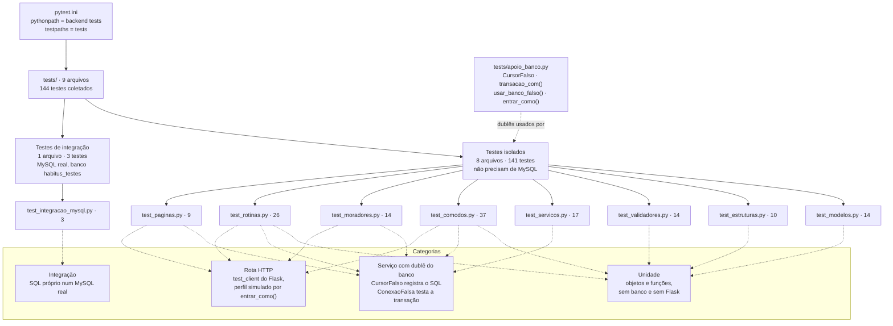
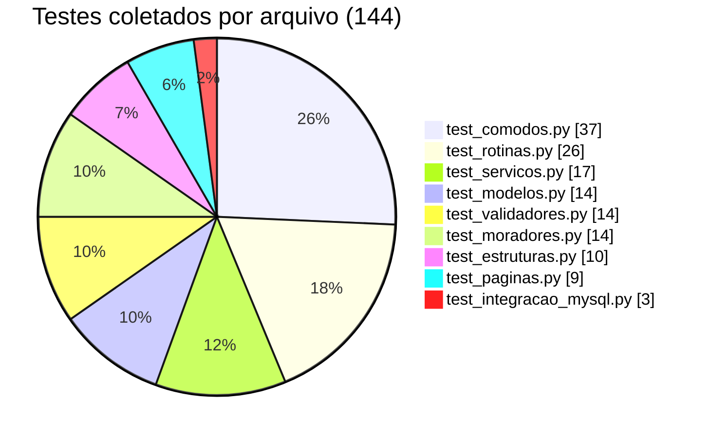
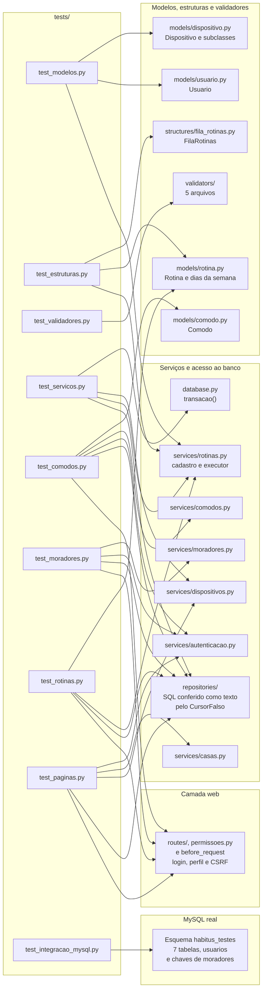
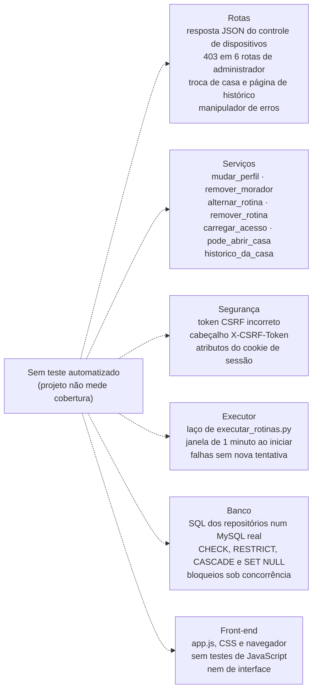

# Diagrama da organização dos testes

Este documento mostra, em diagramas, como os testes automatizados do Habitus estão organizados: os grupos, as categorias, os arquivos, os componentes do sistema que cada arquivo verifica e as lacunas já conhecidas. A descrição detalhada de cada teste, os comandos e os resultados estão em [TESTES.md](../TESTES.md); este documento não repete esse conteúdo.

## Sumário

1. [Coletados e aprovados](#1-coletados-e-aprovados)
2. [Estrutura e categorias](#2-estrutura-e-categorias)
3. [Distribuição por arquivo](#3-distribuição-por-arquivo)
4. [Componentes verificados](#4-componentes-verificados)
5. [Lacunas de cobertura](#5-lacunas-de-cobertura)
6. [Estado da verificação e fontes](#6-estado-da-verificação-e-fontes)

## 1. Coletados e aprovados

"Coletado" e "aprovado" são informações diferentes: um teste coletado é um teste que o pytest encontrou; um teste aprovado é um teste que foi executado e cujas asserções foram todas verdadeiras.

| Indicador | Valor | Como foi obtido | Data |
| --- | --- | --- | --- |
| Testes **coletados** | **144** (141 isolados + 3 de integração) | `python -B -m pytest --collect-only -q -p no:cacheprovider`, que só lista os testes, sem executá-los | 11/11/2026, na criação deste documento |
| Testes **aprovados** | **144** (`144 passed in 2.47s`) | Execução completa registrada em [TESTES.md](../TESTES.md#91-resultado-atual-09112026) | 09/11/2026 |

- Os testes **não** foram executados de novo na criação deste documento. A aprovação citada é a da última execução registrada.
- Cada caso de um teste parametrizado (`@pytest.mark.parametrize`) conta como um teste. Por isso há 144 testes coletados, embora os arquivos tenham 116 funções `test_`.
- Aprovação não é cobertura: o projeto não mede cobertura de código (veja a [seção 5](#5-lacunas-de-cobertura)).

## 2. Estrutura e categorias

| Categoria | Como funciona | Arquivos |
| --- | --- | --- |
| **Unidade** | Cria objetos ou chama funções diretamente. Não usa banco, nem falso, nem Flask | `test_modelos.py`, `test_estruturas.py`, `test_validadores.py`; os testes do modelo `Comodo` em `test_comodos.py` e os da classe `Rotina` em `test_rotinas.py` |
| **Serviço com dublê do banco** | Troca `transacao()` pelo `CursorFalso`, que registra cada comando SQL e devolve respostas prontas; `test_servicos.py` também usa uma `ConexaoFalsa` para testar o COMMIT e o ROLLBACK da própria `transacao()` | `test_servicos.py`, `test_comodos.py`, `test_moradores.py`, `test_rotinas.py`, `test_paginas.py` |
| **Rota HTTP** | Usa o `test_client` do Flask; `entrar_como()` simula um usuário logado (usuário 9, casa 7) com o perfil escolhido e um token CSRF de teste | `test_comodos.py`, `test_moradores.py`, `test_rotinas.py`, `test_paginas.py` |
| **Integração** | Conecta a um MySQL real, no banco separado `habitus_testes`, e desfaz tudo com `rollback` | `test_integracao_mysql.py` |

Um mesmo arquivo pode ter testes de mais de uma categoria. Por exemplo, `test_comodos.py` testa o modelo `Comodo` (unidade), o serviço de cômodos com o banco falso e as rotas com perfis diferentes.

## 3. Distribuição por arquivo

| Arquivo | Coletados | Categorias | Usa `apoio_banco.py`? | Precisa de MySQL? |
| --- | :---: | --- | :---: | :---: |
| `test_comodos.py` | 37 | Unidade, serviço, rota | Sim | Não |
| `test_rotinas.py` | 26 | Unidade, serviço, rota | Sim | Não |
| `test_servicos.py` | 17 | Serviço | Sim | Não |
| `test_modelos.py` | 14 | Unidade | Não | Não |
| `test_validadores.py` | 14 | Unidade | Não | Não |
| `test_moradores.py` | 14 | Serviço, rota | Sim | Não |
| `test_estruturas.py` | 10 | Unidade | Não | Não |
| `test_paginas.py` | 9 | Rota, serviço | Sim | Não |
| `test_integracao_mysql.py` | 3 | Integração | Não | **Sim** |
| **Total** | **144** | | | |

## 4. Componentes verificados

Cada seta liga um arquivo de teste a um componente que ele verifica diretamente, conforme os `import` e as chamadas de cada arquivo.

Observações sobre as ligações:

- `test_modelos.py` usa as funções `dia_permitido()` e `rotina_pendente()` de `services/rotinas.py`, e `test_estruturas.py` usa `rotina_pendente()`. Essas funções não acessam o banco.
- Os **repositórios** não são testados isoladamente: eles são executados pelos serviços, com o `CursorFalso` no lugar do MySQL, e os testes conferem o **texto** do SQL e os parâmetros gerados.
- `test_integracao_mysql.py` usa SQL próprio: valida o esquema do banco, **não** o SQL dos repositórios nem os serviços.
- `test_servicos.py` cria a aplicação com `criar_app()` apenas para testar o executor dentro do contexto do Flask, sem fazer requisições HTTP.

## 5. Lacunas de cobertura

O diagrama resume as lacunas já registradas em [TESTES.md](../TESTES.md#10-o-que-ainda-não-tem-teste-automatizado), que continua sendo a lista de referência.

As 6 rotas de administrador sem teste do 403 são: `POST /dispositivos`, `/dispositivos/<id>/remover`, `/rotinas/<id>/alternar`, `/rotinas/<id>/remover`, `/casa/moradores/<id>/perfil` e `/casa/moradores/<id>/remover`. A permissão dessas rotas foi verificada apenas na leitura do código (decorador `@administrador_obrigatorio`).

## 6. Estado da verificação e fontes

**Testado:** a contagem de testes coletados por arquivo, obtida com `pytest --collect-only` em 11/11/2026 (`144 tests collected`), igual à registrada em [TESTES.md](../TESTES.md#1-visão-geral).

**Verificado no código:** as categorias de cada arquivo, os componentes ligados a cada arquivo (pelos `import` e pelas funções chamadas) e o funcionamento do banco falso.

**Validado com ferramenta (11/11/2026):** a sintaxe e a renderização dos 4 diagramas, com `mermaid.parse()` e `mermaid.render()` das versões 10.9.1 e 11.12.0 do Mermaid, executadas no Google Chrome em modo headless. O título do gráfico de pizza foi encurtado para "Testes coletados por arquivo (144)": a versão anterior era mais larga que o gráfico e ficava cortada à esquerda nas duas versões.

**Não verificado:**

- a aprovação dos testes na data deste documento: os testes não foram executados de novo, e o resultado citado é o de 09/11/2026;
- a renderização no próprio GitHub, que usa a versão do Mermaid escolhida por ele.

**Fontes:** `pytest.ini`, `tests/apoio_banco.py`, os 9 arquivos `tests/test_*.py`, [TESTES.md](../TESTES.md) (seções 1, 9 e 10).

---

Conferido com o código em 11/11/2026.
