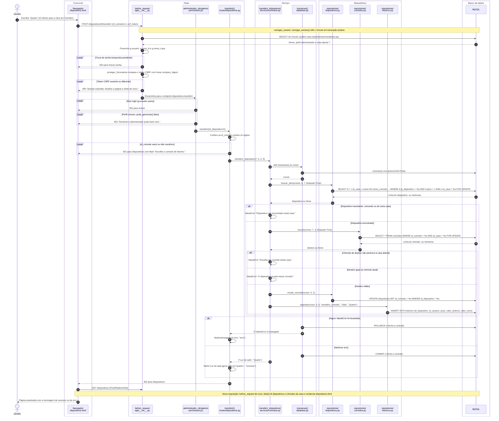

# Diagrama de sequência: transferir um dispositivo entre cômodos

Este documento apresenta o diagrama UML de sequência de uma operação real do Habitus: o administrador muda um dispositivo de cômodo pela tela **Dispositivos**. O fluxo atravessa todas as camadas do sistema: o formulário HTML, as verificações globais do Flask, o decorador de permissão, a rota, o serviço, a transação, três repositórios e o MySQL.

Foi escolhida uma operação diferente das que já têm diagrama de sequência, para não duplicá-los:

- ajuste de brilho por AJAX, com resposta em JSON: [ARQUITETURA.md](../ARQUITETURA.md#42-exemplo-completo-ajustar-o-brilho-de-uma-luz);
- execução automática das rotinas: [EXECUTOR_ROTINAS.md](../EXECUTOR_ROTINAS.md#51-diagrama-do-executor).

## Sumário

1. [Cenário](#1-cenário)
2. [Diagrama](#2-diagrama)
3. [Etapas e código correspondente](#3-etapas-e-código-correspondente)
4. [Transação, bloqueios, COMMIT e ROLLBACK](#4-transação-bloqueios-commit-e-rollback)
5. [Respostas possíveis](#5-respostas-possíveis)
6. [Testes que cobrem este fluxo](#6-testes-que-cobrem-este-fluxo)
7. [Estado da verificação e fontes](#7-estado-da-verificação-e-fontes)

## 1. Cenário

Os valores de exemplo são os mesmos usados em `tests/test_comodos.py`:

| Dado | Valor |
| --- | --- |
| Casa aberta (`g.casa_id`) | 7 |
| Usuário logado (`g.usuario.id_usuario`) | 9, perfil `administrador` |
| Dispositivo | 5, "Luz da sala", hoje no cômodo 1 ("Sala") |
| Cômodo de destino | 2 ("Quarto") |
| Requisição | `POST /dispositivos/5/transferir` com os campos `id_comodo=2` e `csrf_token` |

A opção **Mover para** só aparece para o perfil `administrador` e quando a casa tem mais de um cômodo (`frontend/templates/dispositivos.html`). O formulário é enviado por um POST comum, sem AJAX.

## 2. Diagrama



Os blocos `break` indicam que a requisição **termina ali** com a resposta mostrada. Os blocos `alt` mostram os caminhos alternativos dentro do serviço e o desfecho da transação.

## 3. Etapas e código correspondente

| Etapa | Camada | Arquivo e função | O que acontece |
| --- | --- | --- | --- |
| Envio do formulário | Front-end | `frontend/templates/dispositivos.html` (formulário `form-transferir`) | POST com `id_comodo` e o campo oculto `csrf_token`; a lista só oferece os outros cômodos da casa |
| Carregar o usuário | Flask | `app/__init__.py`, `carregar_usuario` → `services/autenticacao.carregar_acesso` → `repositories/moradores.buscar_acesso` | Relê perfil e casa aberta no MySQL a cada requisição. Se a pessoa não participa de nenhuma casa, a sessão é limpa e a requisição segue sem usuário |
| Troca de senha pendente | Flask | `app/__init__.py`, `exigir_troca_de_senha` | Com `session["trocar_senha"]`, redireciona para `/trocar-senha` |
| CSRF | Flask | `app/__init__.py`, `proteger_formularios` | Compara o token do formulário (ou do cabeçalho `X-CSRF-Token`) com o da sessão; se não conferir, `abort(400)` |
| Login e perfil | Flask | `permissoes.py`, `administrador_obrigatorio` (aplica `login_obrigatorio` antes) | Sem login → 302 para `/entrar`; `pode_gerenciar()` falso → `abort(403)` |
| Validação do campo | Rota | `routes/dispositivos.py`, `transferir` | `id_comodo.isdigit()`; se falhar, o serviço nem é chamado |
| Chamada ao serviço | Rota → Serviço | `services/comodos.transferir_dispositivo(id_casa, id_dispositivo, id_comodo_destino, id_usuario)` | Recebe sempre o `g.casa_id` da casa aberta |
| Transação | Serviço | `database.py`, `transacao()` | Abre a conexão (`autocommit=False`), entrega o cursor, faz COMMIT ou ROLLBACK e sempre fecha a conexão |
| Buscar o dispositivo | Repositório | `repositories/dispositivos.buscar_ativo(..., bloquear=True)` | Só encontra dispositivo **ativo** e **da casa aberta**; bloqueia a linha com `FOR UPDATE` |
| Buscar o destino | Repositório | `repositories/comodos.buscar(..., bloquear=True)` | Só encontra cômodo da casa aberta; bloqueia a linha |
| Regras de negócio | Serviço | `services/comodos.transferir_dispositivo` | Recusa dispositivo não encontrado, destino fora da casa e destino igual ao cômodo atual |
| Mudar o cômodo | Repositório | `repositories/dispositivos.mudar_comodo` | Altera **apenas** `id_comodo`; configurações, rotinas e histórico continuam ligados ao mesmo `id_dispositivo` |
| Registrar o histórico | Repositório | `repositories/historico.registrar` | Grava a ação `transferir_comodo`, com o nome do cômodo de origem como valor anterior e o de destino como valor novo |
| Resposta | Rota | `routes/dispositivos.py`, `transferir` | `flash` de sucesso ou de erro e redirecionamento para `dispositivos.listar` |

## 4. Transação, bloqueios, COMMIT e ROLLBACK

```python
# backend/app/services/comodos.py
def transferir_dispositivo(id_casa, id_dispositivo, id_comodo_destino, id_usuario):
    with transacao() as cursor:
        dispositivo = repo_dispositivos.buscar_ativo(cursor, id_dispositivo, id_casa, bloquear=True)
        if not dispositivo:
            raise ValueError("Dispositivo nao encontrado nesta casa.")
        destino = repo_comodos.buscar(cursor, id_casa, id_comodo_destino, bloquear=True)
        if not destino:
            raise ValueError("Escolha um comodo desta casa.")
        if destino["id_comodo"] == dispositivo["id_comodo"]:
            raise ValueError("O dispositivo ja esta nesse comodo.")

        repo_dispositivos.mudar_comodo(cursor, id_dispositivo, destino["id_comodo"])
        repo_historico.registrar(cursor, id_dispositivo, id_usuario, "transferir_comodo",
                                 dispositivo["nome_comodo"], destino["nome"])
    return dispositivo["nome"], destino["nome"]
```

- **Atomicidade:** o `UPDATE` do dispositivo e o `INSERT` no histórico estão na mesma transação. Ou os dois são gravados (COMMIT), ou nenhum é (ROLLBACK).
- **ROLLBACK:** `transacao()` captura qualquer exceção levantada dentro do bloco `with`, executa `rollback()`, fecha a conexão e propaga a exceção. Nos três casos de `ValueError`, nada foi escrito ainda; o ROLLBACK libera os bloqueios `FOR UPDATE` já obtidos. A rota transforma a mensagem em `flash` de erro.
- **COMMIT:** quando o bloco termina sem exceção, `transacao()` executa `commit()` e fecha a conexão.
- **Bloqueios:** `FOR UPDATE` no dispositivo e no cômodo de destino impede que outra transação altere essas linhas até o fim desta, por exemplo um segundo pedido de transferência simultâneo. O comportamento real dos bloqueios sob concorrência não é testado (veja a seção 7).
- **Isolamento entre casas:** as duas consultas filtram pelo `id_casa` da casa aberta. Um id de outra casa, mesmo digitado à mão na URL ou no formulário, não é encontrado.

## 5. Respostas possíveis

| Situação | Onde é decidida | Resposta HTTP | Mensagem exibida |
| --- | --- | --- | --- |
| Transferência feita | Serviço (COMMIT) | 302 → `/dispositivos` | "Luz da sala agora esta em Quarto." |
| `id_comodo` vazio ou não numérico | Rota | 302 → `/dispositivos` | "Escolha o comodo de destino." |
| Dispositivo inexistente, removido ou de outra casa | Serviço (ROLLBACK) | 302 → `/dispositivos` | "Dispositivo nao encontrado nesta casa." |
| Destino fora da casa aberta | Serviço (ROLLBACK) | 302 → `/dispositivos` | "Escolha um comodo desta casa." |
| Destino igual ao cômodo atual | Serviço (ROLLBACK) | 302 → `/dispositivos` | "O dispositivo ja esta nesse comodo." |
| Perfil `comum` | `@administrador_obrigatorio` | 403 | "Somente o administrador pode fazer isso." |
| Sem login | `@login_obrigatorio` | 302 → `/entrar` | — |
| Token CSRF ausente ou diferente | `proteger_formularios` | 400 | "Sessao expirada. Atualize a pagina e tente de novo." |
| Troca de senha pendente | `exigir_troca_de_senha` | 302 → `/trocar-senha` | — |

As mensagens são copiadas do código, com a grafia original sem acentos.

## 6. Testes que cobrem este fluxo

| Teste | Arquivo | O que comprova |
| --- | --- | --- |
| `test_transfere_dispositivo_sem_perder_dados` | `tests/test_comodos.py` | Um único `UPDATE dispositivos SET id_comodo`, nenhum `DELETE`, nenhum comando em `rotinas` e o histórico `(5, 9, "transferir_comodo", "Sala", "Quarto")` |
| `test_nao_transfere_para_comodo_de_outra_casa` | `tests/test_comodos.py` | `ValueError` "comodo desta casa" e nenhum `UPDATE` |
| `test_nao_transfere_para_o_mesmo_comodo` | `tests/test_comodos.py` | `ValueError` "ja esta" e nenhum `UPDATE` |
| `test_nao_transfere_dispositivo_de_outra_casa` | `tests/test_comodos.py` | `ValueError` "Dispositivo nao encontrado" após um único comando SQL |
| `test_administrador_transfere_dispositivo` | `tests/test_comodos.py` | A rota responde 302, chama o serviço com `(7, 5, 2, 9)` e não o chama com `id_comodo=abc` |
| `test_morador_comum_nao_gerencia_comodos` (caso `/dispositivos/5/transferir`) | `tests/test_comodos.py` | Perfil `comum` recebe 403 e o serviço não é chamado |
| `test_post_sem_token_nao_e_aceito` | `tests/test_paginas.py` | Um POST sem token CSRF recebe 400 (testado em `/cadastro`; a verificação é a mesma para todas as rotas) |
| `test_transacao_confirma_ou_desfaz_tudo` | `tests/test_servicos.py` | `transacao()` faz COMMIT no sucesso e ROLLBACK quando há exceção, e sempre fecha a conexão |

Esses testes usam o banco falso de `tests/apoio_banco.py` e conferem o **texto** do SQL gerado. A organização completa dos testes está em [ORGANIZACAO_TESTES.md](ORGANIZACAO_TESTES.md).

## 7. Estado da verificação e fontes

**Testado:** as regras do serviço, a validação de `id_comodo` na rota, o 403 para o perfil `comum`, o CSRF ausente e o COMMIT e ROLLBACK de `transacao()` (testes da seção 6, aprovados na execução completa de 09/11/2026). Os testes não foram executados de novo durante a criação deste diagrama.

**Verificado no código:** a ordem das verificações globais e dos decoradores; as consultas SQL dos repositórios; as mensagens e os redirecionamentos; a nova requisição `GET /dispositivos` depois do redirecionamento.

**Validado com ferramenta (11/11/2026):** a sintaxe e a renderização do diagrama, com `mermaid.parse()` e `mermaid.render()` das versões 10.9.1 e 11.12.0 do Mermaid, executadas no Google Chrome em modo headless. As duas versões desenham o ator e os 10 participantes, as 5 caixas, os blocos `break` e `alt` e a numeração automática (42 mensagens).

**Não verificado:**

- o SQL dos repositórios executado num MySQL real e o efeito dos bloqueios `FOR UPDATE` com duas transferências simultâneas;
- o caso de token CSRF **incorreto** (só o ausente é testado);
- a renderização no próprio GitHub, que usa a versão do Mermaid escolhida por ele.

**Fontes:** `frontend/templates/dispositivos.html`, `backend/app/__init__.py`, `backend/app/permissoes.py`, `backend/app/models/usuario.py`, `backend/app/routes/dispositivos.py`, `backend/app/services/autenticacao.py`, `backend/app/services/comodos.py`, `backend/app/database.py`, `backend/app/repositories/dispositivos.py`, `backend/app/repositories/comodos.py`, `backend/app/repositories/historico.py`, `backend/app/repositories/moradores.py`, `tests/test_comodos.py`, `tests/test_paginas.py`, `tests/test_servicos.py`, `tests/apoio_banco.py`.

---

Conferido com o código em 11/11/2026.
